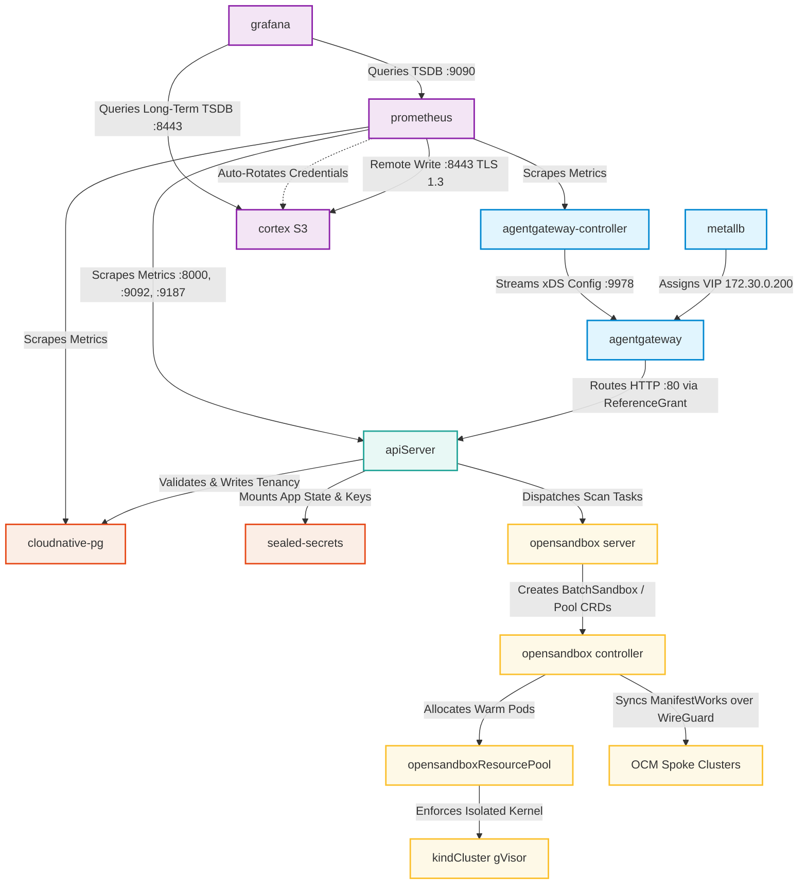

# CodeInspector Umbrella Helm Chart (`codeInspector`)

## 1. Overview & Architectural Purpose

The **CodeInspector** umbrella Helm chart is the single-command deployment harness for the entire **01-Sandbox** multi-tenant, secure code execution and inspection platform.

Rather than deploying isolated microservices manually, this umbrella chart coordinates **12 subcharts** and root-level cluster templates into a unified, enterprise-grade distributed system. It bridges network ingress, API orchestration, hardened container sandboxing (gVisor), multi-cluster federation (Open Cluster Management), relational persistence (CloudNativePG), and multi-region observability (Prometheus, Cortex S3, and Grafana).

```
                              [ External Developers / IDEs / CI Pipelines ]
                                                    │
════════════════════════════════════════════════════╪════════════════════════════════════════════════════
 TIER 1: INGRESS & GATEWAY BOUNDARY                 │
                                                    ▼
                               ┌────────────────────────────────────────┐
                               │ MetalLB (L2 LoadBalancer: 172.30.0.200)│
                               └────────────────────┬───────────────────┘
                                                    │
                                                    ▼
                               ┌────────────────────────────────────────┐
                               │ AgentGateway Proxy (Envoy Data Plane)  │
                               │  - Port 80/443 (HTTPRoute /)           │
                               │  - Rate Limiting & Auth Policies       │
                               │  - Zero-Trust Private /metrics Filter  │
                               └─────────┬────────────────────▲─────────┘
                                         │                    │ xDS Stream (:9978)
                                         │      ┌─────────────┴─────────────────────────┐
                                         │      │ AgentGateway-Controller (Control Plane│
                                         │      └───────────────────────────────────────┘
═════════════════════════════════════════╪═══════════════════════════════════════════════════════════════
 TIER 2 & 4: API LOGIC & PERSISTENCE     │ Forward traffic
                                         ▼
                               ┌────────────────────────────────────────┐
                               │ apiServer (FastAPI Engine)             │
                               │  - User Auth & Tenancy Quotas          │
                               │  - SealedSecrets Key Decryption        │
                               │  - Cross-Region Failover Controller    │
                               └────┬──────────────┬───────────────┬────┘
                                    │              │               │
                 ┌──────────────────┘              │               └──────────────────┐
                 ▼ (Port 5432)                     ▼ (Port 6379)                      ▼ (Port 5672)
    ┌─────────────────────────┐       ┌─────────────────────────┐        ┌─────────────────────────┐
    │ CloudNativePG (Postgres)│       │ Valkey / Redis          │        │ RabbitMQ Message Broker │
    │  - Streaming Replication│       │  - Cache & Lock State   │        │  - Async Scan Tasks     │
    │  - S3 WAL Archival      │       └─────────────────────────┘        └─────────────────────────┘
    └─────────────────────────┘
════════════════════════════════════════════════════════════════════════════════════════════════════════
 TIER 3: EXECUTION SANDBOXING & MULTI-CLUSTER FEDERATION
                                    │
                                    ▼ HTTP REST (/api/v1/01sbx)
                       ┌────────────────────────────────────────┐
                       │ opensandbox-server (REST API :8080)    │
                       └───────────────────┬────────────────────┘
                                           │ Creates BatchSandbox / Pool CRDs
                                           ▼
                       ┌────────────────────────────────────────┐
                       │ opensandbox-controller (CRD Operator)  │
                       └───────────┬────────────────────────┬───┘
                                   │                        │
         Local Warm Pool Execution │                        │ OCM ManifestWorks over WireGuard
                                   ▼                        ▼
     ┌────────────────────────────────────────┐   ┌─────────────────────────────────────────────┐
     │ opensandboxResourcePool                │   │ Open Cluster Management (OCM) Spoke Clusters│
     │  - Pre-warmed Standby Pods (bufferMin) │   │  - Spoke 1 (eu-central-1: 10.99.0.3)        │
     │  - Sub-50ms Allocation Latency         │   │  - Spoke 2 (ap-south-1:   10.99.0.4)        │
     │  - RuntimeClass: gvisor (runsc kernel) │   │  - Spoke 3 (us-west-1:   10.99.0.5)         │
     └────────────────────────────────────────┘   └─────────────────────────────────────────────┘
════════════════════════════════════════════════════════════════════════════════════════════════════════
 TIER 5: OBSERVABILITY & DUAL-ROTATOR TELEMETRY PIPELINE
                                   │
                                   │ 15s Pull Scrape
                                   ▼
                       ┌────────────────────────────────────────┐
                       │ Prometheus Local TSDB Engine           │
                       │  - 25Gi Storage, 7-Day Retention       │
                       │  - Scrapes API, CNPG, OCM Hub & Nodes  │
                       │  - SIGHUP Zero-Restart Reload (24ms)   │
                       │  - Dual CronJob Secret Rotators        │
                       └───────┬────────────────────────┬───────┘
                               │                        │
                remote_write   │ HTTPS :8443            │ Port 9090 PromQL Queries
                (Monthly Auth) ▼                        ▼
     ┌────────────────────────────────────────┐   ┌─────────────────────────────────────────────┐
     │ Cortex Long-Term S3 TSDB Cluster       │   │ Grafana Unified Single Pane of Glass        │
     │  - NGINX TLS 1.3 Gate + Dynamic htpasswd│   │  - Auto-Provisioned Dashboards (ConfigMap)  │
     │  - 9 Sample Limits (Ingestion/Burst)   │   │  - Multi-Cluster Datasources (Local & Remote)│
     │  - AWS S3 ("01-sandbox-cortex-storage")│   │  - Port 3000 / NodePort 32000 / /grafana     │
     └────────────────────────────────────────┘   └─────────────────────────────────────────────┘
```

---

## 2. Subchart Inventory & Technical Mapping

The umbrella chart bundles 12 distinct modular subcharts located in [`charts/`](file:///home/berrybytes/Desktop/Kamal/01-Sandbox/codeInspector/charts/):

| # | Subchart Directory | Namespace | Primary Role | Documentation |
|---|---|---|---|---|
| 1 | [`agentgateway`](file:///home/berrybytes/Desktop/Kamal/01-Sandbox/codeInspector/charts/agentgateway/) | `agentgateway-system` | Envoy Gateway API data-plane proxy, route matching, rate limiting, and zero-trust `/metrics` CIDR enforcement. | [README.md](file:///home/berrybytes/Desktop/Kamal/01-Sandbox/codeInspector/charts/agentgateway/README.md) |
| 2 | [`agentgateway-controller`](file:///home/berrybytes/Desktop/Kamal/01-Sandbox/codeInspector/charts/agentgateway-controller/) | `agentgateway-system` | Control plane operator reconciling Gateway API CRDs into Envoy xDS dynamic gRPC streams (port 9978). | [README.md](file:///home/berrybytes/Desktop/Kamal/01-Sandbox/codeInspector/charts/agentgateway-controller/README.md) |
| 3 | [`apiServer`](file:///home/berrybytes/Desktop/Kamal/01-Sandbox/codeInspector/charts/apiServer/) | `sandbox` | Core FastAPI application, tenancy/auth logic, database routes, and cross-region hub failover agent. | [README.md](file:///home/berrybytes/Desktop/Kamal/01-Sandbox/codeInspector/charts/apiServer/README.md) |
| 4 | [`cloudnative-pg`](file:///home/berrybytes/Desktop/Kamal/01-Sandbox/codeInspector/charts/cloudnative-pg/) | `cnpg-system` | Enterprise PostgreSQL operator managing streaming replication, automatic failover, and WAL archiving. | [README.md](file:///home/berrybytes/Desktop/Kamal/01-Sandbox/codeInspector/charts/cloudnative-pg/README.md) |
| 5 | [`cortex`](file:///home/berrybytes/Desktop/Kamal/01-Sandbox/codeInspector/charts/cortex/) | `cortex` | Multi-tenant long-term metric storage backed by AWS S3, fronted by NGINX TLS 1.3 with dynamic regex auth. | [README.md](file:///home/berrybytes/Desktop/Kamal/01-Sandbox/codeInspector/charts/cortex/README.md) |
| 6 | [`grafana`](file:///home/berrybytes/Desktop/Kamal/01-Sandbox/codeInspector/charts/grafana/) | `opensandbox-system` | Central observability dashboard with auto-provisioned multi-cluster datasources and health dashboards. | [README.md](file:///home/berrybytes/Desktop/Kamal/01-Sandbox/codeInspector/charts/grafana/README.md) |
| 7 | [`kindCluster`](file:///home/berrybytes/Desktop/Kamal/01-Sandbox/codeInspector/charts/kindCluster/) | `kind-cluster` | Registers container isolation primitives (`RuntimeClass/gvisor` with `runsc` handler). | [README.md](file:///home/berrybytes/Desktop/Kamal/01-Sandbox/codeInspector/charts/kindCluster/README.md) |
| 8 | [`metallb`](file:///home/berrybytes/Desktop/Kamal/01-Sandbox/codeInspector/charts/metallb/) | `metallb-system` | Software-defined bare-metal network load balancer allocating Layer 2 virtual IP addresses. | [README.md](file:///home/berrybytes/Desktop/Kamal/01-Sandbox/codeInspector/charts/metallb/README.md) |
| 9 | [`opensandbox`](file:///home/berrybytes/Desktop/Kamal/01-Sandbox/codeInspector/charts/opensandbox/) | `opensandbox-system` | Sandbox lifecycle manager (REST server + CRD operator) and OCM multi-cluster workload dispatcher. | [README.md](file:///home/berrybytes/Desktop/Kamal/01-Sandbox/codeInspector/charts/opensandbox/README.md) |
| 10 | [`opensandboxResourcePool`](file:///home/berrybytes/Desktop/Kamal/01-Sandbox/codeInspector/charts/opensandboxResourcePool/) | `opensandbox-system` | Pre-warmed sandbox pool manager eliminating cold-start latency (< 50ms standby allocation). | [README.md](file:///home/berrybytes/Desktop/Kamal/01-Sandbox/codeInspector/charts/opensandboxResourcePool/README.md) |
| 11 | [`prometheus`](file:///home/berrybytes/Desktop/Kamal/01-Sandbox/codeInspector/charts/prometheus/) | `opensandbox-system` | Local TSDB scraper, OCM SLO calculator, remote-write forwarder, and dual automated secret rotator CronJobs. | [README.md](file:///home/berrybytes/Desktop/Kamal/01-Sandbox/codeInspector/charts/prometheus/README.md) |
| 12 | [`sealed-secrets`](file:///home/berrybytes/Desktop/Kamal/01-Sandbox/codeInspector/charts/sealed-secrets/) | `kube-system` | Asymmetric public-key encryption controller for safe GitOps credential storage in public repositories. | [README.md](file:///home/berrybytes/Desktop/Kamal/01-Sandbox/codeInspector/charts/sealed-secrets/README.md) |

---

## 3. How the Subcharts Associate & Cooperate

The subcharts are not isolated applications; they form an tightly coupled dependency graph where each component solves a specific layer of the platform stack:



### 3.1. Ingress & Traffic Management (`metallb` $\rightarrow$ `agentgateway-controller` $\rightarrow$ `agentgateway`)
- **MetalLB** allocates a virtual Layer 2 IP address (`172.30.0.200`) to the Gateway Service.
- **AgentGateway-Controller** reads Gateway API CRDs (`Gateway`, `HTTPRoute`, `AgentgatewayPolicy`, `ReferenceGrant`) and continuously pushes dynamic route tables to the **AgentGateway Envoy Proxy** over gRPC port `9978`.
- **AgentGateway** enforces rate limits (`policy.yaml`), restricts external access to internal metrics (`policy-metrics.yaml`), and forwards valid traffic to `sandbox-api-service` across namespaces.

### 3.2. Application & Tenancy Orchestration (`apiServer` $\leftrightarrow$ `cloudnative-pg` $\leftrightarrow$ `sealed-secrets`)
- **apiServer** authenticates requests using JWTs or API keys.
- It communicates with **CloudNativePG** (port `5432`) to look up tenant quotas, active API keys, and audit history.
- Sensitive environment variables (database passwords, JWT private RSA keys, E2B tokens) are securely decrypted at cluster boot by the **Sealed Secrets** controller from encrypted `SealedSecret` declarations.
- `apiServer` holds the RBAC `gateway-secret-patcher` permission, enabling it to dynamically update JWT signing keys inside the Gateway namespace without restarting proxies.

### 3.3. Sandboxed Execution Pipeline (`apiServer` $\rightarrow$ `opensandbox` $\rightarrow$ `opensandboxResourcePool` $\rightarrow$ `kindCluster`)
- When code execution is requested, `apiServer` makes a REST call to `opensandbox-server` on port `8080`.
- `opensandbox-server` issues a `Pool` claim or creates a `BatchSandbox` CRD.
- **`opensandboxResourcePool`** intercepts the request and instantly hands over an idle, pre-warmed pod from its memory standby cache (`bufferMin: 3`), reducing cold-start allocation latency to **< 50 milliseconds**.
- The pod runs under `RuntimeClass/gvisor` provided by **`kindCluster`** (`handler: runsc`), trapping all system calls inside Google's user-space guest kernel and shielding the host node from potential container breakouts.
- For multi-cluster scaling, `opensandbox-controller` uses **Open Cluster Management (OCM)** `Placement` and `ManifestWork` to dispatch sandbox pods to remote spoke clusters across the private WireGuard mesh.

### 3.4. Distributed Observability & Automated Security (`prometheus` $\rightarrow$ `cortex` $\rightarrow$ `grafana`)
- **Prometheus** continuously discovers and scrapes metrics from the entire topology: `apiServer` (:8000), `agentgateway-controller` (:9092), `cloudnative-pg` instances (:9187), and OCM hub controllers (:8080).
- It evaluates recording rules (`ocm-slo-rules.yml`) to compute 99.9% webhook admission SLOs and PostgreSQL replication lag.
- Rather than holding large historical volumes locally, Prometheus streams metrics via `remote_write` to the dedicated **Cortex** node over WireGuard (`10.99.0.50:8443`), where they are persisted permanently to an **AWS S3 bucket** (`01-sandbox-cortex-storage`).
- **Automated Dual Rotation:** Two CronJobs hosted inside the Prometheus chart automatically rotate credentials monthly:
  1. `prometheus-secret-rotator` (00:00 UTC): Rotates Prometheus web authentication and triggers a zero-downtime SIGHUP reload in 24ms.
  2. `cortex-secret-rotator` (02:00 UTC): Connects across clusters to Cortex, appends a new `.htpasswd` user, updates local Prometheus remote-write settings, and prunes old credentials after a 10-minute overlap grace period.
- **Grafana** declaratively provisions dashboards and datasources, allowing SREs to query local Prometheus (for 0–7 day real-time triage) and Cortex S3 (for multi-year long-term analysis) simultaneously.

---

## 4. Root Templates & Federation Resources

Beyond the subcharts, the root `templates/` directory in [codeInspector/templates/](file:///home/berrybytes/Desktop/Kamal/01-Sandbox/codeInspector/templates/) provides cluster-level glue and multi-cluster routing:

- [ocm-clusterset.yaml](file:///home/berrybytes/Desktop/Kamal/01-Sandbox/codeInspector/templates/ocm-clusterset.yaml): Declares `ManagedClusterSet/sandbox-spokes` and binds it to `opensandbox-system`, grouping all worker clusters into a manageable fleet.
- [ocm-placement.yaml](file:///home/berrybytes/Desktop/Kamal/01-Sandbox/codeInspector/templates/ocm-placement.yaml): Declares `Placement/sandbox-spoke-placement` with cluster predicates filtering for worker nodes labeled with `sandbox-workload-capable: "true"` and `runtime.gvisor: "true"`.
- [ocm-spoke-runtime.yaml](file:///home/berrybytes/Desktop/Kamal/01-Sandbox/codeInspector/templates/ocm-spoke-runtime.yaml): Distributes `RuntimeClass` definitions for both `gvisor` (`runsc`) and `kata-fc` (Firecracker microVMs) to spoke clusters.
- [node-network-agent.yaml](file:///home/berrybytes/Desktop/Kamal/01-Sandbox/codeInspector/templates/node-network-agent.yaml): Deploys a privileged host-network DaemonSet across all nodes that automatically executes `sysctl -w net.ipv4.ip_forward=1`, ensuring Linux kernel packet forwarding is active for the WireGuard mesh overlay.

---

## 5. Deployment Profiles & Multi-Cluster Values Files

The `codeInspector` chart supports tailored value overlays depending on the cluster's role in the 01-Sandbox fleet:

| Values File | Intended Target | Activated Subcharts & Profile Notes |
|---|---|---|
| [`values.yaml`](file:///home/berrybytes/Desktop/Kamal/01-Sandbox/codeInspector/values.yaml) | **PrimaryHub (us-east-1)** | Full production hub deployment: Ingress, API Server, Primary CNPG, Local Prometheus, Grafana, OpenSandbox Server/Controller, and WireGuard mesh routing. |
| [`values-secondary.yaml`](file:///home/berrybytes/Desktop/Kamal/01-Sandbox/codeInspector/values-secondary.yaml) | **SecondaryHub (eu-west-1)** | Standby disaster recovery hub: CNPG configured with `replication.role: "standby"`, local Prometheus pushing to Cortex, and automated failover controller standby mode. |
| [`values-cortex.yaml`](file:///home/berrybytes/Desktop/Kamal/01-Sandbox/codeInspector/values-cortex.yaml) | **Cortex Storage Node** | Dedicated observability instance: Enables `cortex` subchart, mounts AWS S3 bucket, configures 9 ingestion bounds, and launches NGINX TLS 1.3 gate. |
| [`values-local.yaml`](file:///home/berrybytes/Desktop/Kamal/01-Sandbox/codeInspector/values-local.yaml) | **Local Dev / KinD** | Single-node development cluster: Enables MetalLB, KinD gVisor runtime class, local storage classes, and disabled cloud dependencies. |

---

## 6. Installation & Operational Lifecycle

### 6.1. Full Platform Installation (PrimaryHub)
```bash
# Update Helm chart dependency locks
helm dependency update ./codeInspector

# Deploy all components to PrimaryHub
helm install codeinspector ./codeInspector \
  -f ./codeInspector/values.yaml \
  --namespace opensandbox-system \
  --create-namespace
```

### 6.2. Dedicated Cortex Long-Term Storage Node Installation
```bash
# Deploy Cortex on its dedicated instance
helm install cortex-stack ./codeInspector \
  -f ./codeInspector/values-cortex.yaml \
  --namespace cortex \
  --create-namespace
```

### 6.3. SecondaryHub (Disaster Recovery Standby) Installation
```bash
# Deploy SecondaryHub replicating from PrimaryHub
helm install codeinspector ./codeInspector \
  -f ./codeInspector/values-secondary.yaml \
  --namespace opensandbox-system \
  --create-namespace
```

### 6.4. Verification & Health Audit
```bash
# Inspect all running pods across the platform tiers
kubectl get pods -A -l 'app.kubernetes.io/part-of in (codeinspector, opensandbox)'

# Check Gateway API route programming status
kubectl get gateway,httproute -A

# Check PostgreSQL high-availability replication status
kubectl cnpg status postgresql-primary -n sandbox

# Verify Prometheus metrics scrape targets
kubectl exec -it -n opensandbox-system deploy/prometheus -- curl -s http://localhost:9090/api/v1/targets | jq .data.activeTargets[].scrapePool
```

---

## 7. Platform Verification & Testing

To test whether all 12 subcharts are interacting properly after deployment:

1. **Test Ingress & API Authentication:**
   ```bash
   curl -k -H "Host: shininess-enroll-going.ngrok-free.dev" \
     http://172.30.0.200/health
   # Expected: {"status": "healthy"}
   ```
2. **Execute Sandboxed Code:**
   ```bash
   curl -X POST http://172.30.0.200/api/v1/01sbx/sandbox/run \
     -H "Content-Type: application/json" \
     -d '{"language": "python", "code": "import os; print(os.uname())"}'
   # Expected output indicates gVisor virtual kernel (e.g., Linux ... runsc)
   ```
3. **Verify S3 Long-Term Metric Ingestion:**
   ```bash
   curl -k -u grafana-reader:GrafanaReaderSecret2026! \
     https://10.99.0.50:8443/api/v1/user_stats
   # Expected: JSON showing active time-series count > 0 for tenant "sandbox-metrics"
   ```
