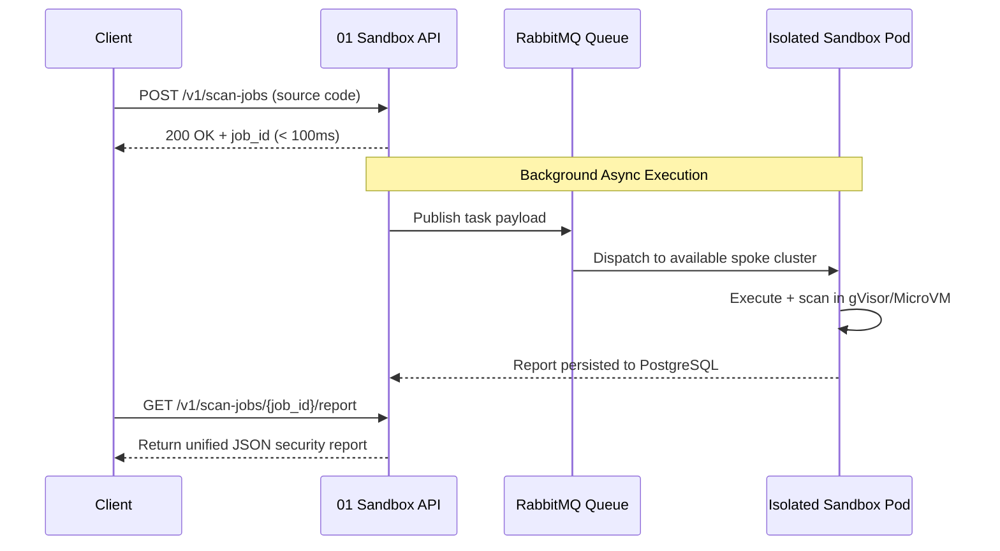
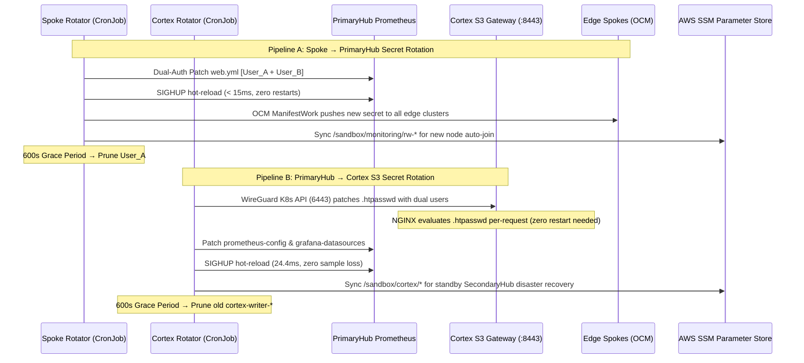

# 01 Sandbox — Client Presentation
### *Enterprise-Grade Secure Code Execution & Multi-Cluster Kubernetes Platform*

> **Website:** [https://sandbox.01security.com](https://sandbox.01security.com)
> **Platform Version:** v0.7.12 — *Kata Firecracker & Multi-Cluster OCM Live*
> **Presented by:** 01Security Engineering Team

---

## Table of Contents

1. [Executive Summary](#1-executive-summary)
2. [The Problem We Solve](#2-the-problem-we-solve)
3. [Platform Overview](#3-platform-overview)
4. [Core Architecture](#4-core-architecture)
5. [Security Hardening — Defense in Depth](#5-security-hardening--defense-in-depth)
6. [Multi-Cluster Architecture](#6-multi-cluster-architecture)
7. [Production Observability](#7-production-observability)
8. [Performance Benchmarks](#8-performance-benchmarks)
9. [Supported Languages & Ecosystems](#9-supported-languages--ecosystems)
10. [Competitive Differentiation](#10-competitive-differentiation)
11. [SLA & High-Availability Guarantees](#11-sla--high-availability-guarantees)
12. [Deployment Models](#12-deployment-models)
13. [Integration Guide](#13-integration-guide)
14. [Summary — Why 01 Sandbox?](#14-summary--why-01-sandbox)

---

## 1. Executive Summary

**01 Sandbox** is a production-grade, Kubernetes-native platform that enables enterprises to safely execute untrusted or AI-generated code inside hardware-isolated environments — without touching the host kernel or exposing infrastructure to malicious payloads.

```
"Execute Untrusted Code In Isolated Environments."
                                    — 01 Sandbox Core Philosophy
```

Built for teams running **AI agents, CI/CD security pipelines, and multi-tenant cloud applications**, 01 Sandbox combines:

- 🔒 **Kernel-Level Isolation** (gVisor + Kata Containers / Firecracker MicroVM)
- 🌐 **Multi-Region, Multi-Cluster Orchestration** (Open Cluster Management + WireGuard Mesh)
- 🛡️ **Automated Security Scanning Pipeline** (8-tool Ultra-Strict toolchain)
- ⚡ **Sub-100ms Job Acknowledgement** (Fire-and-Forget async architecture)
- 📊 **Full-Stack Observability** (Prometheus + Cortex S3 long-term storage + Grafana)

---

## 2. The Problem We Solve

Modern software teams face a fundamental challenge: **how to safely run user-submitted, AI-generated, or third-party code without exposing their infrastructure.**

### Legacy Sandbox Drawbacks

| Problem | Legacy Approach | 01 Sandbox |
|:---|:---|:---|
| **Response Latency** | 30–60 seconds (synchronous blocking) | **< 100 milliseconds** (async Fire-and-Forget) |
| **Concurrent Users** | 5–10 (single-node limits) | **50+ simultaneously** (HPA auto-scaling) |
| **Isolation Strength** | Docker namespace isolation only | **Hardware KVM + gVisor kernel interception** |
| **Security Scanning** | Manual, opt-in | **Automatic, 8-tool pipeline on every execution** |
| **Credential Safety** | Static, never rotated | **Auto-rotating Kubernetes-native secret management** |
| **Data Persistence** | Local disk only (single point of failure) | **AWS S3 (11-nines durability) + Multi-cluster replication** |
| **Multi-Cluster HA** | None — single cluster | **Automated failover in < 5 seconds across global clusters** |
| **Observability** | Basic logs only | **Full metrics pipeline: Prometheus → Cortex → S3 → Grafana** |

---

## 3. Platform Overview

```
┌───────────────────────────────────────────────────────────────────────────┐
│                        01 Sandbox Architecture                            │
│                                                                           │
│   Developer / AI Agent / CI Pipeline                                      │
│          │                                                                │
│          ▼                                                                │
│   ┌─────────────────────────────────────┐                                 │
│   │      Agent Gateway (Envoy Proxy)    │  JWT Auth · Rate Limiting       │
│   │         api-sandbox.01security.com  │  TLS Termination · API Keys     │
│   └─────────────────┬───────────────────┘                                 │
│                     │                                                     │
│                     ▼                                                     │
│   ┌─────────────────────────────────────┐                                 │
│   │       Sandbox API (FastAPI)         │  < 100ms Response               │
│   │       Async Orchestrator            │  Auto-Language Detection        │
│   └─────────────────┬───────────────────┘                                 │
│                     │                                                     │
│                     ▼                                                     │
│   ┌─────────────────────────────────────┐                                 │
│   │  OpenSandbox Controller & Server    │  OCM ManifestWork Dispatch      │
│   │  (Kubernetes Operator)              │  Multi-Cluster Placement        │
│   └─────────────────┬───────────────────┘                                 │
│                     │                                                     │
│        ┌────────────┼────────────┐                                        │
│        ▼            ▼            ▼                                        │
│   ┌─────────┐  ┌─────────┐  ┌─────────┐                                  │
│   │ gVisor  │  │  Kata   │  │  Kata   │  ← Isolated Sandbox Pods         │
│   │  Pod    │  │  FC     │  │  QEMU   │    per Execution Job              │
│   └─────────┘  └─────────┘  └─────────┘                                  │
│        │            │            │                                        │
│        └────────────┴────────────┘                                        │
│                     │                                                     │
│                     ▼                                                     │
│   ┌─────────────────────────────────────┐                                 │
│   │   8-Tool Security Scanner Pipeline  │                                 │
│   │   Semgrep · Gitleaks · Bandit       │                                 │
│   │   Trivy · Yamllint · Kube-Linter    │                                 │
│   │   KubeConform · Kube-Score          │                                 │
│   └─────────────────────────────────────┘                                 │
│                     │                                                     │
│                     ▼                                                     │
│   ┌─────────────────────────────────────┐                                 │
│   │  PostgreSQL  ·  RabbitMQ  · Redis   │  CloudNativePG · Quorum Queues │
│   │  (Replicated across Hub Clusters)   │  Sentinel-Based HA              │
│   └─────────────────────────────────────┘                                 │
└───────────────────────────────────────────────────────────────────────────┘
```

---

## 4. Core Architecture

### 4.1 The Facade Pattern — Pluggable Backend Engine

01 Sandbox uses a **Facade Architecture** that exposes a single, stable HTTP API contract while allowing the underlying execution engine to be swapped at runtime — zero client code changes required.

```
  Stable External API Contract (Never Changes)
                     │
         ┌───────────┴───────────┐
         │   FastAPI Orchestrator │
         └───────────┬───────────┘
                     │
      ┌──────────────┼──────────────┐
      ▼              ▼              ▼
  gVisor Pods    Kata MicroVM    E2B Cloud
  (Local K8s)   (Local KVM)    (Remote API)
```

**Hot-swap backends** without restarting any server or modifying any client configuration.

---

### 4.2 Asynchronous Fire-and-Forget Execution

Traditional sandboxes block your API thread while waiting for a container to boot. 01 Sandbox eliminates this bottleneck entirely:



---

### 4.3 Kubernetes-Native OpenSandbox Operator

The **OpenSandbox Controller** is a full Kubernetes Operator managing the lifecycle of execution sandboxes via custom resource definitions:

| CRD | Purpose |
|:---|:---|
| `BatchSandbox` | Single-shot ephemeral execution pod with security scan configuration |
| `Pool` | Pre-warmed sandbox pool for sub-50ms provisioning of hot-standby pods |
| `Placement` | OCM placement rule for intelligent multi-cluster workload dispatch |
| `ManifestWork` | OCM delivery mechanism to push pod specs to spoke clusters |

---

## 5. Security Hardening — Defense in Depth

01 Sandbox implements a **5-layer security model** — each layer independently prevents a class of attack:

```
Layer 1: Edge Authentication (AgentGateway / Envoy)
Layer 2: JWT + API Key Validation (Auth0 RS256 + PostgreSQL Key Store)
Layer 3: Kubernetes RBAC (Namespace Isolation + ReferenceGrant)
Layer 4: Runtime Isolation (gVisor Kernel Interception / Kata MicroVM)
Layer 5: Automated Static Security Analysis (8-Tool Scanner Pipeline)
```

---

### 5.1 Layer 1 — Agent Gateway (Envoy Edge Proxy)

**AgentGateway** acts as the hardened single-point-of-entry using the Kubernetes Gateway API:

- **JWT Validation**: Enforces strict RS256 token verification using Auth0 JWKS endpoint (cached every 1 hour)
- **API Key Authentication**: Developer-issued keys cryptographically signed and tracked per-user in PostgreSQL
- **Rate Limiting**: Envoy-native local rate limiting (7 req/min by default; configurable to global Redis-backed quotas)
- **Route Isolation**: Cross-namespace routing via `ReferenceGrant` — the Gateway namespace cannot directly access backend services without explicit grants
- **MetalLB Integration**: Dedicated LoadBalancer IP for each cluster (`api-sandbox.01security.com`)

---

### 5.2 Layer 2 — Auth0 Identity & Developer API Keys

Dual authentication model supporting both browser sessions and programmatic access:

```
Browser Flow:   Auth0 OIDC → RS256 JWT → FastAPI Validation
API Flow:       Developer API Key (UUID JTI) → PostgreSQL Key Store Lookup
```

**JWT Classification on Failure (10 categories tracked as Prometheus metrics):**

| Failure Code | Description |
|:---|:---|
| `missing_token` | No Authorization header or cookie |
| `expired_key` | Key TTL exceeded ISO expiry timestamp |
| `revoked_key` | Key manually revoked in PostgreSQL |
| `identity_mismatch` | Attempting to use another user's key (security lockout) |
| `deactivated_key` | Account suspended or key disabled |
| `invalid_token_signature` | JWT cryptographic verification failure |

---

### 5.3 Layer 3 — Sealed Secrets (Git-Safe Credential Management)

All sensitive credentials in the codebase are encrypted using **Bitnami Sealed Secrets**:

```
Plain-Text Secret
      │
      ▼ (kubeseal + Cluster Public Key)
SealedSecret CRD ──► Git Repository (safe to commit)
      │
      ▼ (Sealed Secrets Controller + Private Key)
Kubernetes Secret ──► Mounted into Pods as Env Vars
```

- Credentials are **never stored in plaintext** in Git
- Encrypted with the target cluster's asymmetric keypair — unusable if stolen

---

### 5.4 Layer 4 — Dual-Runtime Kernel Isolation

01 Sandbox supports two selectable isolation runtimes, deployed concurrently:

#### gVisor Sandbox (`runsc`)

| Attribute | Value |
|:---|:---|
| **Isolation Model** | User-space kernel (Sentry) intercepts all syscalls |
| **Cold Start** | ~50ms (ultra-fast) |
| **Security Boundary** | Host kernel never touched — Sentry re-implements Linux ABI |
| **Memory Overhead** | ~15 MB per sandbox |
| **Best For** | High-concurrency static analysis, language scanning, rapid CI/CD |
| **Architecture** | `Untrusted Code → gVisor Sentry → Gofer VFS → Host Kernel (Blocked)` |

#### Kata Containers + Firecracker MicroVM (`kata-fc`)

| Attribute | Value |
|:---|:---|
| **Isolation Model** | Hardware KVM hypervisor — dedicated guest Linux kernel per job |
| **Cold Start** | ~150ms (microVM initialization) |
| **Security Boundary** | Hardware VT-x / AMD-V hypervisor boundary |
| **Memory Overhead** | ~128 MB MicroVM floor |
| **Best For** | Untrusted binary execution, multi-language binary analysis, container image scanning |
| **Architecture** | `Untrusted Code → Dedicated Guest Kernel → Firecracker VMM → Host KVM` |

> **Key Insight:** Even if untrusted code performs a kernel exploit, it escapes only into the _guest_ kernel — the host OS is completely isolated behind the KVM boundary.

---

### 5.5 Layer 5 — Ultra-Strict 8-Tool Security Scanner Pipeline

Every piece of code that enters 01 Sandbox is **automatically audited** by all 8 tools in parallel, inside the isolated pod:

| Tool | Category | What It Catches |
|:---|:---|:---|
| **Semgrep** | SAST — Multi-language | SQLi, Command Injection, Path Traversal, Logic Errors |
| **Gitleaks** | Secret Discovery | Hardcoded API keys, tokens, credentials, SSH keys |
| **Bandit** | Python Security | Unsafe functions, weak crypto, OS command injection |
| **Trivy** | Filesystem CVEs | Known CVEs in OS packages, dependencies, container images |
| **Yamllint** | YAML Validation | Syntax errors, formatting violations in K8s manifests |
| **Kube-Linter** | K8s Best Practices | Root container checks, missing resource limits, privileged containers |
| **KubeConform** | Schema Validation | K8s manifest version compatibility against official JSON schemas |
| **Kube-Score** | Scoring & Recommendations | Security scoring, resilience, reliability recommendations |

**Output:** A single, unified JSON security report with severity levels, line numbers, tool attribution, and executive summary — available via API even after the sandbox pod is destroyed.

---

### 5.6 End-to-End Zero-Downtime Secret Rotation (Edge-to-Hub & Hub-to-Cortex)

Security credentials across the entire distributed observability pipeline are **automatically rotated every 30 days** using two coordinated, 100% Kubernetes-native CronJobs — zero manual intervention, zero cloud Lambda dependencies:

1. **Edge-to-Hub Pipeline (`prometheus-secret-rotator`)**:
   - Rotates Spoke $\rightarrow$ PrimaryHub metrics ingestion credentials.
   - Dual-auth overlap on PrimaryHub (`web.yml`), autonomous distribution to all edge spokes via **OCM ManifestWork**, and 15ms SIGHUP reloads.
2. **Hub-to-Cortex Pipeline (`cortex-secret-rotator`)**:
   - Rotates PrimaryHub $\rightarrow$ Cortex long-term storage writer and reader credentials.
   - Dynamic regex RBAC on Cortex NGINX proxy (`~^cortex-writer` and `~^grafana-reader`), cross-cluster secret updates over WireGuard (port 6443), and 24.4ms SIGHUP reloads.



**Result:** Zero 401 Unauthorized errors, zero dropped metric samples, zero downtime, and complete cryptographic hygiene across all tiers.

---

## 6. Multi-Cluster Architecture

01 Sandbox is designed for **global, multi-region deployment** using a Hub-and-Spoke topology managed by **Open Cluster Management (OCM)**.

### 6.1 Production Topology

```
                        ┌───────────────────────────────┐
                        │       Users & API Clients      │
                        └───────────────┬───────────────┘
                                        │
                                        ▼
                        ┌───────────────────────────────┐
                        │   Envoy Gateway VIP            │
                        │   api-sandbox.01security.com  │
                        └───────┬───────────────┬───────┘
                                │               ·
              [Normal Traffic]  │               ·  [Failover Traffic]
                                ▼               ▼
     ┌─────────────────────────────┐  ┌──────────────────────────────┐
     │       PrimaryHub            │  │       SecondaryHub            │
     │  (AWS us-east-1)            │  │  (AWS eu-west-1)              │
     │  • sandbox-api              │  │  • sandbox-api (warm standby) │
     │  • PostgreSQL Primary       │  │  • PostgreSQL Secondary       │
     │  • RabbitMQ Leader          │  │  • RabbitMQ Follower          │
     │  • Redis Master             │  │  • Redis Replica              │
     │  • OCM Hub (Primary)        │  │  • OCM Hub (Standby)          │
     │  • Prometheus + Grafana     │  │  • Watchdog Controller        │
     └───────────────┬─────────────┘  └─────────────┬────────────────┘
                     │                               ▲
                     │   WireGuard Encrypted WAL     │
                     └───────────────────────────────┘
                                       │ OCM ManifestWork Dispatch
                                       │
         ┌─────────────────────────────┼──────────────────────────────┐
         ▼                             ▼                              ▼
 ┌──────────────┐             ┌──────────────┐              ┌──────────────┐
 │   Spoke 1    │             │   Spoke 2    │              │   Spoke 3    │
 │ (eu-central) │             │ (ap-south)   │              │ (us-west)    │
 │ gVisor Pods  │             │ gVisor Pods  │              │ Kata FC Pods │
 └──────────────┘             └──────────────┘              └──────────────┘
```

---

### 6.2 WireGuard Encrypted Mesh Network

All inter-cluster communication is **fully encrypted** at the kernel level:

- **Protocol:** WireGuard UDP (ChaCha20-Poly1305 symmetric encryption)
- **Mesh:** Every Hub and Spoke maintains persistent encrypted tunnels to all peers
- **Kubernetes Overlay:** Cilium ClusterMesh runs WireGuard pod-to-pod encryption (`cilium_wg0`) in addition to the host-level WireGuard mesh (`wg0`)
- **Port:** UDP 51820 only (firewall rules block all other cross-cluster traffic)
- **Compliance:** PCI-DSS / SOC 2 compliant encrypted transit

**Network Topology (Production AWS):**

| Node | Region | WireGuard IP | Role |
|:---|:---|:---|:---|
| **primaryhub** | us-east-1 | `10.99.0.1` | Active Primary Control Plane |
| **secondaryhub** | eu-west-1 | `10.99.0.2` | Warm Standby / Watchdog |
| **spoke1** | eu-central-1 | `10.99.0.3` | Managed Workload Cluster |
| **spoke2** | ap-south-1 | `10.99.0.4` | Managed Workload Cluster |
| **cortex** | us-east-1 | `10.99.0.50` | Long-Term Metrics Storage |

---

### 6.3 OCM Intelligent Workload Placement

**Open Cluster Management (OCM)** provides intelligent multi-cluster workload dispatch:

```python
# OCM Placement Policy: Dispatch to cluster with lowest CPU utilization
placement = {
    "predicates": [{"requiredClusterSelector": {"labelSelector": {"role": "spoke"}}}],
    "prioritizers": [{"name": "ResourceAllocatableCPU", "weight": 2}]
}
# Result: OCM scores spoke1 (23% CPU) higher than spoke2 (71% CPU)
# → Sends ManifestWork to spoke1 automatically
```

**ManifestWork Delivery Flow:**
1. `sandbox-api` submits scan job → `opensandbox-server` creates OCM `ManifestWork`
2. OCM evaluates cluster placement scores (CPU, RAM, latency telemetry)
3. `klusterlet` agent on target spoke applies `ManifestWork` → boots isolated sandbox pod
4. Sandbox pod pulls task from RabbitMQ queue over encrypted WireGuard + Cilium eBPF tunnel
5. Scan results pushed to PostgreSQL via `.svc.clusterset.local` MCS API DNS

---

### 6.4 Automated Failover — Zero-Touch High Availability

The **Watchdog Controller** (deployed on SecondaryHub) monitors PrimaryHub every 2 seconds over WireGuard:

```
Timeline: Primary Hub Failure Event
─────────────────────────────────────────────────────────
T+0s:   PrimaryHub EC2 / network failure
T+2s:   Watchdog detects first miss
T+4s:   Watchdog detects second miss → FAILOVER_TRIGGERED
T+5s:   PostgreSQL Secondary promoted (pg_ctl promote)
T+5s:   OCM SecondaryHub takes over spoke cluster management
T+5s:   Envoy VIP updates → traffic routed to SecondaryHub
        [RTO achieved: < 5 seconds]

Timeline: Primary Hub Recovery
─────────────────────────────────────────────────────────
T+0s:   PrimaryHub comes back online
T+3s:   Watchdog detects PrimaryHub kube-api healthy
T+5s:   pg_isready confirms PostgreSQL Primary healthy
T+7s:   Delta sync Job copies SecondaryHub-only data back
T+9s:   PostgreSQL Secondary downgraded back to standby
T+9s:   Traffic routed back to PrimaryHub
        [Failback achieved: < 10 seconds]
```

**Split-Brain Protection:** The Watchdog includes a **quorum witness** check — failover is aborted if the spoke cluster can still reach PrimaryHub, preventing false positives.

---

### 6.5 Database HA — CloudNativePG Cross-Cluster Replication

| Component | Replication Method | Failover Time |
|:---|:---|:---|
| **PostgreSQL** | CloudNativePG WAL streaming (physical replication) | < 1 second (auto-promote) |
| **RabbitMQ** | Quorum Queues (Raft consensus) | Instant leader election |
| **Redis** | Sentinel-managed replication | < 3 seconds (Sentinel vote) |

> **RPO = 0:** Continuous physical WAL streaming means no committed transaction is ever lost.

---

## 7. Production Observability

01 Sandbox includes a **production-grade, multi-cluster observability stack** deployed across all 5 nodes.

### 7.1 Telemetry Architecture

```
Edge Spokes (EU, AP)
     │ Prometheus scrape every 15s
     │ WAL buffer → Snappy compression
     │ WireGuard authenticated remote_write
     ▼
PrimaryHub Prometheus
     │ 7-day local TSDB retention (AWS EBS)
     │ Simultaneous remote_write to Cortex
     ▼
Cortex (Dedicated EC2 Node)
     │ NGINX TLS gateway (cortex-writer auth)
     │ 2h WAL → TSDB blocks → S3 upload
     ▼
AWS S3 (01-sandbox-cortex-storage)
     │ 11-nines durability
     │ Lifecycle: S3 Standard → IA (90d) → Glacier (365d)
     ▼
Central Grafana
     │ Dual datasource: PrimaryHub (< 7d) + Cortex S3 (historical)
     │ Multi-cluster dashboards: cluster=$cluster dropdown
     ▼
Alerts → PagerDuty / Slack
```

### 7.2 Key Metrics Tracked

| Metric | Description |
|:---|:---|
| `http_requests_total` | Total API requests by method, path, status code |
| `job_execution_total` | Scan jobs completed (success, failure, retry, cancelled) |
| `job_execution_duration_seconds` | End-to-end scan latency histogram |
| `auth_failures_total` | Auth failures classified by type (10 categories) |
| `queue_depth_jobs` | Live RabbitMQ queue depth (scan.quick, scan.repo, scan.failed) |
| `sandbox_provision_duration_seconds` | Time to allocate an isolated sandbox pod |
| `api_key_requests_total` | Requests mapped to individual API key identifiers |
| `ocm:managedcluster_admissions_total` | Spoke cluster join validations (OCM webhook) |

### 7.3 Cortex S3 Long-Term Storage

| Feature | Specification |
|:---|:---|
| **S3 Bucket** | `01-sandbox-cortex-storage` (us-east-1) |
| **Block Format** | Thanos-compatible TSDB (`meta.json`, `index`, `chunks/000001`) |
| **Upload Cadence** | Every 2 hours (10-min compaction) |
| **Retention Tiers** | Day 0–90: S3 Standard → Day 91–365: S3-IA → Day 365+: S3 Glacier |
| **Multi-Tenancy** | `X-Scope-OrgID: sandbox-metrics` enforced via NGINX RBAC proxy |
| **Authentication & Rotation** | Dynamic regex RBAC (`~^cortex-writer`, `~^grafana-reader`) + Autonomous monthly rotation (`cortex-secret-rotator` CronJob) + AWS IMDSv2 for S3 |
| **Durability** | 11 nines (99.999999999%) |

---

## 8. Performance Benchmarks

### Live System Metrics

| Metric | Benchmark | Notes |
|:---|:---|:---|
| **Job Acknowledgement** | **< 100ms** | P99 measured in production |
| **gVisor Cold Start** | **~50ms** | From pod creation to first syscall |
| **Kata FC Cold Start** | **~150ms** | Full Firecracker MicroVM init |
| **Concurrent Users** | **50+ simultaneously** | Kubernetes HPA auto-scales |
| **Cluster Failover (RTO)** | **< 5 seconds** | Automated, zero human intervention |
| **Data Loss on Failover (RPO)** | **0 seconds** | Continuous WAL replication |
| **Secret Rotation** | **< 25ms hot-reload** | Zero container restarts, end-to-end dual pipeline (Spoke-to-Hub & Hub-to-Cortex) |
| **Split-Brain Detection** | **< 2 seconds** | Watchdog probe frequency |
| **Metrics Collection Lag** | **< 15 seconds** | Prometheus scrape interval |
| **Historical Query Latency** | **< 300ms** | Cortex Store-Gateway (S3 → Grafana) |

---

## 9. Supported Languages & Ecosystems

01 Sandbox **automatically detects** the language and routes to the appropriate scanner configuration — no manual setup required:

| Language | Scanner Coverage |
|:---|:---|
| **Python** | Semgrep + Bandit + Gitleaks + Trivy |
| **JavaScript / Node.js** | Semgrep + Gitleaks + Trivy |
| **TypeScript** | Semgrep + Gitleaks + Trivy |
| **Go** | Semgrep + Gitleaks + Trivy |
| **Java** | Semgrep + Trivy |
| **Rust** | Semgrep + Trivy |
| **PHP** | Semgrep + Gitleaks |
| **Ruby** | Semgrep + Gitleaks |
| **C / C++** | Semgrep + Trivy |
| **Swift** | Semgrep + Gitleaks |
| **Bash / Shell** | Semgrep + Gitleaks |
| **YAML** | Yamllint + Kube-Linter + KubeConform + Kube-Score |
| **SQL** | Semgrep (SQL injection patterns) |
| **Dockerfile** | Trivy + Kube-Linter |
| **Kubernetes Manifests** | Kube-Linter + KubeConform + Kube-Score |

---

## 10. Competitive Differentiation

### What Makes 01 Sandbox Unique

```
┌─────────────────────────────────────────────────────────────────────────┐
│                   01 Sandbox vs. Competitors                            │
├──────────────────────────┬────────────┬────────────────┬────────────────┤
│ Feature                  │ 01 Sandbox │ Generic Docker │ Cloud Lambda   │
├──────────────────────────┼────────────┼────────────────┼────────────────┤
│ Hardware-Level Isolation │ ✅ MicroVM  │ ❌ Namespaces   │ ⚠️ Hypervisor  │
│ Kernel Interception      │ ✅ gVisor   │ ❌ None         │ ❌ None        │
│ 8-Tool Auto Scanning     │ ✅ Always   │ ❌ Manual       │ ❌ Manual      │
│ Multi-Cluster HA         │ ✅ < 5s RTO │ ❌ None         │ ✅ Managed     │
│ Self-Hosted Control      │ ✅ Full     │ ✅ Full         │ ❌ Vendor Lock │
│ Secret Auto-Rotation     │ ✅ 30-day   │ ❌ Manual       │ ❌ Manual      │
│ Long-Term Metrics (S3)   │ ✅ Cortex   │ ❌ None         │ ❌ None        │
│ < 100ms Job ACK          │ ✅ Always   │ ❌ Varies       │ ⚠️ Cold start  │
│ Pluggable Runtime        │ ✅ Hot-swap │ ❌ Restart req. │ ❌ Fixed       │
│ Language Auto-Detect     │ ✅ Always   │ ❌ Manual       │ ❌ Manual      │
│ Multi-Tenant Isolation   │ ✅ Per-job  │ ⚠️ Per-pod      │ ✅ Per-request │
│ Open Source Foundation   │ ✅ CNCF     │ ✅ OCI          │ ❌ Proprietary │
└──────────────────────────┴────────────┴────────────────┴────────────────┘
```

### Unique Value Propositions

1. **Dual Runtime Flexibility** — Only platform offering both gVisor (speed) and Kata/Firecracker (hardware isolation) in a single Kubernetes deployment, selectable per-workload at runtime.

2. **Built-In Automated Security** — Not a bolt-on. 8 tools execute automatically inside every isolated pod. No configuration. No opt-in. No missed scans.

3. **True Multi-Cluster HA** — Sub-5-second automated failover with zero split-brain risk, zero RPO, and zero manual intervention. Most competitors require manual failover procedures.

4. **Kubernetes-Native Everything** — Helm-managed, CRD-driven, operator-controlled. No external dependencies (no Consul, no etcd clusters, no proprietary control planes).

5. **Full Observability Stack Included** — Push-based multi-cluster Prometheus pipeline with Cortex S3 long-term storage and Grafana dashboards deployed out of the box — not an afterthought.

6. **Secret Lifecycle Management** — Automated credential rotation across geographically distributed clusters with dual-auth overlap — zero dropped connections, zero manual key updates.

---

## 11. SLA & High-Availability Guarantees

| SLA Metric | Guarantee | Architecture Mechanism |
|:---|:---|:---|
| **Job Acknowledgement Latency** | P99 < 100ms | Fire-and-Forget async FastAPI + RabbitMQ |
| **Recovery Time Objective (RTO)** | < 5 seconds | Watchdog Controller auto-promotes SecondaryHub |
| **Recovery Point Objective (RPO)** | 0 seconds | Continuous physical WAL streaming (zero committed data loss) |
| **Split-Brain Protection** | 100% | Quorum witness check before failover execution |
| **Automated Failback** | < 10 seconds | Delta sync + PostgreSQL timeline realignment |
| **Secret Rotation Downtime** | 0 seconds | Dual-auth overlap during 600s grace period |
| **S3 Metrics Durability** | 11 nines (99.999999999%) | AWS S3 Standard + Lifecycle tiering |
| **Reboot Survivability** | 100% | Kubernetes DaemonSets + StatefulSets + PVC persistence |

---

## 12. Deployment Models

### 12.1 Single-Node (Development / Small Teams)

```
1 EC2 / bare metal node (KinD cluster)
├── AgentGateway
├── Sandbox API
├── OpenSandbox Server + Controller
├── PostgreSQL (single instance)
├── RabbitMQ (single node)
└── Prometheus + Grafana
```

**Use Case:** Development environments, internal tooling, proof-of-concept deployments.

---

### 12.2 Multi-Cluster Production (Recommended)

```
PrimaryHub (AWS us-east-1)
├── Full control plane stack
├── PostgreSQL Primary (CNPG)
├── RabbitMQ Leader (Raft Quorum)
└── Prometheus + Cortex + Grafana

SecondaryHub (AWS eu-west-1)
├── Full control plane stack (warm standby)
├── PostgreSQL Secondary (streaming replica)
└── Watchdog Controller

Spoke Clusters (1–N, any region)
└── Stateless sandbox execution pods (gVisor / Kata)
```

**Use Case:** Production deployments serving external customers, multi-region compliance requirements, 24/7 uptime SLA.

---

### 12.3 Hybrid Cloud / On-Premises Spokes

Spoke clusters can run on:
- **AWS EC2** (any instance type supporting nested virtualization for Kata FC)
- **On-premises bare metal** (Intel VT-x / AMD-V required for MicroVM; gVisor works on all)
- **GCP / Azure VMs** (with nested virtualization enabled)
- **Proxmox / KVM hypervisors** (on-premises data centers)

> Hub clusters can remain in cloud while spokes run on-premises for data-residency compliance.

---

## 13. Integration Guide

### 13.1 Quickstart — Scan Your First Repository

```python
import requests
import time

BASE_URL = "https://api-sandbox.01security.com/api/z1sandbox"
HEADERS = {
    "Authorization": "Bearer YOUR_API_KEY",
    "Content-Type": "application/json"
}

# 1. Submit code for scanning
payload = {
    "code": "import os\nos.system('rm -rf /')",
    "language": "python"  # Optional — auto-detected if omitted
}
response = requests.post(f"{BASE_URL}/v1/scan-jobs", json=payload, headers=HEADERS)
job_id = response.json()["job_id"]
print(f"Job submitted: {job_id}")  # < 100ms

# 2. Poll for status
while True:
    status = requests.get(f"{BASE_URL}/v1/scan-status/{job_id}", headers=HEADERS)
    if "Security scans complete" in status.text or "FAILED" in status.text:
        break
    time.sleep(2)

# 3. Retrieve structured JSON report
report = requests.get(f"{BASE_URL}/v1/scan-jobs/{job_id}/report", headers=HEADERS)
print(report.json())
# → { "severity": "HIGH", "findings": [{tool: "Semgrep", line: 2, issue: "OS Command Injection"}...] }
```

---

### 13.2 CI/CD Pipeline Integration (GitHub Actions Example)

```yaml
- name: 01 Sandbox Security Scan
  run: |
    JOB=$(curl -s -X POST https://api-sandbox.01security.com/api/z1sandbox/v1/scan-jobs \
      -H "Authorization: Bearer ${{ secrets.SANDBOX_API_KEY }}" \
      -H "Content-Type: application/json" \
      -d '{"code": "'"$(cat main.py | jq -Rs .)"'"}' | jq -r .job_id)

    echo "Scan Job ID: $JOB"

    # Poll until complete
    while true; do
      STATUS=$(curl -s https://api-sandbox.01security.com/api/z1sandbox/v1/scan-status/$JOB \
        -H "Authorization: Bearer ${{ secrets.SANDBOX_API_KEY }}")
      echo "$STATUS" | grep -q "complete" && break
      sleep 3
    done

    # Fail pipeline on HIGH findings
    curl -s https://api-sandbox.01security.com/api/z1sandbox/v1/scan-jobs/$JOB/report \
      -H "Authorization: Bearer ${{ secrets.SANDBOX_API_KEY }}" | \
      jq -e '.findings | map(select(.severity == "HIGH")) | length == 0'
```

---

### 13.3 Helm Deployment (Kubernetes)

```bash
# Deploy full 01 Sandbox stack
helm upgrade --install codeinspector ./codeInspector \
  -n opensandbox-system \
  --create-namespace \
  -f values.yaml

# Deploy with Cortex S3 long-term storage (Cortex node)
helm upgrade --install codeinspector ./codeInspector \
  -n opensandbox-system \
  --create-namespace \
  -f values-cortex.yaml

# Verify deployment
kubectl get pods -n opensandbox-system
kubectl get batchsandbox -A
kubectl get managedcluster -A  # OCM spoke registrations
```

---

## 14. Summary — Why 01 Sandbox?

```
┌─────────────────────────────────────────────────────────────────────┐
│                    01 Sandbox — Value Summary                       │
├─────────────────────────────────────────────────────────────────────┤
│                                                                     │
│  🔒 SECURITY FIRST                                                  │
│     • Dual hardware+software isolation (gVisor + Kata FC)           │
│     • 8-tool automatic security scanner on every execution          │
│     • JWT + API Key auth with 10-category failure classification    │
│     • Auto-rotating credentials across all distributed clusters     │
│     • Git-safe encrypted secrets (Bitnami Sealed Secrets)          │
│                                                                     │
│  🌐 ENTERPRISE MULTI-CLUSTER                                        │
│     • 5-node global topology (us-east, eu-west, eu-central, ap)    │
│     • OCM intelligent workload placement (CPU-aware scoring)        │
│     • < 5-second automated failover, 0-second data loss            │
│     • WireGuard + Cilium eBPF full-mesh encryption                 │
│     • Zero split-brain, zero RPO, zero manual intervention          │
│                                                                     │
│  ⚡ PERFORMANCE                                                      │
│     • < 100ms job acknowledgement (Fire-and-Forget)                 │
│     • 50+ concurrent users without performance degradation          │
│     • ~50ms gVisor cold start / ~150ms Kata MicroVM cold start      │
│     • HPA auto-scaling native to Kubernetes                        │
│                                                                     │
│  📊 FULL OBSERVABILITY                                              │
│     • Push-based multi-cluster Prometheus pipeline                 │
│     • Cortex S3 long-term storage (up to Glacier archiving)         │
│     • Grafana dashboards with per-cluster dropdown filtering        │
│     • 15+ custom metrics including auth, queue depth, job timing   │
│                                                                     │
│  🛠️  DEVELOPER EXPERIENCE                                           │
│     • Auto-language detection (15 languages + IaC)                 │
│     • Single REST API for all runtimes                              │
│     • Plug into CI/CD in < 5 minutes                               │
│     • Book a demo: sandbox.01security.com/book-a-demo              │
│                                                                     │
└─────────────────────────────────────────────────────────────────────┘
```

---

> **Ready to Ship Safer Code?**
>
> Plug 01 Sandbox into your AI agents, CI/CD pipelines, and multi-tenant cloud applications in minutes.
>
> 🌐 **Website:** [https://sandbox.01security.com](https://sandbox.01security.com)
> 📅 **Book a Demo:** [https://sandbox.01security.com/book-a-demo](https://sandbox.01security.com/book-a-demo)
> 📧 **Contact:** team@01security.com

---

*Document generated from 01-Sandbox production configuration — `feat/production` branch, v0.7.12*
