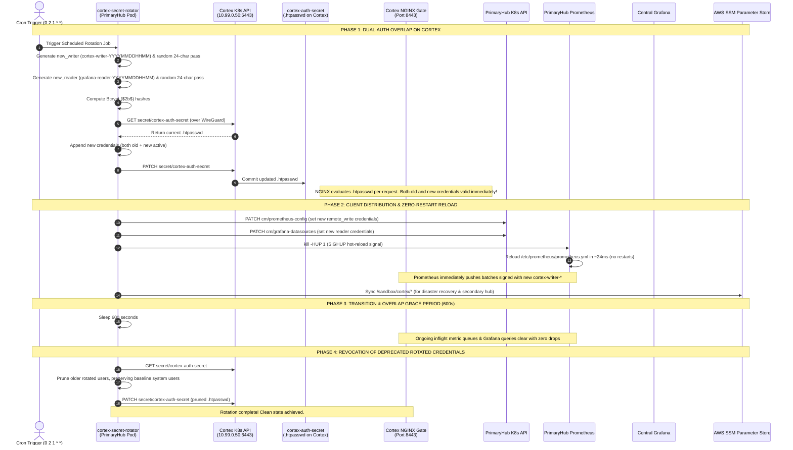

# Cortex Automated Zero-Downtime Secret Rotation Architecture

This document details the **Kubernetes-native, zero-downtime automated secret rotation architecture** implemented for the Cortex Long-Term S3 Storage cluster in 01 Sandbox. It eliminates static passwords from Helm values and automatically rotates both ingestion (`cortex-writer`) and query (`grafana-reader`) credentials on a scheduled monthly basis.

---

## 1. Architectural Overview

The observability architecture connects PrimaryHub and the dedicated Cortex storage node across an encrypted full-mesh **WireGuard VPN overlay** (`10.99.0.0/24`):

* **Cortex Node** (`10.99.0.50`, EC2 `i-00345c93f722ba2f6`, `us-east-1`): Dedicated cluster running Cortex monolithic TSDB backed by AWS S3 (`01-sandbox-cortex-storage`), fronted by an NGINX TLS 1.3 reverse proxy on port `8443` (NodePort `30443`).
* **PrimaryHub Cluster** (`10.99.0.1`, EC2 `i-0bcd35beefd16e3e3`, `us-east-1`): Runs Central Prometheus (pushing real-time metrics batches to Cortex) and Central Grafana (querying long-term historical metrics).
* **Cross-Cluster Control Plane**: PrimaryHub communicates directly with the Cortex Kubernetes API server (`https://10.99.0.50:6443`) over WireGuard using a least-privilege ServiceAccount (`cortex-auth-rotator`).

```text
┌────────────────────────────────────────────────────────────────────────────────────────┐
│                              PRIMARYHUB KUBERNETES CLUSTER                             │
│                                                                                        │
│   ┌───────────────────────────────┐     1. Generate Dynamic Credentials                │
│   │     cortex-secret-rotator     │ ──────────────────────────────────┐                │
│   │  (CronJob: 1st of month 02:00)│                                   │                │
│   └───────────────┬───────────────┘                                   ▼                │
│                   │ 2. Dual-Auth Update              ┌───────────────────────────────┐ │
│                   │    via WireGuard (Port 6443)     │ AWS SSM Parameter Store       │ │
│                   ├────────────────────────────────► │ /sandbox/cortex/writer-*      │ │
│                   │                                  │ /sandbox/cortex/reader-*      │ │
│                   │ 3. SIGHUP Hot-Reload (<25ms)     └───────────────┬───────────────┘ │
│                   ▼                                                  │                 │
│   ┌───────────────────────────────┐                                  │ Standby Sync    │
│   │ PrimaryHub Prometheus/Grafana │                                  │                 │
│   │ (Pushes with new credentials) │                                  │                 │
│   └───────────────┬───────────────┘                                  │                 │
└───────────────────┼──────────────────────────────────────────────────┼─────────────────┘
                    │                                                  │
        WireGuard   │ HTTPS POST /api/v1/push (Batch samples)          │ K8s API
        VPN Mesh    │ HTTPS GET  /prometheus/ (Grafana queries)        │ Port 6443
                    ▼                                                  ▼
┌────────────────────────────────────────────────────────────────────────────────────────┐
│                                DEDICATED CORTEX CLUSTER                                │
│                                                                                        │
│   ┌────────────────────────────────────────────────────────────────────────────────┐   │
│   │ NGINX TLS & RBAC Proxy Gate (Port 8443)                                        │   │
│   │ • Evaluates HTTP Basic Auth per request via /etc/nginx/auth/.htpasswd          │   │
│   │ • Dynamic regex RBAC:                                                          │   │
│   │     "~^cortex-writer"  → Role 1 (Ingestion: POST /api/v1/push)                 │   │
│   │     "~^grafana-reader" → Role 2 (Queries:   GET /prometheus/*)                 │   │
│   │ • ZERO NGINX reload required when .htpasswd updates                            │   │
│   │ • Accepts BOTH old & new credentials simultaneously during 600s Grace Period   │   │
│   └────────────────────────────────────────────────────────────────────────────────┘   │
│                                           │                                            │
│                                           ▼                                            │
│   ┌────────────────────────────────────────────────────────────────────────────────┐   │
│   │ Cortex Monolithic Daemon (Port 9009) ──► AWS S3 Bucket: 01-sandbox-cortex-...  │   │
│   └────────────────────────────────────────────────────────────────────────────────┘   │
└────────────────────────────────────────────────────────────────────────────────────────┘
```

---

## 2. The 4-Phase Dual-Authentication Overlap Lifecycle

To achieve **zero sample loss** and **zero 401 Unauthorized errors**, credential rotation utilizes a transitional overlap window:



---

## 3. Dynamic Regex RBAC Pattern

In [`codeInspector/charts/cortex/templates/configmap.yaml`](file:///home/berrybytes/Desktop/Kamal/01-Sandbox/codeInspector/charts/cortex/templates/configmap.yaml), the NGINX `map` directive was upgraded from exact string comparison to regex prefix matching:

```nginx
map $remote_user $is_authorized {
    default              0;
    "~^cortex-writer"    1;   # Matches cortex-writer, cortex-writer-202611121005, etc.
    "~^grafana-reader"   2;   # Matches grafana-reader, grafana-reader-202611121005, etc.
}
```

### Why this enables zero-downtime rotation:
1. **Per-Request Evaluation**: NGINX `auth_basic_user_file` opens `/etc/nginx/auth/.htpasswd` per incoming HTTP connection. Updating the Secret on Kubernetes propagates to the container file without requiring an NGINX process reload.
2. **Regex Role Mapping**: Any user starting with `cortex-writer-` is granted Write-Only access (`$is_authorized = 1`), strictly limited to `POST /api/v1/push`. Any user starting with `grafana-reader-` is granted Read-Only access (`$is_authorized = 2`), strictly limited to `GET /prometheus/*`.

---

## 4. Cross-Cluster Security & Scoped RBAC

PrimaryHub authenticates to the Cortex cluster API (`https://10.99.0.50:6443`) using a dedicated, least-privilege ServiceAccount created on the Cortex node:

### Cortex Node RBAC ([`rbac-rotator.yaml`](file:///home/berrybytes/Desktop/Kamal/01-Sandbox/codeInspector/charts/cortex/templates/rbac-rotator.yaml))
```yaml
apiVersion: v1
kind: ServiceAccount
metadata:
  name: cortex-auth-rotator
  namespace: opensandbox-system
---
apiVersion: rbac.authorization.k8s.io/v1
kind: Role
metadata:
  name: cortex-auth-rotator-role
  namespace: opensandbox-system
rules:
  - apiGroups: [""]
    resources: ["secrets"]
    resourceNames: ["cortex-auth-secret"]
    verbs: ["get", "patch", "update"]
---
apiVersion: rbac.authorization.k8s.io/v1
kind: RoleBinding
metadata:
  name: cortex-auth-rotator-binding
  namespace: opensandbox-system
roleRef:
  apiGroup: rbac.authorization.k8s.io
  kind: Role
  name: cortex-auth-rotator-role
subjects:
  - kind: ServiceAccount
    name: cortex-auth-rotator
    namespace: opensandbox-system
```

The bound ServiceAccount token is mounted securely into the PrimaryHub rotator pod via Secret `cortex-rotator-kubeconfig`. The rotator cannot modify any other pods, nodes, or workloads outside of `cortex-auth-secret`.

---

## 5. Live Production Verification

The rotation pipeline was tested and verified live on production nodes `i-0bcd35beefd16e3e3` (PrimaryHub) and `i-00345c93f722ba2f6` (Cortex):

### 1. Prometheus Configuration Reload Latency
```text
ts=2026-11-12T10:05:40.292Z caller=main.go:1367 level=info msg="Loading configuration file" filename=/etc/prometheus/prometheus.yml
ts=2026-11-12T10:05:40.317Z caller=main.go:1415 level=info msg="Completed loading of configuration file" totalDuration=24.405909ms remote_storage=508.657µs
```
* **Result**: Prometheus updated its remote_write storage credentials in **508 microseconds** and completed full configuration reload in **24.4 milliseconds** without pod restart.

### 2. Cortex NGINX Ingestion Logs (Post-Rotation)
```text
10.150.0.1 - cortex-writer-202611121005 [12/Nov/2026:10:11:21 +0000] "POST /api/v1/push HTTP/2.0" 200 0 "-" "Prometheus/2.54.1"
10.150.0.1 - cortex-writer-202611121005 [12/Nov/2026:10:11:23 +0000] "POST /api/v1/push HTTP/2.0" 200 0 "-" "Prometheus/2.54.1"
10.150.0.1 - cortex-writer-202611121005 [12/Nov/2026:10:11:27 +0000] "POST /api/v1/push HTTP/2.0" 200 0 "-" "Prometheus/2.54.1"
```
* **Result**: New rotated user `cortex-writer-202611121005` is actively authenticated and accepted with `HTTP 200 OK` every 2–3 seconds.

---

## 6. Operational Runbook

### On-Demand Secret Rotation Trigger
To rotate Cortex credentials immediately without waiting for the monthly schedule:
```bash
kubectl create job \
  --from=cronjob/cortex-secret-rotator cortex-manual-rotation \
  -n opensandbox-system
```

### Inspect Rotation Progress
```bash
kubectl logs -n opensandbox-system -l job-name=cortex-manual-rotation -c rotator -f
```

### Verify Active Cortex Users
```bash
# On Cortex cluster:
kubectl -n opensandbox-system get secret cortex-auth-secret \
  -o jsonpath="{.data.\.htpasswd}" | base64 -d
```
