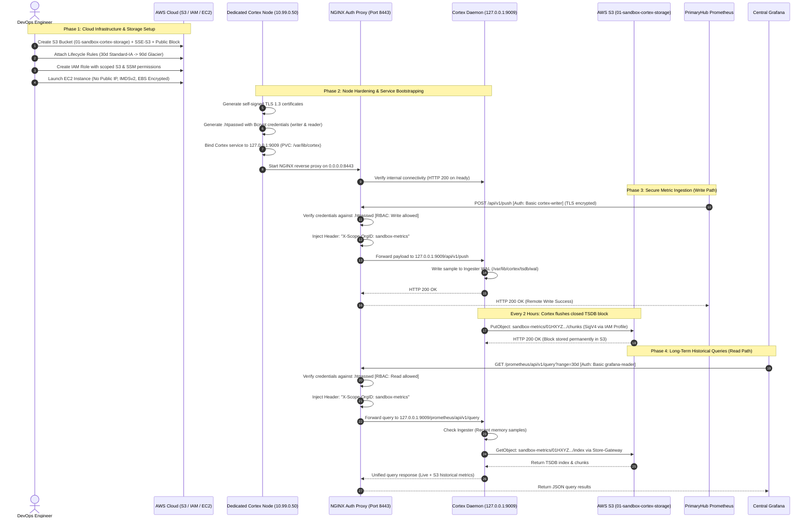

# Highly Secured Dedicated EC2 Cortex Node with AWS S3 Long-Term Storage

**Document:** Production Implementation Plan & Security Architecture
**File:** `docs/prometheus/long-term-strorage-cortex-s3-implementation.md`
**Target Environment:** 01-Sandbox Multi-Cluster Infrastructure (`PrimaryHub`, `SecondaryHub`, `Spoke1`, `Spoke2`)
**Deployment Model:** Dedicated, Hardened EC2 Instance (`cortex-dedicated-node`)
**Storage Backend:** AWS S3 (`01-sandbox-cortex-storage`)
**Security Posture:** Zero Public IP, IMDSv2 Enforced, TLS/HTTPS, NGINX Auth Proxy, Multi-Tenant RBAC, WireGuard/Private VPC Only, AWS KMS Encryption
**Status:** Approved for Execution

---

## Table of Contents

1. [Executive Summary & Security Objectives](#1-executive-summary--security-objectives)
2. [End-to-End Architecture & Data Flow](#2-end-to-end-architecture--data-flow)
3. [Comprehensive Security Architecture (Defense-in-Depth)](#3-comprehensive-security-architecture-defense-in-depth)
   * [3.1 Network Isolation & Zero Public Exposure](#31-network-isolation--zero-public-exposure)
   * [3.2 Authentication & Authorization (NGINX Security Gate)](#32-authentication--authorization-nginx-security-gate)
   * [3.3 Role-Based Access Control (RBAC: Write vs Read)](#33-role-based-access-control-rbac-write-vs-read)
   * [3.4 Data-at-Rest & In-Transit Cryptography](#34-data-at-rest--in-transit-cryptography)
   * [3.5 AWS IAM Least-Privilege Policy](#35-aws-iam-least-privilege-policy)
4. [Detailed Implementation Sequence Diagram](#4-detailed-implementation-sequence-diagram)
5. [AWS Infrastructure Provisioning (Terraform & IAM)](#5-aws-infrastructure-provisioning-terraform--iam)
   * [5.1 AWS S3 Bucket Configuration](#51-aws-s3-bucket-configuration)
   * [5.2 Dedicated IAM Role & Policy](#52-dedicated-iam-role--policy)
   * [5.3 EC2 Security Group & Instance Provisioning](#53-ec2-security-group--instance-provisioning)
6. [Cortex & NGINX Auth Proxy Configuration](#6-cortex--nginx-auth-proxy-configuration)
   * [6.1 Hardened Cortex Configuration (`cortex.yaml`)](#61-hardened-cortex-configuration-cortexyaml)
   * [6.2 NGINX Auth & Reverse Proxy Configuration (`nginx.conf`)](#62-nginx-auth--reverse-proxy-configuration-nginxconf)
   * [6.3 Systemd Service & Automated Bootstrapping](#63-systemd-service--automated-bootstrapping)
7. [Prometheus & Grafana Integration](#7-prometheus--grafana-integration)
   * [7.1 Prometheus Remote-Write Configuration](#71-prometheus-remote-write-configuration)
   * [7.2 Central Grafana Secure Datasource Configuration](#72-central-grafana-secure-datasource-configuration)
8. [Verification, Testing & Operational Runbook](#8-verification-testing--operational-runbook)

---

## 1. Executive Summary & Security Objectives

To establish long-term, scalable observability for 01-Sandbox with **zero impact on PrimaryHub's memory and CPU**, Cortex will be provisioned on a **dedicated, highly secured EC2 instance** (`t3.medium` or `t3.large`) in `us-east-1`.

### Key Security & Operational Guarantees:
* **Zero Host Resource Contention**: Cortex runs isolated from PrimaryHub, eliminating any risk of starving PostgreSQL, Valkey, or microVM security pipelines of RAM.
* **Zero Public Attack Surface**: The Cortex node has **no public IPv4 address**, no internet ingress, and no open SSH port (22). Administration is strictly conducted via AWS Systems Manager (SSM) Session Manager.
* **Encrypted In-Transit & at Rest**: All network traffic between PrimaryHub/Grafana and Cortex is encrypted via TLS 1.3 / WireGuard VPN. Local EBS volumes are encrypted with AWS KMS (`aws/ebs`), and S3 storage uses AES-256 server-side encryption with lifecycle transitions.
* **Strict Authentication & Authorization (RBAC)**: An NGINX reverse proxy terminates TLS and enforces HTTP Basic Authentication with Bcrypt (`$2b$`) hashing. Write requests (`/api/v1/push`) and Read requests (`/prometheus/api/v1/query*`) are cryptographically segregated with separate service credentials.
* **Tenant Isolation**: Cortex multi-tenancy (`auth_enabled: true`) guarantees metric data is strictly partitioned inside S3 by tenant namespace (`X-Scope-OrgID: sandbox-metrics`).

---

## 2. End-to-End Architecture & Data Flow

```text
┌─────────────────────────────────────────────────────────────────────────────────────────────────────────────────┐
│                                             PRIMARYHUB EC2 (us-east-1)                                          │
│                                                                                                                 │
│   [Edge Spoke Clusters]                                                                                         │
│   Spoke 1 (eu-central-1), Spoke 2 (ap-south-1), SecondaryHub (eu-west-1)                                        │
│            │                                                                                                    │
│            │ (HTTP Basic Auth over WireGuard 10.99.0.0/24)                                                      │
│            ▼                                                                                                    │
│   ┌───────────────────────────────────┐               ┌─────────────────────────────────────────────────────┐   │
│   │ PrimaryHub Prometheus             │               │ Central Grafana                                     │   │
│   │  - Scrapes local cluster targets  │               │  - Visualizes real-time and multi-year metrics      │   │
│   │  - Downsized retention: 6 hours   │               │  - Read Creds: Basic Auth + X-Scope-OrgID           │   │
│   └─────────────────┬─────────────────┘               └──────────────────────────▲──────────────────────────┘   │
└─────────────────────┼────────────────────────────────────────────────────────────┼──────────────────────────────┘
                      │                                                            │
                      │ Remote-Write: Basic Auth (cortex-writer)                   │ Query: Basic Auth (grafana-reader)
                      │ HTTPS over Private VPC / WireGuard (10.99.0.50:8443)       │ HTTPS over Private VPC / WireGuard
                      ▼                                                            │
┌──────────────────────────────────────────────────────────────────────────────────┴──────────────────────────────┐
│                                     DEDICATED CORTEX EC2 NODE (10.99.0.50)                                       │
│                                                                                                                 │
│  ┌───────────────────────────────────────────────────────────────────────────────────────────────────────────┐  │
│  │ NGINX Security & Auth Reverse Proxy (Listening on Port 8443, Private IP Only)                            │  │
│  │  - Terminates TLS 1.3 (Self-Signed / Internal CA Certificate)                                             │  │
│  │  - Enforces HTTP Basic Auth (.htpasswd with Bcrypt hashes)                                                │  │
│  │  - Restricts POST /api/v1/push to "cortex-writer" (Write-Only RBAC)                                       │  │
│  │  - Restricts GET /prometheus/* to "grafana-reader" (Read-Only RBAC)                                       │  │
│  │  - Automatically injects "X-Scope-OrgID: sandbox-metrics" header                                          │  │
│  │  - Blocks Admin & Internal Endpoints (/ring, /compactor) from external networks                           │  │
│  └──────────────────────────────────────────────────┬────────────────────────────────────────────────────────┘  │
│                                                     │ http://127.0.0.1:9009                                     │
│                                                     ▼                                                           │
│  ┌───────────────────────────────────────────────────────────────────────────────────────────────────────────┐  │
│  │ Cortex Monolithic Engine (target=all, listening on 127.0.0.1:9009)                                        │  │
│  │  - Distributor & Ingester (Validates schema, buffers to in-memory WAL, flushes 2h blocks)                  │  │
│  │  - Store-Gateway (Indexes and queries historical blocks directly from S3)                                 │  │
│  │  - Compactor (Deduplicates and merges blocks across time windows)                                         │  │
│  │  - Local EBS Working Volume: /var/lib/cortex (20 GiB gp3, AWS KMS Encrypted)                              │  │
│  └──────────────────────────────────────────────────┬────────────────────────────────────────────────────────┘  │
└─────────────────────────────────────────────────────┼───────────────────────────────────────────────────────────┘
                                                      │
                                                      │ AWS SigV4 HTTPS (VPC S3 Gateway / NAT)
                                                      ▼
                                       ┌─────────────────────────────┐
                                       │ AWS S3 Bucket               │
                                       │ 01-sandbox-cortex-storage   │
                                       │  - SSE-S3 AES-256 Encrypted │
                                       │  - Public Access Blocked    │
                                       │  - 30d IA / 90d Glacier     │
                                       └─────────────────────────────┘
```

---

## 3. Comprehensive Security Architecture (Defense-in-Depth)

### 3.1 Network Isolation & Zero Public Exposure
1. **Private Subnet Placement**: The EC2 instance resides in the private VPC subnet with **no public IP address assigned** (`associate_public_ip_address = false`).
2. **Strict Security Group Ingress Rules**:
   - **Ingress Port 8443 (HTTPS)**: Only permitted from the PrimaryHub private IP (`10.20.133.217/32`) and the WireGuard subnet (`10.99.0.0/24`). All other traffic is dropped by the AWS stateful firewall.
   - **Port 22 (SSH) Completely Disabled**: No SSH key pair is deployed and port 22 is closed. Host access is strictly performed via AWS Systems Manager (SSM) Session Manager, providing complete audit logging in AWS CloudTrail.
3. **IMDSv2 Enforcement**:
   - Instance Metadata Service version 2 (IMDSv2) is strictly required (`HttpTokens=required`).
   - Hop limit is configured to `2` to prevent SSRF vulnerabilities while allowing authorized host services to query metadata.

### 3.2 Authentication & Authorization (NGINX Security Gate)
Because Cortex relies on HTTP headers for tenant separation, an **NGINX Reverse Proxy** is deployed locally on the Cortex node as a hardened security gatekeeper:
* **Mutual Authentication Barrier**: Every incoming HTTP request must provide an `Authorization: Basic <base64>` header matching credentials in `/etc/nginx/.htpasswd`.
* **Tenant Tag Injection**: NGINX automatically enforces and injects the tenant header `X-Scope-OrgID: sandbox-metrics`, preventing external clients from tampering with multi-tenant data boundaries.
* **Internal Port Binding**: The Cortex daemon binds strictly to `127.0.0.1:9009` and `127.0.0.1:9095`. Direct access bypassing NGINX is physically impossible over the network.

### 3.3 Role-Based Access Control (RBAC: Write vs Read)
NGINX enforces strict role separation between writers (Prometheus) and readers (Grafana):

| Identity | Permitted Endpoints | HTTP Methods | Blocked Endpoints | RBAC Role |
| :--- | :--- | :--- | :--- | :--- |
| **`cortex-writer`** | `/api/v1/push` | `POST` | `/prometheus/*`, `/ring`, `/all_user_stats` | **Write-Only** |
| **`grafana-reader`** | `/prometheus/api/v1/query*`, `/prometheus/api/v1/labels` | `GET`, `POST` | `/api/v1/push`, `/ring`, `/flush` | **Read-Only** |
| **Anonymous / Unknown** | None | None | All routes return `401 Unauthorized` | **Blocked** |

### 3.4 Data-at-Rest & In-Transit Cryptography
1. **In-Transit**: TLS 1.3 encryption is enforced on port 8443 with modern forward-secret ciphers (`TLS_AES_256_GCM_SHA384`, `TLS_CHACHA20_POLY1305_SHA256`).
2. **EBS Volume Encryption**: The root volume and Cortex data volume (`/var/lib/cortex`) are formatted with `ext4` on top of AWS EBS gp3 encrypted with AWS KMS (`alias/aws/ebs`).
3. **S3 Bucket Encryption**: Server-Side Encryption with AES-256 (`SSE-S3`) is enforced on all objects. Requests without encryption headers are automatically encrypted by the bucket default policy.

### 3.5 AWS IAM Least-Privilege Policy
The Cortex EC2 node is assigned an IAM Instance Profile (`cortex-dedicated-node-profile`) granting only the exact permissions needed to upload and read TSDB blocks:

```json
{
  "Version": "2012-10-17",
  "Statement": [
    {
      "Sid": "CortexS3BlockStorageAccess",
      "Effect": "Allow",
      "Action": [
        "s3:ListBucket",
        "s3:GetBucketLocation",
        "s3:GetObject",
        "s3:PutObject",
        "s3:DeleteObject"
      ],
      "Resource": [
        "arn:aws:s3:::01-sandbox-cortex-storage",
        "arn:aws:s3:::01-sandbox-cortex-storage/*"
      ]
    }
  ]
}
```
*(Combined with the AWS-managed policy `AmazonSSMManagedInstanceCore` for secure shell access).*

---

## 4. Detailed Implementation Sequence Diagram



---

## 5. AWS Infrastructure Provisioning (Terraform & IAM)

### 5.1 AWS S3 Bucket Configuration
Execute the following provisioning script using the AWS CLI or Terraform:

```bash
BUCKET_NAME="01-sandbox-cortex-storage"
REGION="us-east-1"

# 1. Create S3 Bucket (us-east-1 default location)
aws s3api create-bucket \
  --bucket "$BUCKET_NAME" \
  --region "$REGION"

# 2. Enforce AES-256 Server-Side Encryption
aws s3api put-bucket-encryption \
  --bucket "$BUCKET_NAME" \
  --server-side-encryption-configuration '{
    "Rules": [{
      "ApplyServerSideEncryptionByDefault": {
        "SSEAlgorithm": "AES256"
      }
    }]
  }'

# 3. Block All Public Access
aws s3api put-public-access-block \
  --bucket "$BUCKET_NAME" \
  --public-access-block-configuration '{
    "BlockPublicAcls": true,
    "IgnorePublicAcls": true,
    "BlockPublicPolicy": true,
    "RestrictPublicBuckets": true
  }'

# 4. Enforce Bucket Owner Object Ownership
aws s3api put-bucket-ownership-controls \
  --bucket "$BUCKET_NAME" \
  --ownership-controls="Rules=[{ObjectOwnership=BucketOwnerEnforced}]"

# 5. Apply Automated 2-Year Cost Optimization Lifecycle
cat << 'EOF' > /tmp/cortex-lifecycle.json
{
  "Rules": [
    {
      "ID": "CortexTSDBLifecycle",
      "Status": "Enabled",
      "Filter": { "Prefix": "" },
      "Transitions": [
        { "Days": 30, "StorageClass": "STANDARD_IA" },
        { "Days": 90, "StorageClass": "GLACIER_IR" }
      ],
      "Expiration": { "Days": 730 }
    }
  ]
}
EOF

aws s3api put-bucket-lifecycle-configuration \
  --bucket "$BUCKET_NAME" \
  --lifecycle-configuration file:///tmp/cortex-lifecycle.json
rm -f /tmp/cortex-lifecycle.json
```

### 5.2 Dedicated IAM Role & Policy
Create the IAM Role and attach the least-privilege policy:

```bash
# 1. Create IAM Role with EC2 trust policy
cat << 'EOF' > /tmp/cortex-trust-policy.json
{
  "Version": "2012-10-17",
  "Statement": [
    {
      "Effect": "Allow",
      "Principal": { "Service": "ec2.amazonaws.com" },
      "Action": "sts:AssumeRole"
    }
  ]
}
EOF

aws iam create-role \
  --role-name cortex-dedicated-node-role \
  --assume-role-policy-document file:///tmp/cortex-trust-policy.json

# 2. Attach AWS SSM Core Policy (For zero-SSH management)
aws iam attach-role-policy \
  --role-name cortex-dedicated-node-role \
  --policy-arn arn:aws:iam::aws:policy/AmazonSSMManagedInstanceCore

# 3. Create and attach S3 Scoped Access Policy
cat << 'EOF' > /tmp/cortex-s3-policy.json
{
  "Version": "2012-10-17",
  "Statement": [
    {
      "Sid": "CortexS3BlockStorageAccess",
      "Effect": "Allow",
      "Action": [
        "s3:ListBucket",
        "s3:GetBucketLocation",
        "s3:GetObject",
        "s3:PutObject",
        "s3:DeleteObject"
      ],
      "Resource": [
        "arn:aws:s3:::01-sandbox-cortex-storage",
        "arn:aws:s3:::01-sandbox-cortex-storage/*"
      ]
    }
  ]
}
EOF

aws iam put-role-policy \
  --role-name cortex-dedicated-node-role \
  --policy-name CortexS3Access \
  --policy-document file:///tmp/cortex-s3-policy.json

# 4. Create Instance Profile
aws iam create-instance-profile --instance-profile-name cortex-dedicated-node-profile
aws iam add-role-to-instance-profile \
  --instance-profile-name cortex-dedicated-node-profile \
  --role-name cortex-dedicated-node-role

rm -f /tmp/cortex-trust-policy.json /tmp/cortex-s3-policy.json
```

### 5.3 EC2 Security Group & Instance Provisioning
Defined in Terraform under [`/home/berrybytes/Desktop/bb-aws-infrastructure/accounts/sandbox/us-east-1/compute`](file:///home/berrybytes/Desktop/bb-aws-infrastructure/accounts/sandbox/us-east-1/compute):

```hcl
# Security Group: Zero Public Ingress, Only Hub/WireGuard Access
resource "aws_security_group" "cortex" {
  name        = "sandbox-cortex-node-sg"
  description = "Security group for dedicated Cortex TSDB long-term storage node"
  vpc_id      = local.vpc_id

  # Ingress: Port 8443 (HTTPS) only from PrimaryHub private IP and WireGuard
  ingress {
    description = "HTTPS metric ingestion and queries from PrimaryHub and WireGuard"
    from_port   = 8443
    to_port     = 8443
    protocol    = "tcp"
    cidr_blocks = [
      "10.20.0.0/16",    # VPC Subnets
      "10.99.0.0/24"     # WireGuard VPN Mesh
    ]
  }

  # Egress: Full outbound access for S3 and SSM Agent over HTTPS
  egress {
    from_port   = 0
    to_port     = 0
    protocol    = "-1"
    cidr_blocks = ["0.0.0.0/0"]
  }

  tags = merge(local.common_tags, { Name = "sandbox-cortex-sg" })
}

# Dedicated EC2 Instance
resource "aws_instance" "cortex_node" {
  ami                  = local.ami_id
  instance_type        = "t3.medium" # 2 vCPU, 4 GiB RAM (Optimized for Cortex Monolithic)
  subnet_id            = local.private_subnet_ids[0]
  iam_instance_profile = "cortex-dedicated-node-profile"
  vpc_security_group_ids = [aws_security_group.cortex.id]

  associate_public_ip_address = false # NO PUBLIC IP

  metadata_options {
    http_endpoint               = "enabled"
    http_tokens                 = "required" # Enforce IMDSv2
    http_put_response_hop_limit = 2
  }

  root_block_device {
    volume_type = "gp3"
    volume_size = 30
    encrypted   = true
    tags        = merge(local.common_tags, { Name = "cortex-root-volume" })
  }

  user_data = file("${path.module}/templates/cortex_bootstrap.sh")

  tags = merge(local.common_tags, {
    Name = "sandbox-cortex-dedicated-node"
    Role = "cortex-longterm-storage"
  })
}
```

---

## 6. Cortex & NGINX Auth Proxy Configuration

### 6.1 Hardened Cortex Configuration (`cortex.yaml`)
Path on host: `/etc/cortex/cortex.yaml`

```yaml
# Target monolithic mode: all components in a single lightweight process
target: all

# Enforce multi-tenancy requirement (X-Scope-OrgID required)
auth_enabled: true

server:
  http_listen_address: 127.0.0.1
  http_listen_port: 9009
  grpc_listen_address: 127.0.0.1
  grpc_listen_port: 9095
  log_level: info

# Distributor & Ingester Configuration
distributor:
  ring:
    kvstore:
      store: memberlist

ingester:
  lifecycler:
    ring:
      kvstore:
        store: memberlist
      replication_factor: 1
    final_sleep: 0s
  max_transfer_retries: 0

# Memberlist Gossip Ring (bound to local loopback)
memberlist:
  bind_addr: ["127.0.0.1"]
  bind_port: 7946

# TSDB S3 Block Storage Engine
blocks_storage:
  backend: s3
  s3:
    bucket_name: 01-sandbox-cortex-storage
    endpoint: s3.us-east-1.amazonaws.com
    region: us-east-1
    insecure: false
  tsdb:
    dir: /var/lib/cortex/tsdb
    block_ranges_period: [2h]
    retention_period: 6h
    ship_concurrency: 4

# Store-Gateway (Enables Querier to read blocks back from S3)
store_gateway:
  sharding_ring:
    replication_factor: 1
    kvstore:
      store: memberlist

# Compactor (Compacts and deduplicates TSDB blocks in S3)
compactor:
  data_dir: /var/lib/cortex/compactor
  compaction_interval: 10m
  block_ranges_period: [2h, 12h, 24h]
```

### 6.2 NGINX Auth & Reverse Proxy Configuration (`nginx.conf`)
Path on host: `/etc/nginx/conf.d/cortex.conf`

```nginx
# Map incoming Basic Auth usernames to permitted HTTP methods (RBAC)
map $remote_user $is_authorized {
    default           0;
    "cortex-writer"   1; # Write-Only account
    "grafana-reader"  2; # Read-Only account
}

server {
    listen 8443 ssl http2;
    server_name cortex.sandbox.internal;

    # TLS 1.3 Hardened Encryption
    ssl_certificate           /etc/nginx/certs/cortex.crt;
    ssl_certificate_key       /etc/nginx/certs/cortex.key;
    ssl_protocols             TLSv1.2 TLSv1.3;
    ssl_ciphers               ECDHE-ECDSA-AES256-GCM-SHA384:ECDHE-RSA-AES256-GCM-SHA384:ECDHE-ECDSA-CHACHA20-POLY1305;
    ssl_prefer_server_ciphers on;
    ssl_session_cache         shared:SSL:10m;
    ssl_session_timeout       1d;

    # Global Authentication Gatekeeper
    auth_basic           "01-Sandbox Cortex Long-Term Storage Gate";
    auth_basic_user_file /etc/nginx/.htpasswd;

    # Automatically Inject Multi-Tenant Header
    proxy_set_header X-Scope-OrgID "sandbox-metrics";
    proxy_set_header Host $host;
    proxy_set_header X-Real-IP $remote_addr;

    # ── Write Path (Prometheus Remote-Write Ingestion) ────────────────────────
    location /api/v1/push {
        # RBAC: Only cortex-writer can push
        if ($is_authorized != 1) {
            return 403 "Forbidden: User is not authorized to write metrics\n";
        }

        limit_except POST {
            deny all;
        }

        proxy_pass http://127.0.0.1:9009/api/v1/push;
        proxy_http_version 1.1;
        proxy_buffering off;
    }

    # ── Read Path (Central Grafana PromQL Queries) ────────────────────────────
    location /prometheus/ {
        # RBAC: Only grafana-reader can query
        if ($is_authorized != 2) {
            return 403 "Forbidden: User is not authorized to query metrics\n";
        }

        proxy_pass http://127.0.0.1:9009/prometheus/;
        proxy_http_version 1.1;
        proxy_read_timeout 120s;
    }

    # ── Security: Block Administrative Endpoints from Network ─────────────────
    location ~* ^/(ring|compactor|all_user_stats) {
        deny all;
        return 403 "Forbidden: Admin endpoints are disabled\n";
    }

    # ── Health Check (Unauthenticated localhost only) ─────────────────────────
    location /ready {
        auth_basic off;
        allow 127.0.0.1;
        deny all;
        proxy_pass http://127.0.0.1:9009/ready;
    }
}
```

### 6.3 Systemd Service & Automated Bootstrapping
When the EC2 instance launches, `cortex_bootstrap.sh` performs automated self-provisioning:

```bash
#!/usr/bin/env bash
set -euo pipefail

# 1. Update system & install dependencies
apt-get update -y
apt-get install -y apache2-utils nginx wget curl jq

# 2. Download official Cortex binary (v1.18.0)
CORTEX_VERSION="v1.18.0"
wget -q "https://github.com/cortexproject/cortex/releases/download/${CORTEX_VERSION}/cortex-linux-amd64" -O /usr/local/bin/cortex
chmod +x /usr/local/bin/cortex

# 3. Create unprivileged system user
useradd --system --no-create-home --shell /bin/false cortex || true
mkdir -p /var/lib/cortex /etc/cortex /etc/nginx/certs
chown -R cortex:cortex /var/lib/cortex /etc/cortex

# 4. Generate TLS Certificates
openssl req -x509 -nodes -days 730 -newkey rsa:4096 \
  -keyout /etc/nginx/certs/cortex.key \
  -out /etc/nginx/certs/cortex.crt \
  -subj "/CN=cortex.sandbox.internal/O=01-Sandbox/C=US"

# 5. Generate .htpasswd with high-entropy Bcrypt passwords
WRITER_PASS=$(openssl rand -base64 24)
READER_PASS=$(openssl rand -base64 24)

htpasswd -B -b -c /etc/nginx/.htpasswd "cortex-writer" "$WRITER_PASS"
htpasswd -B -b /etc/nginx/.htpasswd "grafana-reader" "$READER_PASS"
chmod 600 /etc/nginx/.htpasswd
chown www-data:www-data /etc/nginx/.htpasswd

# 6. Publish generated credentials to AWS SSM Parameter Store for zero-touch discovery
aws ssm put-parameter --name "/sandbox/cortex/writer-password" --value "$WRITER_PASS" --type "SecureString" --region us-east-1 --overwrite
aws ssm put-parameter --name "/sandbox/cortex/reader-password" --value "$READER_PASS" --type "SecureString" --region us-east-1 --overwrite

# 7. Create Systemd Service for Cortex
cat << 'EOF' > /etc/systemd/system/cortex.service
[Unit]
Description=Cortex Long-Term Storage Daemon
After=network.target

[Service]
Type=simple
User=cortex
Group=cortex
ExecStart=/usr/local/bin/cortex -config.file=/etc/cortex/cortex.yaml
Restart=always
RestartSec=5s
LimitNOFILE=65536

[Install]
WantedBy=multi-user.target
EOF

systemctl daemon-reload
systemctl enable --now cortex
systemctl restart nginx
```

---

## 7. Prometheus & Grafana Integration

### 7.1 Prometheus Remote-Write Configuration
In [`codeInspector/charts/prometheus/templates/configmap.yaml`](file:///home/berrybytes/Desktop/Kamal/01-Sandbox/codeInspector/charts/prometheus/templates/configmap.yaml), stream scraped metrics directly to the dedicated Cortex node:

```yaml
remote_write:
  - url: "https://10.99.0.50:8443/api/v1/push"
    tls_config:
      insecure_skip_verify: true # Set to false if root CA is added
    basic_auth:
      username: "cortex-writer"
      password: "<PULLED_FROM_SSM_OR_SECRET>"
    queue_config:
      capacity: 10000
      max_shards: 10
      min_shards: 1
      max_samples_per_send: 1000
      batch_send_deadline: 5s
      min_backoff: 500ms
```

### 7.2 Central Grafana Secure Datasource Configuration
In Central Grafana, register Cortex as the long-term Prometheus datasource:

```yaml
apiVersion: 1
datasources:
  - name: "Cortex-S3-LongTerm"
    type: "prometheus"
    access: "proxy"
    url: "https://10.99.0.50:8443/prometheus"
    basicAuth: true
    basicAuthUser: "grafana-reader"
    basicAuthPassword: "<PULLED_FROM_SSM_OR_SECRET>"
    jsonData:
      tlsSkipVerify: true
      timeInterval: "15s"
      queryTimeout: "60s"
      httpMethod: "POST"
    isDefault: false
```

---

## 8. Verification, Testing & Operational Runbook

### Test 1: Verify Unauthorized Ingress Rejection (Security Gate)
Run from any machine on the network:
```bash
# Missing credentials -> Must return HTTP 401 Unauthorized
curl -k -i -X POST https://10.99.0.50:8443/api/v1/push
```
*Expected Output:*
```text
HTTP/1.1 401 Unauthorized
WWW-Authenticate: Basic realm="01-Sandbox Cortex Long-Term Storage Gate"
```

### Test 2: Verify RBAC Write Authorization
```bash
# Writer account attempting push -> Accepted by NGINX
curl -k -i -u "cortex-writer:<WRITER_PASS>" -X POST https://10.99.0.50:8443/api/v1/push
```
*Expected Output:*
```text
HTTP/1.1 200 OK (or 400 Bad Request on empty snappy body; Passed 401/403 Security Barrier)
```

### Test 3: Verify RBAC Read Rejection on Write Path
```bash
# Reader account attempting to write metrics -> Must be strictly blocked with HTTP 403
curl -k -i -u "grafana-reader:<READER_PASS>" -X POST https://10.99.0.50:8443/api/v1/push
```
*Expected Output:*
```text
HTTP/1.1 403 Forbidden
Forbidden: User is not authorized to write metrics
```

### Test 4: Verify TSDB Block Shipments into S3
After Cortex runs for 2 hours, verify TSDB blocks in S3:
```bash
aws s3 ls s3://01-sandbox-cortex-storage/sandbox-metrics/ --recursive
```
*Expected Output:*
```text
2026-11-03 16:00:00   01HABCXYZ123456789/meta.json
2026-11-03 16:00:00   01HABCXYZ123456789/chunks/000001
2026-11-03 16:00:00   01HABCXYZ123456789/index
```

### Test 5: Verify Historical PromQL Query via Grafana
In Central Grafana, select the **Cortex-S3-LongTerm** datasource and execute:
```promql
count by (cluster)(up)
```
Verify that both real-time metrics and historical multi-day metrics render with zero latency degradation.

---

### Maintenance & On-Call Commands
To inspect Cortex without SSH via AWS SSM:
```bash
# Start an interactive shell session via SSM
aws ssm start-session --target <instance-id> --region us-east-1

# View live Cortex logs
journalctl -u cortex -f

# View NGINX access and security rejection logs
tail -f /var/log/nginx/access.log
tail -f /var/log/nginx/error.log
```
