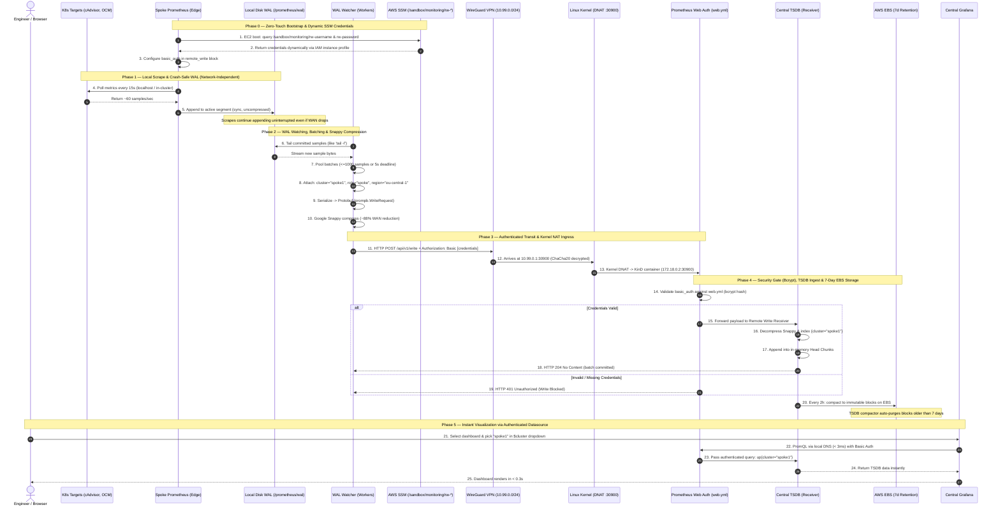

# Prometheus Multi-Cluster Monitoring: Architecture & Operations Guide

This document is the authoritative technical reference for the Prometheus-based observability system deployed across the 01-Sandbox multi-cluster infrastructure. It covers the full architecture, the complete data flow from metric scrape to Grafana rendering, what is monitored, how it is deployed, and how to operate it.

---

## Table of Contents

1. [Introduction: Why This Architecture Exists](#1-introduction-why-this-architecture-exists)
2. [System Architecture: The Big Picture](#2-system-architecture-the-big-picture)
3. [The Complete Data Flow: Step by Step](#3-the-complete-data-flow-step-by-step)
4. [Sequence Diagrams](#4-sequence-diagrams)
5. [What Gets Monitored](#5-what-gets-monitored)
6. [Infrastructure & Deployment](#6-infrastructure--deployment)
7. [Grafana: Dashboards & Access](#7-grafana-dashboards--access)
8. [External Access via ngrok](#8-external-access-via-ngrok)
9. [CLI Operations & Verification](#9-cli-operations--verification)
10. [Safe Helm Chart Upgrade Procedure](#10-safe-helm-chart-upgrade-procedure)
11. [Performance: Before vs. After](#11-performance-before-vs-after)

---

## 1. Introduction: Why This Architecture Exists

### 1.1 The Problem: Traditional Cross-WAN Pull Model

The clusters in this environment are geographically distributed across AWS regions:

| Cluster | Region | Role |
| :--- | :--- | :--- |
| **PrimaryHub** | `us-east-1` (N. Virginia) | Central control plane, Grafana, persistent storage |
| **SecondaryHub** | `us-west-2` (Oregon) | Standby control plane |
| **Spoke 1** | `eu-central-1` (Frankfurt) | Edge compute & workloads |
| **Spoke 2** | `ap-south-1` (Mumbai) | Edge compute & workloads |
| **Spoke 3** | `eu-west-1` (Ireland) | Edge compute & workloads |

All inter-cluster communication travels over a **full-mesh WireGuard encrypted overlay** (`10.99.0.0/24`).

The **original design** had Grafana in `us-east-1` directly *pulling* (querying) metrics from individual Prometheus scrapers running at the edge in Frankfurt, Mumbai, and Ireland:

```
TRADITIONAL PULL MODEL (SLOW & VOLATILE):

Grafana (US East)
    │
    ├── Query 1: PromQL (RTT ~180ms) ────────────────► Spoke 1 (Frankfurt)
    ├── Query 2: PromQL (RTT ~240ms) ────────────────► Spoke 2 (Mumbai)
    └── Query 3: PromQL (RTT ~120ms) ────────────────► SecondaryHub (Oregon)

[!] 12 dashboard panels × 4 clusters = 48 cross-WAN queries per refresh
[!] Spoke EC2 terminated → ALL historical metrics permanently erased
```

This caused two critical failures:

1. **High latency**: Physical fiber distances create unavoidable round-trip times:
   - `us-east-1` ↔ `eu-central-1` (Frankfurt): **~90–110 ms RTT**
   - `us-east-1` ↔ `ap-south-1` (Mumbai): **~220–260 ms RTT**
   - A 12-panel dashboard issued 48 concurrent WAN queries → **4.5–8.0 second load time**, often hitting HTTP 504 timeouts.

2. **Data loss on teardown**: Spoke EC2 instances and KinD clusters are routinely terminated or recreated in sandbox environments. Metrics stored only in edge scrapers' local memory or ephemeral disks were **permanently destroyed** on instance termination.

### 1.2 The Solution: Push-Based Prometheus Remote Write (PRW)

Instead of Grafana pulling across the WAN, **edge clusters push their metrics to a central hub**. The architecture is built on three pillars:

| Pillar | Mechanism | Benefit |
| :--- | :--- | :--- |
| **Push over WireGuard** | Edge scrapers send compressed metric batches to PrimaryHub | Eliminates WAN query latency |
| **Crash-Safe WAL Buffer** | Metrics are written to a local Write-Ahead Log before sending | Zero metric loss on network outages |
| **AWS EBS Persistence** | All data stored on a dedicated EBS volume (`DeleteOnTermination=false`) | Survives complete EC2 termination |

### 1.3 Key Design Principles

- **Zero Disruption**: Scrapes PostgreSQL and OCM with no database restarts, custom agents, or cluster re-creation.
- **Headless Deployment**: No external ingress by default; accessible via cluster-internal DNS or secure SSH/SSM port-forwarding.
- **Automated SLO/SLI Evaluation**: Prometheus recording rules evaluated every 15 seconds calculate SLIs against defined SLOs.
- **Autonomous Provisioning**: New spoke clusters deployed via Terraform automatically provision and begin streaming metrics without any manual intervention.

---

## 2. System Architecture: The Big Picture

### 2.1 Topology Diagram

```
                    ┌─────────────────────────────────────────────────────────────────────┐
                    │                        PrimaryHub (us-east-1)                        │
                    │                                                                     │
                    │  ┌────────────────────────────┐   ┌───────────────────────────────┐ │
                    │  │  Central Prometheus TSDB    │   │      Central Grafana           │ │
                    │  │  (--web.enable-remote-      │   │  (http://prometheus-service    │ │
                    │  │   write-receiver)           │◄──│   .opensandbox-system:9090)    │ │
                    │  │  NodePort: 30900            │   │  < 3ms local query latency    │ │
                    │  └──────────┬─────────────────┘   └───────────────────────────────┘ │
                    │             │                                                        │
                    │  ┌──────────▼─────────────────┐                                    │
                    │  │   100 GiB AWS EBS Volume    │                                    │
                    │  │   (DeleteOnTermination=false)│                                    │
                    │  │   /data → /prometheus (PVC) │                                    │
                    │  └────────────────────────────-┘                                    │
                    └──────────────────────────────────────────────────────────────────────┘
                              ▲                  ▲                   ▲
             HTTP POST        │    HTTP POST     │    HTTP POST      │
             /api/v1/write    │    /api/v1/write │    /api/v1/write  │
             WireGuard 10.99.0.1:30900           │                   │
                              │                  │                   │
          ┌───────────────────┘      ┌───────────┘       ┌──────────┘
          │                          │                    │
┌─────────┴──────────┐    ┌──────────┴─────────┐   ┌─────┴──────────────┐
│  SecondaryHub       │    │  Spoke 1 (Frankfurt)│   │  Spoke 2 (Mumbai)  │
│  (us-west-2)        │    │  (eu-central-1)     │   │  (ap-south-1)      │
│  WG: 10.99.0.2      │    │  WG: 10.99.0.3      │   │  WG: 10.99.0.4     │
│  • Local Scraper    │    │  • Local Scraper     │   │  • Local Scraper   │
│  • Local WAL        │    │  • Local WAL         │   │  • Local WAL       │
│  cluster=           │    │  cluster=            │   │  cluster=          │
│  "secondaryhub"     │    │  "spoke1"            │   │  "spoke2"          │
└────────────────────-┘    └─────────────────────┘   └────────────────────┘
```

### 2.2 Component Roles

| Component | Where | What It Does |
| :--- | :--- | :--- |
| **Local Prometheus Scraper** | Each Spoke & SecondaryHub | Polls local Kubernetes components every 15s; appends samples to local WAL; pushes batches to PrimaryHub |
| **WAL (Write-Ahead Log)** | Each edge cluster, `/prometheus/wal/` | Crash-safe disk buffer. All scraped samples are written here before transmission |
| **WAL Watcher (walWatcher)** | Edge scraper process | Background goroutine that tails the WAL, batches samples, compresses with Snappy, and dispatches via HTTP |
| **WireGuard Overlay** | All clusters | Encrypted mesh network (`10.99.0.0/24`). All PRW traffic uses this tunnel |
| **Linux Kernel Netfilter** | PrimaryHub host | Wire-speed DNAT: routes port 30900 from WireGuard interface to KinD container — no userspace proxy |
| **Central Prometheus** | PrimaryHub (`opensandbox-system`) | Accepts inbound `/api/v1/write` streams; stores all cluster metrics in a unified TSDB |
| **AWS EBS Volume** | PrimaryHub | 100 GiB GP3 volume (`DeleteOnTermination=false`). TSDB blocks survive EC2 termination |
| **Central Grafana** | PrimaryHub (`monitoring`) | Queries the local central TSDB via in-cluster DNS in `< 3ms`. Pre-provisioned multi-cluster dashboards |

### 2.3 What Prometheus Scrapes on PrimaryHub

On PrimaryHub, the central Prometheus both *receives* remote write streams *and* directly scrapes local components:

```
                    ┌────────────────────────────────────────┐
                    │     Central Prometheus (port 9090)      │
                    └───────────────┬────────────────────────┘
                                    │
         ┌──────────────────────────┼──────────────────────────┐
         │                          │                           │
         ▼                          ▼                           ▼
┌────────────────┐        ┌──────────────────┐      ┌──────────────────┐
│ CloudNativePG  │        │  Open Cluster    │      │  FastAPI Backend  │
│  Port :9187    │        │  Management      │      │  Port :80         │
│ • WAL lag      │        │  Port :8080      │      │ • Request rates   │
│ • Replay lag   │        │ • Spoke admission│      │ • Error codes     │
│ • Sync status  │        │ • Join latency   │      │ • API durations   │
└────────────────┘        └──────────────────┘      └──────────────────┘
```

---

## 3. The Complete Data Flow: Step by Step

This section explains exactly what happens from the moment a metric is scraped on an edge cluster to when it appears as a graph panel in Grafana. There are **6 sequential phases**.

---

### Phase 1 — Local Scrape & Write-Ahead Log (WAL)

**What happens:** The edge Prometheus scraper polls local Kubernetes components every 15 seconds and immediately appends the collected samples to a local disk file called the Write-Ahead Log (WAL). This happens entirely locally with no network dependency.

**Why the WAL matters:** The WAL is a crash-safe buffer. If the WAN link or PrimaryHub becomes unavailable at any point, the local scraper simply keeps appending to the WAL undisturbed. Not a single metric is lost. When connectivity returns, the WAL watcher replays the buffered data automatically.

**WAL structure** (`/prometheus/wal/`):

```
/prometheus $ ls -la /prometheus/wal/
drwxr-xr-x  3 nobody  nobody       81 Oct 27 05:45 .
-rw-r--r--  1 nobody  nobody  1179648 Oct 26 13:52 00000006   ← Completed past segment
-rw-r--r--  1 nobody  nobody    32768 Oct 27 05:45 00000007   ← Replay/startup segment
-rw-r--r--  1 nobody  nobody  2406999 Oct 27 07:39 00000008   ← ACTIVE: appended every 15s
drwxr-xr-x  2 nobody  nobody       22 Oct 27 05:45 checkpoint.00000005  ← Compaction marker
```

| File | Purpose |
| :--- | :--- |
| `00000006`, `00000007` | Completed sequential WAL segments from prior scrape cycles |
| `00000008` | **Active segment**: new samples appended every 15 seconds |
| `checkpoint.00000005` | Created every 2 hours during TSDB compaction. Allows older WAL files to be safely deleted |

> [!IMPORTANT]
> **WAL data is stored as raw uncompressed binary on disk.** Snappy compression is applied later, strictly in RAM and only for network transmission. The WAL exists solely as a local crash-safety buffer.

**Growth rate math:**
- Scrape frequency: every 15 seconds = 4 scrapes/min
- Example: `00000008` grew from 1.02 MB to 2.41 MB in 66 minutes (264 scrape intervals)
- Bytes appended per scrape: 1,377,181 bytes ÷ 264 scrapes ≈ **~5.2 KB per scrape cycle**
- Live ingestion rate query: `~58.8 float samples/sec` continuously streaming into the active segment

**Defined in:** EC2 Launch Template [`/home/berrybytes/Desktop/bb-aws-infrastructure/accounts/sandbox/<region>/compute/templates/user_data.sh.tftpl`](file:///home/berrybytes/Desktop/bb-aws-infrastructure/accounts/sandbox/eu-central-1/compute/templates/user_data.sh.tftpl) → `deploy_spoke_monitoring()`

---

### Phase 2 — WAL Watching, Batching & Snappy Compression

**What happens:** A background goroutine inside the Prometheus process called the **WAL Watcher** (`walWatcher`) continuously tails the active WAL segment — just like `tail -f` on a log file. When it detects new bytes (new scraped samples), it reads them into memory (RAM), groups them into batches, and prepares them for network transmission.

**The batching pipeline:**

```
DISK (WAL Segment 00000008)
  │  [walWatcher tails new bytes, like 'tail -f']
  ▼
RAM: Pool samples into batches
  │  Up to 1,000 samples OR wait 5 seconds (batch_send_deadline)
  ▼
RAM: Attach external labels
  │  cluster="spoke1", role="spoke", region="eu-central-1"
  ▼
RAM: Serialize to Protocol Buffers
  │  prompb.WriteRequest message (~90 KB for 1,000 samples)
  ▼
RAM: Google Snappy compression
  │  ~90 KB → ~12 KB  (88% WAN bandwidth reduction)
  ▼
HTTP POST /api/v1/write  (onto the wire)
```

**Queue configuration** (`queue_config` in scraper ConfigMap):

```yaml
queue_config:
  capacity: 10000          # Max samples buffered in RAM per shard before backpressure
  max_shards: 10           # Maximum parallel worker goroutines (auto-scales)
  min_shards: 1            # Baseline: 1 worker goroutine during normal operation
  max_samples_per_send: 1000  # Flush immediately when 1,000 samples accumulate
  batch_send_deadline: 5s  # Flush regardless after 5 seconds (guarantees fresh data)
  min_backoff: 500ms       # Minimum retry delay on network errors
  max_backoff: 10s         # Maximum exponential backoff cap
```

**What each setting means:**
- At ~60 samples/sec, a full batch of 1,000 samples accumulates in ~17 seconds. In practice, the `5s` deadline fires first, sending ~300 samples every 5 seconds.
- When PrimaryHub is temporarily unreachable, the worker enters exponential backoff (`500ms → 1s → 2s → ... → 10s`). New samples keep appending safely to the local WAL.
- When connectivity is restored, the **Shard Controller** detects backlog and automatically spawns up to 10 parallel workers to drain the queue 10x faster, then scales back down.

**The critical distinction — what does and does not travel over the network:**

| Layer | Location | Compressed? | Format |
| :--- | :--- | :--- | :--- |
| Disk WAL segments (`00000008`) | Spoke local disk | ❌ No | Raw binary, 32 KB pages |
| In-memory sample batches | Spoke RAM | ❌ No | Go structs (`[]prompb.TimeSeries`) |
| Serialized batch | Spoke RAM | ❌ No (pre-compression) | Protobuf `WriteRequest` (~90 KB) |
| **Network payload** | **WireGuard tunnel** | ✅ **Yes (Snappy)** | **~12 KB compressed binary** |
| TSDB blocks on PrimaryHub | EBS volume | ✅ Yes (Gorilla XOR) | ~1.37 bytes/sample |

**Compression efficiency on the wire:**
- Raw Prometheus text format: **~180–220 bytes per metric line**
- Snappy-compressed Protobuf: **~17.8 bytes per sample** (~88% reduction)
- Entire spoke cluster bandwidth: **< 5 KB/s** outbound WAN traffic

**Defined in:** EC2 Launch Template [`/home/berrybytes/Desktop/bb-aws-infrastructure/accounts/sandbox/<region>/compute/templates/user_data.sh.tftpl`](file:///home/berrybytes/Desktop/bb-aws-infrastructure/accounts/sandbox/eu-central-1/compute/templates/user_data.sh.tftpl) → `deploy_spoke_monitoring()`

---

### Phase 3 — Network Transmission: WireGuard & Kernel Netfilter

**What happens:** The compressed HTTP POST payload leaves the spoke cluster through the encrypted WireGuard tunnel (`wg0`) and arrives at PrimaryHub. On PrimaryHub, the Linux Kernel Netfilter (iptables DNAT) routes the packet directly into the KinD container — no userspace proxy daemons involved.

**Traffic path:**

```
Spoke 1 (Frankfurt)
  │
  │ Go HTTP client: POST http://10.99.0.1:30900/api/v1/write
  │ Headers:
  │   Content-Type: application/x-protobuf
  │   Content-Encoding: snappy
  │   X-Prometheus-Remote-Write-Version: 0.1.0
  ▼
Linux Kernel: routes dst=10.99.0.1 → dev wg0 (WireGuard interface)
  │
  │ ChaCha20-Poly1305 encryption → UDP port 51820 over internet
  ▼
PrimaryHub WireGuard interface (wg0) at 10.99.0.1
  │
  │ Linux Kernel Netfilter DNAT:
  │   iptables -t nat -A PREROUTING ! -i br-+ -p tcp --dport 30900 \
  │     -j DNAT --to-destination 172.18.0.2:30900
  ▼
KinD container node (172.18.0.2:30900)
  │
  │ Kubernetes NodePort → Service (ClusterIP:9090)
  ▼
Central Prometheus Pod (port 9090)
```

**Why kernel Netfilter instead of a userspace proxy:**
Standard Docker port publishing (`docker-proxy`) runs a userspace daemon for every published port, introducing system call overhead and packet copies. The Netfilter DNAT rules intercept packets entirely in kernel space at wire speed — matching the declarative design used for PostgreSQL (`:30432`) and Valkey (`:30379`).

**KinD `extraPortMappings` declaration** ([`/home/berrybytes/Desktop/Kamal/01-Sandbox/script/prod-docker-multi-script/lib/clusters.sh`](file:///home/berrybytes/Desktop/Kamal/01-Sandbox/script/prod-docker-multi-script/lib/clusters.sh)):
```yaml
nodes:
- role: control-plane
  extraPortMappings:
  - containerPort: 30432
    hostPort: 30432
    protocol: TCP
  - containerPort: 30379
    hostPort: 30379
    protocol: TCP
  - containerPort: 30900
    hostPort: 30900
    protocol: TCP
```

**Network routing table:**

| Cluster | WireGuard IP | Role | Connection |
| :--- | :--- | :--- | :--- |
| **PrimaryHub** | `10.99.0.1` | Central TSDB receiver | WG `:30900` → Kernel DNAT → KinD `:30900` → Pod `:9090` |
| **SecondaryHub** | `10.99.0.2` | Push client | → `http://10.99.0.1:30900/api/v1/write` |
| **Spoke 1** | `10.99.0.3` | Push client | → `http://10.99.0.1:30900/api/v1/write` |
| **Spoke 2** | `10.99.0.4` | Push client | → `http://10.99.0.1:30900/api/v1/write` |
| **Spoke 3** | `10.99.0.5` | Push client | → `http://10.99.0.1:30900/api/v1/write` |

---

### Phase 4 — Central Ingestion: PrimaryHub TSDB

**What happens:** PrimaryHub's Prometheus receives the HTTP POST, decompresses the Snappy payload, validates the Protobuf structure, and appends the samples into its local Time-Series Database (TSDB). The `cluster="..."` external labels ensure that metrics from different clusters are stored as completely separate time-series, preventing any collision.

**The receiver flag** ([`/home/berrybytes/Desktop/Kamal/01-Sandbox/codeInspector/charts/prometheus/templates/deployment.yaml`](file:///home/berrybytes/Desktop/Kamal/01-Sandbox/codeInspector/charts/prometheus/templates/deployment.yaml)):
```yaml
containers:
  - name: prometheus
    image: prom/prometheus:v2.51.0
    args:
      - "--config.file=/etc/prometheus/prometheus.yml"
      - "--storage.tsdb.path=/prometheus"
      - "--storage.tsdb.retention.time=7d"
      - "--web.enable-remote-write-receiver"   # ← Unlocks POST /api/v1/write
      - "--web.enable-lifecycle"
      - "--web.config.file=/etc/prometheus-web/web.yml" # ← Dynamic Basic Auth security
```

**Dual-mode operation:** Central Prometheus simultaneously:
1. **Receives** inbound push streams from edge clusters at `/api/v1/write`
2. **Scrapes** local PrimaryHub components directly (PostgreSQL, OCM, FastAPI, Envoy)

**How metric disambiguation works:**

Each edge cluster configures `external_labels` in its scraper config. These labels are permanently attached to every sample before it leaves the spoke:

```yaml
# Injected via /home/berrybytes/Desktop/bb-aws-infrastructure/accounts/sandbox/eu-central-1/compute/templates/user_data.sh.tftpl (deploy_spoke_monitoring()) on Spoke 1:
global:
  external_labels:
    cluster: 'spoke1'
    role:    'spoke'
    region:  'eu-central-1'
```

```yaml
# In /home/berrybytes/Desktop/Kamal/01-Sandbox/codeInspector/values-secondary.yaml (SecondaryHub):
prometheus:
  global:
    external_labels:
      cluster: 'secondaryhub'
      region:  'us-west-2'
```

In the central TSDB, time-series identity = metric name + **all labels**. Therefore:
- `up{cluster="spoke1", job="prometheus-scraper"}` and
- `up{cluster="spoke2", job="prometheus-scraper"}`

are stored as **completely independent time-series** — no collision, no overwriting.

**Live proof — 4 clusters streaming simultaneously:**
```bash
kubectl -n opensandbox-system exec deploy/prometheus -- \
  wget -qO- "http://localhost:9090/api/v1/query?query=count%20by%20(cluster)(up)" | jq .
```
```json
{
  "data": {
    "result": [
      { "metric": {},                         "value": ["...", "20"] },
      { "metric": { "cluster": "secondaryhub" }, "value": ["...", "17"] },
      { "metric": { "cluster": "spoke1" },       "value": ["...", "6"]  },
      { "metric": { "cluster": "spoke2" },       "value": ["...", "6"]  }
    ]
  }
}
```
**49 total monitored services** across 4 clusters, all in one TSDB, all disambiguated by `cluster="..."`.

---

### Phase 5 — Persistent Storage: AWS EBS Volume

**What happens:** The TSDB writes incoming samples to in-memory head chunks and simultaneously to a local WAL. Every 2 hours, it compacts the in-memory data into immutable 2-hour block directories on disk, compressed using Facebook Gorilla encoding. All of this disk I/O targets the `/prometheus` PVC, which is physically backed by a dedicated 100 GiB AWS EBS volume that **persists independently of the EC2 instance**.

**TSDB internal structure:**
```
/prometheus/
  ├── wal/                      ← Active Write-Ahead Log (crash-safe buffer)
  │   ├── 00000006              ← Past WAL segment
  │   └── 00000008              ← Active WAL segment (appended every 15s)
  │
  ├── 01JAX1G0S.../             ← 2-hour compacted TSDB block (immutable)
  │   ├── chunks/               ← Gorilla-compressed sample data
  │   ├── index                 ← Inverted label search index
  │   └── meta.json             ← Block boundaries & sample count
  │
  └── 01JAX7M5F.../             ← Next 2-hour block
```

**Facebook Gorilla compression (inside 2-hour blocks):**
- **Timestamps**: Double-Delta encoding — when scrape intervals are consistent (every 15s), each timestamp needs only ~1 bit
- **Values**: XOR float compression — stores only the changed bits vs the previous value
- **Result**: 16-byte raw samples compressed to **~1.37 bytes/sample** (> 90% storage savings)

**The EBS persistence lifecycle:**

```
AWS EBS Volume (vol-007928387cbe1370f, 100 GiB GP3)
  DeleteOnTermination: FALSE
          │
    ┌─────┴──────┐
    │             │
    ▼             ▼
EC2 Instance A  EC2 Instance B (replacement)
(Day 1, 18:00)  (Day 2, 09:00)
Terminated       Booted via Launch Template
    │             │
    │ cloud-init: │ cloud-init:
    │ attach vol  │ attach same vol
    ▼             ▼
/data mounted → /data re-mounted
    │             │
    ▼             ▼
TSDB blocks     TSDB blocks
written         replayed — 100% history intact
```

**Why EC2 termination does NOT destroy metrics:**
1. Terraform provisions a dedicated 100 GiB GP3 EBS volume per region with `DeleteOnTermination: false`
2. The EC2 Launch Template cloud-init script runs `aws ec2 attach-volume` on boot
3. Docker's `data-root` is set to `/data/docker` on this volume
4. KinD uses `rancher.io/local-path` provisioner — all PVs inherit EBS persistence
5. Prometheus PVC `prometheus-pvc` binds to this storage class
6. On restart, Prometheus replays the WAL and serves the full 7-day historical timeline (metrics older than 7 days are automatically purged by the TSDB compactor)

**Kubernetes PVC definition** ([`/home/berrybytes/Desktop/Kamal/01-Sandbox/codeInspector/charts/prometheus/templates/pvc.yaml`](file:///home/berrybytes/Desktop/Kamal/01-Sandbox/codeInspector/charts/prometheus/templates/pvc.yaml)):
```yaml
apiVersion: v1
kind: PersistentVolumeClaim
metadata:
  name: prometheus-pvc
  namespace: opensandbox-system
spec:
  accessModes:
    - ReadWriteOnce
  storageClassName: standard
  resources:
    requests:
      storage: 25Gi
```

---

### Phase 6 — Visualization: Grafana

**What happens:** Central Grafana (co-located with Central Prometheus on PrimaryHub) connects to the TSDB via in-cluster Kubernetes DNS. Because all cluster metrics are already in this one TSDB, every Grafana query is a **local** DNS call — there are no cross-WAN requests. Dashboard panels render in `< 0.3 seconds`.

**Why there are no separate data sources for each spoke:**

In Grafana's data sources config, all cluster names (`primaryhub`, `secondaryhub`, `spoke1`, `spoke2`) point to the **same URL**:

```yaml
# /home/berrybytes/Desktop/Kamal/01-Sandbox/codeInspector/charts/grafana/templates/configmap-datasources.yaml
datasources:
  - name: "primaryhub"
    url: http://prometheus-service.opensandbox-system.svc.cluster.local:9090
    isDefault: true

  - name: "secondaryhub"
    url: http://prometheus-service.opensandbox-system.svc.cluster.local:9090

  - name: "spoke1"
    url: http://prometheus-service.opensandbox-system.svc.cluster.local:9090

  - name: "spoke2"
    url: http://prometheus-service.opensandbox-system.svc.cluster.local:9090
```

This works because **all spoke metrics already live inside PrimaryHub's TSDB**, tagged with immutable `cluster="..."` labels. Grafana filters by cluster using PromQL:
- `up{cluster="spoke1"}` → returns only Spoke 1 metrics
- `up{cluster="spoke2"}` → returns only Spoke 2 metrics

**Dynamic spoke discovery (auto-scaling fleet dashboards):**

The **Spoke Edge Fleet** dashboard's `$cluster` dropdown variable automatically lists only spokes that are currently alive, using a 60-second liveness window:

```promql
query_result(
  (up{role="spoke", job="prometheus-scraper"} == 1)
  and
  ((time() - timestamp(up{role="spoke", job="prometheus-scraper"})) < 60)
)
```

- When a **new spoke launches** via Terraform, it appears in the dropdown within 60 seconds — no manual configuration needed.
- When a **spoke is terminated**, it automatically disappears from the dropdown after 60 seconds.

---

## 4. Sequence Diagrams

### 4.1 Interactive Mermaid Diagram

The following sequence diagram tracks a single metric sample from its initial local scrape at the edge in Frankfurt, through dynamic SSM credential retrieval, in-flight Snappy compression, WireGuard transit, kernel Netfilter NAT, HTTP Basic Auth validation against `/etc/prometheus-web/web.yml`, TSDB ingestion with 7-day retention on PrimaryHub, and authenticated query rendering in Grafana:



---

### 4.2 ASCII Text Sequence Diagram

The same flow in plain-text format for terminal viewing or documentation without Mermaid rendering:

```text
================================================================================================================================
                    PUSH-BASED PROMETHEUS REMOTE WRITE (PRW) – END-TO-END SEQUENCE WITH AUTHENTICATION
================================================================================================================================

 [K8s Targets]   [Spoke Scraper]     [Disk WAL]    [WAL Watcher]   [AWS SSM]     [WireGuard]    [Kernel NAT]   [Web Auth / TSDB]   [EBS PVC]    [Grafana]
(cAdvisor/OCM)  (Edge Prometheus)  (/prom/wal)    (Worker Pool)  (us-east-1)   (10.99.0.0/24)  (iptables)     (--web.config.file) (7d Retain)  (Dashboard)
      │                │                │               │             │              │              │                 │              │           │
      │  PHASE 0: ZERO-TOUCH BOOTSTRAP & DYNAMIC CREDENTIALS          │              │              │                 │              │           │
      │  ───────────────────────────────────────────────────          │              │              │                 │              │           │
      │                ├── Query /sandbox/monitoring/rw-* ───────────►│              │              │                 │              │           │
      │                │◄── Dynamic credentials (IAM profile) ────────┤              │              │                 │              │           │
      │                ├── Configure basic_auth in remote_write       │              │              │                 │              │           │
      │                │                │               │             │              │              │                 │              │           │
      │  PHASE 1: LOCAL SCRAPE & CRASH-SAFE DISK WAL (100% decoupled from internet health)          │                 │              │           │
      │  ─────────────────────────────────────────────────────────────────────────────────          │                 │              │           │
      │◄── Scrape (15s) ──┤                │               │             │              │              │                 │              │           │
      │── Metrics (60/s) ─►                │               │             │              │              │                 │              │           │
      │                   ├── Append Sample ─►             │             │              │              │                 │              │           │
      │                   │   (raw binary, │               │             │              │              │                 │              │           │
      │                   │   uncompressed)│               │             │              │              │                 │              │           │
      │                   │                │               │             │              │              │                 │              │           │
      │  PHASE 2: WAL WATCHING, BATCHING & IN-FLIGHT SNAPPY COMPRESSION                         │                 │              │           │
      │  ───────────────────────────────────────────────────────                                │                 │              │           │
      │                   │                │◄── Tail ──────┤             │              │              │                 │              │           │
      │                   │                ├── Raw bytes ──►             │              │              │                 │              │           │
      │                   │                │               ├── 1. Pool in RAM (≤1000 or 5s)             │                 │              │           │
      │                   │                │               ├── 2. Tag: cluster="spoke1"                 │                 │              │           │
      │                   │                │               ├── 3. Encode → Protobuf                     │                 │              │           │
      │                   │                │               └── 4. Google Snappy (-88% WAN)              │                 │              │           │
      │                   │                │               │             │              │              │                 │              │           │
      │  PHASE 3: AUTHENTICATED TRANSIT & KERNEL INGRESS NAT                                    │                 │              │           │
      │  ───────────────────────────────────────────────────                                    │                 │              │           │
      │                   │                │               ├── HTTP POST (/api/v1/write) +              │                 │              │           │
      │                   │                │               │   Authorization: Basic [credentials] ──►   │                 │              │           │
      │                   │                │               │             │              ├──ChaCha20─────►                 │              │           │
      │                   │                │               │             │              │  encrypted   ├──DNAT :30900─────►              │           │
      │                   │                │               │             │              │              │  to KinD IP      │              │           │
      │  PHASE 4: BASIC AUTH SECURITY GATE, TSDB INGESTION & 7-DAY EBS STORAGE                                            │              │           │
      │  ─────────────────────────────────────────────────────────────────────                                            │              │           │
      │                   │                │               │             │              │              │   1. Validate Bcrypt in web.yml     │           │
      │                   │                │               │             │              │              │   ├─ [Fail]: Return HTTP 401 ────┐  │           │
      │                   │                │               │             │              │              │   └─ [Pass]: Decompress Snappy   │  │           │
      │                   │                │               │             │              │              │   2. Index: {cluster="spoke1"}   │  │           │
      │                   │                │               │             │              │              │   3. Append → Head Chunks        │  │           │
      │                   │                │               │◄────────────┼──────────────┼──────────────┼────── HTTP 204 No Content        │  │           │
      │                   │                │               │             │              │              │   4. Every 2h: compact to disk   │  │           │
      │                   │                │               │             │              │              │   5. TSDB auto-purges > 7d ─────┼──►          │
      │                   │                │               │             │              │              │      (EBS survives EC2 replace) │  │          │
      │                   │                │               │             │              │              │                                 │  │          │
      │  PHASE 5: INSTANT LOCAL VISUALIZATION (AUTHENTICATED DATASOURCE)                                                                 │  │          │
      │  ───────────────────────────────────────────────────────────────                                                                 │  │          │
      │                   │                │               │             │              │              │                 │◄── PromQL ────┼──┼──────────┤
      │                   │                │               │             │              │              │                 │    with Basic │  │          │
      │                   │                │               │             │              │              │                 │    Auth (<3ms)│  │          │
      │                   │                │               │             │              │              │                 ├── Results ────┼──┼─────────►│
      │                   │                │               │             │              │              │                 │               │  │ renders  │
      │                   │                │               │             │              │              │                 │               │  │ < 0.3s    │
================================================================================================================================
```
```

---

## 5. What Gets Monitored

### 5.1 Monitored Target Inventory

49 total endpoints are scraped across all clusters:

| Cluster | Targets | Components |
| :--- | :--- | :--- |
| **PrimaryHub** (`us-east-1`) | **20** | CloudNativePG leader & poolers (`:9187`), CNPG operator, FastAPI backend (`:8000`), AgentGateway/Envoy, OCM Hub controllers, OCM local agent, CoreDNS (`:9153`), Prometheus self (`:9090`) |
| **SecondaryHub** (`us-west-2`) | **17** | Standby PostgreSQL replica (`:9187`), secondary FastAPI, secondary OCM controllers, CoreDNS, node metrics |
| **Spoke 1** (`eu-central-1`) | **6** | `prometheus-scraper` self, `klusterlet-registration-agent` (`:8080`), `klusterlet-work-agent` (`:8080`), CoreDNS ×2 (`:9153`), `local-path-provisioner` |
| **Spoke 2** (`ap-south-1`) | **6** | Same 6 components as Spoke 1 |

### 5.2 PostgreSQL HA Replication Metrics

CloudNativePG exports full database internals from `pg_stat_replication` and `pg_stat_wal_receiver` on port `9187`.

**Dedicated metrics service** ([`/home/berrybytes/Desktop/Kamal/01-Sandbox/codeInspector/charts/prometheus/templates/cnpg-metrics-services.yaml`](file:///home/berrybytes/Desktop/Kamal/01-Sandbox/codeInspector/charts/prometheus/templates/cnpg-metrics-services.yaml)):
```yaml
apiVersion: v1
kind: Service
metadata:
  name: postgresql-primary-metrics
  annotations:
    prometheus.io/scrape: "true"
    prometheus.io/port: "9187"
    prometheus.io/path: "/metrics"
spec:
  type: ClusterIP
  selector:
    cnpg.io/cluster: postgresql-primary
  ports:
  - name: metrics
    port: 9187
    targetPort: 9187
```

**Recording rules for HA SLIs** ([`/home/berrybytes/Desktop/Kamal/01-Sandbox/codeInspector/charts/prometheus/templates/configmap.yaml`](file:///home/berrybytes/Desktop/Kamal/01-Sandbox/codeInspector/charts/prometheus/templates/configmap.yaml)):
```yaml
- name: postgresql-ha-replication
  rules:
    - record: postgresql:replication_lag_seconds
      expr: cnpg_pg_replication_lag

    - record: postgresql:wal_streaming_replay_lag_bytes
      expr: cnpg_pg_stat_replication_stream_replay_lag_bytes

    - record: postgresql:streaming_replicas_count
      expr: cnpg_pg_replication_streaming_replicas

    - record: postgresql:wal_archival_failed_total
      expr: cnpg_pg_stat_archiver_failed_count
```

**Metric reference & SLO targets:**

| Metric | Unit | What It Measures | SLO Target |
| :--- | :--- | :--- | :--- |
| `postgresql:replication_lag_seconds` | Seconds | End-to-end lag from Primary commit to Standby application | `0s` (< 5s) |
| `postgresql:streaming_replicas_count` | Count | Active streaming replica sessions connected to Primary | ≥ 1 |
| `postgresql:wal_streaming_replay_lag_bytes` | Bytes | WAL received but not yet replayed on Standby | < 10 MB |
| `cnpg_pg_stat_replication_stream_write_lag_seconds` | Seconds | Time until Standby saves WAL to OS memory buffer | `0s` (< 2s) |
| `cnpg_pg_stat_replication_stream_flush_lag_seconds` | Seconds | Time until Standby flushes WAL to physical disk | `0s` (< 5s) |
| `cnpg_pg_stat_replication_stream_replay_lag_seconds` | Seconds | Time until Standby applies WAL to database tables | `0s` (< 5s) |
| `cnpg_pg_stat_database_blks_hit` | Counter | Disk blocks served from PostgreSQL RAM buffer cache | High (cache hit ratio > 99%) |
| `cnpg_pg_stat_database_blks_read` | Counter | Disk blocks read from physical EBS storage | Low |
| `cnpg_pg_stat_activity_connections` | Gauge | Active backend client connections to PostgreSQL | < 100 |

### 5.3 Open Cluster Management (OCM) SLI / SLO Metrics

OCM manages multi-region spoke clusters and exposes cluster admission and validation metrics via webhooks on port `8080`.

**Hub controller scraper configuration:**
```yaml
- job_name: 'open-cluster-management-hub'
  kubernetes_sd_configs:
    - role: pod
      namespaces:
        names:
          - open-cluster-management-hub
          - open-cluster-management
  relabel_configs:
    - source_labels: [__meta_kubernetes_pod_label_app]
      action: keep
      regex: (cluster-manager-.+|registration-.+)
    - source_labels: [__address__]
      action: replace
      regex: ([^:]+)(?::\d+)?
      replacement: $1:8080
      target_label: __address__
```

**SLO/SLI recording rules:**
```yaml
groups:
  - name: ocm-slo-sli
    rules:
      # Webhook admission success rate (SLO: >= 99.9%)
      - record: ocm:admission_success_rate:ratio_rate5m
        expr: |
          sum(rate(controller_runtime_webhook_requests_total{job="open-cluster-management-hub",code="200"}[5m]))
          /
          clamp_min(sum(rate(controller_runtime_webhook_requests_total{job="open-cluster-management-hub"}[5m])), 0.0001)

      # Total successful admissions
      - record: ocm:managedcluster_admissions_total
        expr: sum(controller_runtime_webhook_requests_total{job="open-cluster-management-hub",code="200"})

      # Total admission errors (SLO: 0)
      - record: ocm:managedcluster_admission_errors_total
        expr: sum(controller_runtime_webhook_requests_total{job="open-cluster-management-hub",code=~"5.*"}) or vector(0)

      # P99 admission webhook latency (SLO: < 200ms)
      - record: ocm:webhook_latency_seconds:p99
        expr: |
          histogram_quantile(0.99,
            sum(rate(controller_runtime_webhook_latency_seconds_bucket{job="open-cluster-management-hub"}[5m]))
            by (le, webhook)
          )
```

**OCM metric reference:**

| Recording Rule / Metric | Description | SLO Target |
| :--- | :--- | :--- |
| `ocm:admission_success_rate:ratio_rate5m` | HTTP 200 vs total admission requests over 5 min | ≥ 99.9% |
| `ocm:managedcluster_admissions_total` | Total successful spoke cluster join validations | Continuous |
| `ocm:managedcluster_admission_errors_total` | Total HTTP 5xx errors on ManagedCluster webhooks | 0 |
| `ocm:webhook_latency_seconds:p99` | P99 latency of spoke cluster admission webhooks | < 200ms |
| `controller:reconcile_success_rate:ratio_rate5m` | Operator loop reconciliation success rate | ≥ 99.9% |
| `controller:workqueue_depth:sum` | Active backlog depth across all controller workqueues | < 10 |

### 5.4 Admission Webhook Routes Explained

| Webhook Route | What It Intercepts |
| :--- | :--- |
| `/validate-cluster-...-managedcluster` | Spoke cluster join requests; validates credentials, CSRs, and certificates |
| `/mutate-cluster-...-managedcluster` | Injects standard metadata and lease intervals into newly joining spokes |
| `/validate-...-managedclustersetbinding` | Ensures correct spoke-to-cluster-set mapping for workload placement |
| `/validate-work-...-manifestwork` | Validates manifest payloads before pushing from Hub to spokes |
| `/validate-...-cluster` & `/mutate-...-cluster` | CloudNativePG webhook; validates PostgreSQL cluster configs and PVC specs |

### 5.5 Kubernetes Operator Workqueue Metrics

These track the health of internal worker queues for operators (CNPG operator, OCM agent):

| Metric | Unit | What It Measures | Healthy Value |
| :--- | :--- | :--- | :--- |
| `workqueue_depth` | Gauge | Items waiting for a reconciler thread | 0 (< 5). > 20 = operator overloaded |
| `workqueue_adds_total` | Counter | Rate of events pushed into the workqueue | Monotonically increasing |
| `workqueue_queue_duration_seconds_bucket` | Histogram | Time an item waits before processing starts | P99 < 0.5s |
| `workqueue_work_duration_seconds_bucket` | Histogram | Execution time to reconcile one object | P99 < 1.0s |
| `workqueue_retries_total` | Counter | Reconciliation failures requiring requeue | Stable; spikes indicate failing API calls |

---

## 6. Infrastructure & Deployment

### 6.1 Spoke Scraper: Zero-Touch Cloud-Init Provisioning

Spoke monitoring is **fully automated** via the EC2 Launch Template [`/home/berrybytes/Desktop/bb-aws-infrastructure/accounts/sandbox/<region>/compute/templates/user_data.sh.tftpl`](file:///home/berrybytes/Desktop/bb-aws-infrastructure/accounts/sandbox/eu-central-1/compute/templates/user_data.sh.tftpl) across all 4 AWS regions (`ap-south-1`, `eu-central-1`, `eu-west-1`, `us-east-1`). There are zero manual configuration steps.

**The Spoke Bootstrapping Pipeline:**
1. cloud-init boots the instance, joins WireGuard (`10.99.0.0/24`), and starts the KinD cluster container
2. Executes `clusteradm join` to register with Open Cluster Management (OCM)
3. Invokes `deploy_spoke_monitoring()` which:
   - Queries AWS SSM Parameter Store (`/sandbox/monitoring/rw-username` and `rw-password`) using the instance's IAM Profile
   - Applies the `monitoring` Namespace, ServiceAccount, and ClusterRole RBAC
   - Renders the `prometheus-scraper-config` ConfigMap with cluster labels, `remote_write` URL, and `basic_auth`
   - Applies the `prometheus-scraper` Deployment running `prom/prometheus:v2.54.1`
4. Within 10–15 seconds, the scraper pod reaches `Running` state and streams authenticated batches to PrimaryHub
5. In Grafana, the new spoke dynamically appears in the `$cluster` dropdown variable within 60 seconds

**Autonomous Cloud-Init Script Snippet ([`/home/berrybytes/Desktop/bb-aws-infrastructure/accounts/sandbox/eu-central-1/compute/templates/user_data.sh.tftpl`](file:///home/berrybytes/Desktop/bb-aws-infrastructure/accounts/sandbox/eu-central-1/compute/templates/user_data.sh.tftpl)):**
```bash
# =============================================================================
# Autonomous Spoke Prometheus Remote Write Deployment (/home/berrybytes/Desktop/bb-aws-infrastructure/accounts/sandbox/eu-central-1/compute/templates/user_data.sh.tftpl)
# =============================================================================
deploy_spoke_monitoring() {
  echo "=== Deploying Autonomous Spoke Prometheus Scraper (Push to PrimaryHub) ==="
  export KUBECONFIG=/etc/kubernetes/admin.conf

  # 1. Base RBAC & Namespace
  kubectl apply -f - <<'EOF_MON_BASE'
apiVersion: v1
kind: Namespace
metadata:
  name: monitoring
---
apiVersion: v1
kind: ServiceAccount
metadata:
  name: prometheus-scraper
  namespace: monitoring
---
apiVersion: rbac.authorization.k8s.io/v1
kind: ClusterRole
metadata:
  name: prometheus-scraper-role
rules:
  - apiGroups: [""]
    resources: ["nodes", "nodes/metrics", "services", "endpoints", "pods"]
    verbs: ["get", "list", "watch"]
  - apiGroups: ["apps"]
    resources: ["daemonsets", "statefulsets", "deployments"]
    verbs: ["get", "list", "watch"]
  - nonResourceURLs: ["/metrics"]
    verbs: ["get"]
---
apiVersion: rbac.authorization.k8s.io/v1
kind: ClusterRoleBinding
metadata:
  name: prometheus-scraper-binding
roleRef:
  apiGroup: rbac.authorization.k8s.io
  kind: ClusterRole
  name: prometheus-scraper-role
subjects:
  - kind: ServiceAccount
    name: prometheus-scraper
    namespace: monitoring
EOF_MON_BASE

  # 2. Dynamically retrieve Remote Write credentials from AWS SSM Parameter Store (Zero-Touch N Spokes)
  RW_USER=$(aws ssm get-parameter --name "/sandbox/monitoring/rw-username" --region "us-east-1" --query "Parameter.Value" --output text 2>/dev/null || true)
  [ -z "$RW_USER" ] || [ "$RW_USER" = "None" ] && RW_USER="prometheus-rw"
  RW_PASS=$(aws ssm get-parameter --name "/sandbox/monitoring/rw-password" --region "us-east-1" --query "Parameter.Value" --with-decryption --output text 2>/dev/null || true)
  [ -z "$RW_PASS" ] || [ "$RW_PASS" = "None" ] && RW_PASS="PrometheusRemoteWriteSecure2026!"

  # 3. Apply scraper ConfigMap with remote_write and basic_auth
  cat <<EOF_CM | kubectl apply -f -
apiVersion: v1
kind: ConfigMap
metadata:
  name: prometheus-scraper-config
  namespace: monitoring
data:
  prometheus.yml: |
    global:
      scrape_interval: 15s
      evaluation_interval: 15s
      scrape_timeout: 10s
      external_labels:
        cluster: "${cluster_name}"
        role: "${role}"
        region: "${region}"

    remote_write:
      - url: "http://10.99.0.1:30900/api/v1/write"
        basic_auth:
          username: "$${RW_USER}"
          password: "$${RW_PASS}"
        queue_config:
          capacity: 10000
          max_shards: 10
          min_shards: 1
          max_samples_per_send: 1000
          batch_send_deadline: 5s
          min_backoff: 500ms
          max_backoff: 10s

    scrape_configs:
      - job_name: 'prometheus-scraper'
        static_configs:
          - targets: ['localhost:9090']

      - job_name: 'open-cluster-management-agent'
        kubernetes_sd_configs:
          - role: pod
            namespaces:
              names:
                - open-cluster-management-agent
        relabel_configs:
          - source_labels: [__address__]
            action: replace
            regex: ([^:]+)(?::\d+)?
            replacement: \$1:8080
            target_label: __address__
          - action: labelmap
            regex: __meta_kubernetes_pod_label_(.+)
          - source_labels: [__meta_kubernetes_namespace]
            target_label: kubernetes_namespace
          - source_labels: [__meta_kubernetes_pod_name]
            target_label: kubernetes_pod_name

      - job_name: 'kubernetes-services'
        kubernetes_sd_configs:
          - role: service
        relabel_configs:
          - source_labels: [__meta_kubernetes_service_annotation_prometheus_io_scrape]
            action: keep
            regex: true
          - source_labels: [__meta_kubernetes_service_annotation_prometheus_io_path]
            action: replace
            target_label: __metrics_path__
            regex: (.+)
          - source_labels: [__address__, __meta_kubernetes_service_annotation_prometheus_io_port]
            action: replace
            regex: ([^:]+)(?::\d+)?;(\d+)
            replacement: \$1:\$2
            target_label: __address__
          - action: labelmap
            regex: __meta_kubernetes_service_label_(.+)
          - source_labels: [__meta_kubernetes_namespace]
            target_label: kubernetes_namespace
          - source_labels: [__meta_kubernetes_service_name]
            target_label: kubernetes_name

      - job_name: 'kubernetes-pods'
        kubernetes_sd_configs:
          - role: pod
        relabel_configs:
          - source_labels: [__meta_kubernetes_pod_annotation_prometheus_io_scrape]
            action: keep
            regex: true
          - source_labels: [__meta_kubernetes_pod_annotation_prometheus_io_path]
            action: replace
            target_label: __metrics_path__
            regex: (.+)
          - source_labels: [__address__, __meta_kubernetes_pod_annotation_prometheus_io_port]
            action: replace
            regex: ([^:]+)(?::\d+)?;(\d+)
            replacement: \$1:\$2
            target_label: __address__
          - action: labelmap
            regex: __meta_kubernetes_pod_label_(.+)
          - source_labels: [__meta_kubernetes_pod_namespace]
            action: replace
            target_label: kubernetes_namespace
          - source_labels: [__meta_kubernetes_pod_name]
            action: replace
            target_label: kubernetes_pod_name
EOF_CM

  # 4. Deploy the Prometheus Scraper container
  cat <<'EOF_DEP' | kubectl apply -f -
apiVersion: apps/v1
kind: Deployment
metadata:
  name: prometheus-scraper
  namespace: monitoring
  labels:
    app: prometheus-scraper
spec:
  replicas: 1
  selector:
    matchLabels:
      app: prometheus-scraper
  template:
    metadata:
      labels:
        app: prometheus-scraper
    spec:
      serviceAccountName: prometheus-scraper
      containers:
        - name: prometheus
          image: prom/prometheus:v2.54.1
          args:
            - "--config.file=/etc/prometheus/prometheus.yml"
            - "--storage.tsdb.path=/prometheus"
            - "--storage.tsdb.retention.time=2h"
            - "--web.enable-lifecycle"
          ports:
            - containerPort: 9090
              name: web
          volumeMounts:
            - name: config
              mountPath: /etc/prometheus
            - name: storage
              mountPath: /prometheus
      volumes:
        - name: config
          configMap:
            name: prometheus-scraper-config
        - name: storage
          emptyDir: {}
EOF_DEP
}
```

---

### 6.2 Hub & Standby Monitoring: Helm Chart Architecture & Code

Monitoring on the control plane hubs is managed by the self-contained Helm chart [`/home/berrybytes/Desktop/Kamal/01-Sandbox/codeInspector`](file:///home/berrybytes/Desktop/Kamal/01-Sandbox/codeInspector), deployed during cluster provisioning in [`/home/berrybytes/Desktop/Kamal/01-Sandbox/script/prod-docker-multi-script/lib/deploy.sh`](file:///home/berrybytes/Desktop/Kamal/01-Sandbox/script/prod-docker-multi-script/lib/deploy.sh):

| Hub | Deployment Mode | Security & Ingress | Retention |
| :--- | :--- | :--- | :--- |
| **PrimaryHub** | Central TSDB receiver + local scraper | `--web.config.file` (Basic Auth), NodePort `30900` | **7 days** (automated EBS compaction) |
| **SecondaryHub** | Push client + local scraper | `remote_write` with `basic_auth` → `10.99.0.1:30900` | Local 2h buffer + central streaming |

#### 1. Helm Values Configuration ([`/home/berrybytes/Desktop/Kamal/01-Sandbox/codeInspector/charts/prometheus/values.yaml`](file:///home/berrybytes/Desktop/Kamal/01-Sandbox/codeInspector/charts/prometheus/values.yaml))
```yaml
namespace: opensandbox-system
clusterName: "primaryhub"
clusterRole: "hub"
retention: "7d"             # Automated compactor cleans blocks older than 7d
cnpgMetrics:
  enabled: true
persistence:
  enabled: true
  pvcName: "prometheus-pvc"
  storageClass: "standard"
  size: "25Gi"
service:
  type: ClusterIP
  port: 9090
  nodePort:
    enabled: true
    port: 30900
auth:
  enabled: true
  remoteWrite:
    username: "prometheus-rw"
    hashedPassword: "$2y$10$XNVJltW/XwJnMEwAxlcUo.mcQWUhIJrlqLONxd9Xn8etCITQkHo5O" # bcrypt hash
    plainPassword: "PrometheusRemoteWriteSecure2026!"
```

#### 2. Prometheus Web Configuration Secret Template ([`/home/berrybytes/Desktop/Kamal/01-Sandbox/codeInspector/charts/prometheus/templates/secret-web-config.yaml`](file:///home/berrybytes/Desktop/Kamal/01-Sandbox/codeInspector/charts/prometheus/templates/secret-web-config.yaml))
```yaml
{{- if and .Values.auth .Values.auth.enabled }}
apiVersion: v1
kind: Secret
metadata:
  name: prometheus-web-config
  namespace: {{ .Values.namespace }}
  labels:
    app: prometheus
type: Opaque
stringData:
  web.yml: |
    basic_auth_users:
      {{ .Values.auth.remoteWrite.username }}: {{ .Values.auth.remoteWrite.hashedPassword | quote }}
{{- end }}
```

#### 3. PrimaryHub Prometheus Deployment Manifest ([`/home/berrybytes/Desktop/Kamal/01-Sandbox/codeInspector/charts/prometheus/templates/deployment.yaml`](file:///home/berrybytes/Desktop/Kamal/01-Sandbox/codeInspector/charts/prometheus/templates/deployment.yaml))
```yaml
apiVersion: apps/v1
kind: Deployment
metadata:
  name: prometheus
  namespace: {{ .Values.namespace }}
spec:
  replicas: 1
  template:
    spec:
      containers:
        - name: prometheus
          image: "{{ .Values.image.repository }}:{{ .Values.image.tag }}"
          args:
            - "--config.file=/etc/prometheus/prometheus.yml"
            - "--storage.tsdb.path=/prometheus"
            - "--storage.tsdb.retention.time={{ .Values.retention | default "7d" }}"
            - "--web.enable-lifecycle"
            - "--web.enable-remote-write-receiver"
            - "--web.route-prefix=/"
            {{- if and .Values.auth .Values.auth.enabled }}
            - "--web.config.file=/etc/prometheus-web/web.yml"
            {{- end }}
          volumeMounts:
            - name: config
              mountPath: /etc/prometheus
            {{- if and .Values.auth .Values.auth.enabled }}
            - name: web-config
              mountPath: /etc/prometheus-web
            {{- end }}
            - name: storage
              mountPath: /prometheus
      volumes:
        - name: config
          configMap:
            name: prometheus-config
        {{- if and .Values.auth .Values.auth.enabled }}
        - name: web-config
          secret:
            secretName: prometheus-web-config
        {{- end }}
        - name: storage
          persistentVolumeClaim:
            claimName: {{ .Values.persistence.pvcName }}
```

#### 4. PrimaryHub Prometheus Self-Scrape Authentication ([`/home/berrybytes/Desktop/Kamal/01-Sandbox/codeInspector/charts/prometheus/templates/configmap.yaml`](file:///home/berrybytes/Desktop/Kamal/01-Sandbox/codeInspector/charts/prometheus/templates/configmap.yaml))
```yaml
    scrape_configs:
      - job_name: 'prometheus'
        metrics_path: '{{ if and .Values.ingressRoute .Values.ingressRoute.enabled }}/prometheus/metrics{{ else }}/metrics{{ end }}'
        {{- if and .Values.auth .Values.auth.enabled }}
        basic_auth:
          username: {{ .Values.auth.remoteWrite.username | quote }}
          password: {{ .Values.auth.remoteWrite.plainPassword | quote }}
        {{- end }}
        static_configs:
          - targets: ['localhost:9090']
```

#### 5. SecondaryHub Push Client Values ([`/home/berrybytes/Desktop/Kamal/01-Sandbox/codeInspector/values-secondary.yaml`](file:///home/berrybytes/Desktop/Kamal/01-Sandbox/codeInspector/values-secondary.yaml))
```yaml
prometheus:
  enabled: true
  clusterName: "secondaryhub"
  clusterRole: "hub"
  remoteWrite:
    - url: "http://10.99.0.1:30900/api/v1/write"
      basic_auth:
        username: "prometheus-rw"
        password: "PrometheusRemoteWriteSecure2026!"
      queue_config:
        capacity: 10000
        max_shards: 10
        min_shards: 1
        max_samples_per_send: 1000
        batch_send_deadline: 5s
        min_backoff: 500ms
        max_backoff: 10s
```

#### 6. Central Grafana Authenticated Datasources ([`/home/berrybytes/Desktop/Kamal/01-Sandbox/codeInspector/charts/grafana/templates/configmap-datasources.yaml`](file:///home/berrybytes/Desktop/Kamal/01-Sandbox/codeInspector/charts/grafana/templates/configmap-datasources.yaml))
```yaml
      - name: "primaryhub"
        uid: "prometheus-primaryhub"
        type: prometheus
        access: proxy
        url: http://{{ .Values.prometheusServiceName }}.{{ .Values.prometheusNamespace }}.svc.cluster.local:{{ .Values.prometheusPort }}
        isDefault: true
        jsonData:
          timeInterval: "15s"
          httpMethod: GET
        {{- if and .Values.prometheusAuth .Values.prometheusAuth.enabled }}
        basicAuth: true
        basicAuthUser: {{ .Values.prometheusAuth.username | quote }}
        secureJsonData:
          basicAuthPassword: {{ .Values.prometheusAuth.password | quote }}
        {{- end }}
        editable: false
```

### 6.3 Spoke Egress NAT Issue & Fix

During initial fleet deployment, spoke nodes had blanket iptables rules that intercepted **all** outbound port 30900 traffic — including the remote write traffic destined for PrimaryHub — and looped it back to the local KinD container, causing `Connection refused` or `i/o timeout` errors.

**The bad rules (on spokes, now removed):**
```bash
-A PREROUTING -p tcp -m tcp --dport 30900 -j DNAT --to-destination 172.18.0.2:30900
-A OUTPUT     -p tcp -m tcp --dport 30900 -j DNAT --to-destination 172.18.0.2:30900
```

**Fix applied on all spokes:**
```bash
sudo iptables -t nat -D PREROUTING -p tcp -m tcp --dport 30900 -j DNAT --to-destination 172.18.0.2:30900
sudo iptables -t nat -D OUTPUT     -p tcp -m tcp --dport 30900 -j DNAT --to-destination 172.18.0.2:30900
```

After removal, spokes communicate with `http://10.99.0.1:30900/-/healthy` with correct ~90ms WireGuard latency.

---

## 7. Grafana: Dashboards & Access

### 7.1 Accessing Grafana

**Option 1 — One-command SSM tunnel (recommended):**
```bash
cd ~/Desktop/Kamal/01-Sandbox/script/prod-docker-multi-script
./port-forward-grafana.sh
```
Open: **http://localhost:3000** — Login: `admin` / `sandbox-admin`

**Option 2 — Public URL via ngrok (persistent):**
```
https://dipper-shun-glowing.ngrok-free.dev/grafana/
```
Login: `admin` / `sandbox-admin`

**Option 3 — Raw kubectl port-forward:**
```bash
KUBECONFIG=/etc/kubernetes/admin.conf kubectl -n monitoring \
  port-forward --address 0.0.0.0 svc/grafana 3000:3000
```
Then on your laptop:
```bash
aws ssm start-session \
  --target <PRIMARYHUB_INSTANCE_ID> \
  --region us-east-1 \
  --document-name AWS-StartPortForwardingSession \
  --parameters '{"portNumber":["3000"],"localPortNumber":["3000"]}'
```

### 7.2 Pre-Provisioned Dashboards

All dashboards are embedded inside Helm ConfigMap `grafana-dashboard-codeinspector` ([`/home/berrybytes/Desktop/Kamal/01-Sandbox/codeInspector/charts/grafana/templates/configmap-dashboards.yaml`](file:///home/berrybytes/Desktop/Kamal/01-Sandbox/codeInspector/charts/grafana/templates/configmap-dashboards.yaml)) and auto-mounted into Grafana at startup — no manual JSON imports needed.

| Dashboard | Key | Description |
| :--- | :--- | :--- |
| **Spoke Edge Fleet – Dynamic Multi-Cluster Observability** | `spoke-fleet.json` | Universal dynamic dashboard. The `$cluster` dropdown auto-discovers live spokes using the 60s liveness query. Terminated spokes vanish automatically. |
| **Global Fleet Overview** | `multi-cluster-overview.json` | Cross-cluster status table (`count by (cluster)(up)`), regional distribution, CoreDNS throughput, API request rates |
| **PrimaryHub Control Plane** | `primaryhub.json` | CloudNativePG primary DB, WAL replication, FastAPI backend, Envoy proxy, OCM Hub controllers |
| **SecondaryHub Standby** | `secondaryhub.json` | Standby PostgreSQL replica lag, secondary FastAPI, secondary OCM agents |
| **Core Application Inspector** | `codeinspector-dashboard.json` | CodeInspector worker metrics, queue sizes, scan jobs, task execution durations |

### 7.3 Access via Individual Cluster Prometheus

```bash
# View any cluster's raw Prometheus UI:
./script/prod-docker-multi-script/port-forward-prometheus.sh primaryhub
./script/prod-docker-multi-script/port-forward-prometheus.sh secondaryhub
./script/prod-docker-multi-script/port-forward-prometheus.sh spoke1
./script/prod-docker-multi-script/port-forward-prometheus.sh spoke2
```
Open: **http://localhost:9090**

**Key browser URLs:**
- `/targets` — Live status of all scrapers
- `/rules` — Real-time evaluation of SLO/SLI recording rules
- `/graph` — Interactive PromQL query builder

---

## 8. External Access via ngrok

To expose Grafana, Prometheus, and the Swagger API externally under a single HTTPS domain, ngrok tunnels to the **AgentGateway** (`agentgateway-proxy`) running on PrimaryHub.

```
Internet → https://dipper-shun-glowing.ngrok-free.dev
                        │
                        ▼ (ngrok tunnel)
PrimaryHub (:30896) → KinD (172.18.0.2:30896)
                        │
                        ▼
            agentgateway-proxy (Envoy)
              ├── /grafana/      → grafana-service:3000
              ├── /prometheus/   → prometheus-service:9090
              ├── /api/z1sandbox/→ sandbox-api-service:8000
              └── /health        → sandbox-api-service:8000
```

**URL directory:**

| Service | Public URL | Credentials |
| :--- | :--- | :--- |
| Grafana dashboards | `https://dipper-shun-glowing.ngrok-free.dev/grafana/` | `admin` / `sandbox-admin` |
| Prometheus UI | `https://dipper-shun-glowing.ngrok-free.dev/prometheus/` | No auth |
| Swagger API docs | `https://dipper-shun-glowing.ngrok-free.dev/api/z1sandbox/docs` | No auth |
| Health check | `https://dipper-shun-glowing.ngrok-free.dev/health` | No auth |

**Setup steps (run on PrimaryHub EC2 host):**

```bash
# 1. Install ngrok
curl -sSL -o /tmp/ngrok.tar.gz https://bin.equinox.io/c/bNyj1mQVY4c/ngrok-v3-stable-linux-amd64.tgz
sudo tar -xvzf /tmp/ngrok.tar.gz -C /usr/local/bin
ngrok config add-authtoken <YOUR_NGROK_AUTHTOKEN>

# 2. Find the KinD container IP and AgentGateway NodePort
docker inspect primaryhub-control-plane \
  --format '{{range .NetworkSettings.Networks}}{{.IPAddress}}{{end}}'
# Output: 172.18.0.2

kubectl get svc -n agentgateway-system agentgateway-proxy
# PORT(S): 80:30896/TCP  → NodePort is 30896

# 3. Start the tunnel (background / persistent)
nohup ngrok http --domain=dipper-shun-glowing.ngrok-free.dev 172.18.0.2:30896 \
  --log=stdout > /tmp/ngrok.log 2>&1 &
```

**Common issues:**

| Error | Cause | Fix |
| :--- | :--- | :--- |
| `502 Bad Gateway` | Targeting MetalLB VIP instead of KinD NodePort | Always target `172.18.0.2:30896`, not the ClusterIP |
| `404 Not Found` on `/` | No route defined on bare root path | Navigate to `/grafana/`, `/prometheus/`, or `/api/z1sandbox/docs` |
| ngrok browser warning on API calls | ngrok interstitial page | Add header: `ngrok-skip-browser-warning: true` |

---

## 9. CLI Operations & Verification

### 9.1 Multi-Cluster Ingestion Verification

```bash
# Helper: Export base64 auth token for Prometheus CLI queries:
AUTH_HEADER="Authorization: Basic $(echo -n 'prometheus-rw:PrometheusRemoteWriteSecure2026!' | base64)"

# Verify all 4 clusters are streaming (the "crown jewel" query):
kubectl exec -n opensandbox-system deploy/prometheus -- \
  wget -qO- --header="$AUTH_HEADER" "http://localhost:9090/api/v1/query?query=count%20by%20(cluster)(up)" | jq .

# Verify all scrape target health statuses:
kubectl exec -n opensandbox-system deploy/prometheus -- \
  wget -qO- --header="$AUTH_HEADER" "http://localhost:9090/api/v1/targets" | \
  jq '.data.activeTargets[] | {job: .labels.job, cluster: .labels.cluster, health: .health}'
```

### 9.2 PostgreSQL Replication Health

```bash
# All replication and PostgreSQL metrics:
kubectl exec -n opensandbox-system deploy/prometheus -- \
  wget -qO- --header="$AUTH_HEADER" "http://localhost:9090/api/v1/query?query={__name__=~\"cnpg_pg_stat_replication.*|postgresql:.*\"}" \
  | jq -r '.data.result[] | "\(.metric.__name__): \(.value[1])"' | sort -u
```

### 9.3 OCM Admission Health

```bash
# Total successful spoke admissions:
kubectl exec -n opensandbox-system deploy/prometheus -- \
  wget -qO- --header="$AUTH_HEADER" "http://localhost:9090/api/v1/query?query=sum(controller_runtime_webhook_requests_total{code=\"200\",app=~\"cluster-manager.*\"})" | jq .

# Total admission errors (should be 0):
kubectl exec -n opensandbox-system deploy/prometheus -- \
  wget -qO- --header="$AUTH_HEADER" "http://localhost:9090/api/v1/query?query=sum(controller_runtime_webhook_requests_total{code=\"500\",app=~\"cluster-manager.*\"})%20or%20vector(0)" | jq .
```

### 9.4 Remote Write Outbound Verification (on Spokes)

```bash
# Total samples successfully delivered to PrimaryHub:
kubectl -n monitoring exec deploy/prometheus-scraper -- \
  wget -qO- "http://localhost:9090/api/v1/query?query=rate(prometheus_remote_storage_succeeded_samples_total[5m])" | jq .

# Pending queue backlog (should be 0 or near 0 during normal operation):
kubectl -n monitoring exec deploy/prometheus-scraper -- \
  wget -qO- "http://localhost:9090/api/v1/query?query=prometheus_remote_storage_samples_pending" | jq .

# Bytes per sample on the wire (should be ~17–18):
kubectl -n monitoring exec deploy/prometheus-scraper -- \
  wget -qO- "http://localhost:9090/api/v1/query?query=rate(prometheus_remote_storage_bytes_total[5m])/rate(prometheus_remote_storage_samples_total[5m])" | \
  jq '.data.result[0].value[1]'

# WAL watcher and shard activity in spoke logs:
kubectl -n monitoring logs deploy/prometheus-scraper --tail=30 | grep -i "remote"
```

### 9.5 Remote Write Receiver Authentication Verification

Execute these verification checks from any node or management host across the WireGuard mesh (`10.99.0.0/24`):

```bash
# 1. Unauthenticated write test (MUST be rejected with HTTP 401 Unauthorized):
curl -s -o /dev/null -w "%{http_code}\n" -X POST http://10.99.0.1:30900/api/v1/write
# Expected output: 401

# 2. Authenticated health probe test (MUST succeed with HTTP 200 OK):
curl -s -u "prometheus-rw:PrometheusRemoteWriteSecure2026!" -o /dev/null -w "%{http_code}\n" \
  http://10.99.0.1:30900/-/healthy
# Expected output: 200

# 3. Authenticated write endpoint probe (MUST accept credentials - HTTP 400 Bad Request on empty payload, NOT 401):
curl -s -u "prometheus-rw:PrometheusRemoteWriteSecure2026!" -o /dev/null -w "%{http_code}\n" -X POST \
  http://10.99.0.1:30900/api/v1/write
# Expected output: 400

# 4. Verify AWS SSM Parameter Store credential provisioning (for zero-touch N-spoke joins):
aws ssm get-parameter --name "/sandbox/monitoring/rw-username" --region "us-east-1" --query "Parameter.Value" --output text
# Expected output: prometheus-rw

aws ssm get-parameter --name "/sandbox/monitoring/rw-password" --with-decryption --region "us-east-1" --query "Parameter.Value" --output text
# Expected output: PrometheusRemoteWriteSecure2026!

# 5. Verify spoke scrapers show zero 401 errors and successful WAL replay:
kubectl -n monitoring logs deploy/prometheus-scraper --tail=20 | grep -E "WAL|remote"
# Expected output: caller=dedupe.go:112 component=remote level=info ... msg="Done replaying WAL"

# 6. Verify Central Grafana datasource proxy succeeds:
kubectl -n opensandbox-system exec deploy/grafana -- \
  curl -s -u admin:sandbox-admin "http://localhost:3000/api/datasources/proxy/uid/prometheus-primaryhub/api/v1/query?query=count%20by%20(cluster)(up)" | jq .
# Expected output: {"status":"success","data":{"resultType":"vector","result":[...]}}
```

### 9.6 EBS Persistence Verification (on PrimaryHub Host)

```bash
# Verify EBS volume is mounted on /data:
df -hT /data
# Expected: /dev/nvme1n1  ext4  100G  28G  72G  28%  /data

# Verify the PVC is bound:
kubectl -n opensandbox-system get pvc prometheus-pvc
# Expected: STATUS=Bound, CAPACITY=25Gi, STORAGECLASS=standard

# Inspect the 2-hour TSDB block directories:
kubectl -n opensandbox-system exec deploy/prometheus -- ls -lh /prometheus

# Verify 7 days of historical data retention (compactor auto-cleans blocks older than 7d):
kubectl -n opensandbox-system exec deploy/prometheus -- \
  wget -qO- --header="Authorization: Basic $(echo -n 'prometheus-rw:PrometheusRemoteWriteSecure2026!' | base64)" \
  "http://localhost:9090/api/v1/query?query=up[24h]" | \
  jq '.data.result[0].values | length'
# Expected: 5760  (5,760 × 15s = 24 hours of continuous data)
```

### 9.6 Metric Discovery

```bash
# List all available metric names:
kubectl exec -n opensandbox-system deploy/prometheus -- \
  wget -qO- "http://localhost:9090/api/v1/label/__name__/values" | jq -r '.data[]'

# Filter for specific metric families:
kubectl exec -n opensandbox-system deploy/prometheus -- \
  wget -qO- "http://localhost:9090/api/v1/label/__name__/values" | \
  jq -r '.data[]' | grep -i "replication"
```

### 9.7 Automated End-to-End Verification

```bash
# Run the multi-cluster verification suite:
cd ~/Desktop/Kamal/01-Sandbox/script/prod-docker-multi-script
./docker-multi-cluster.sh --verify
```

---

## 10. Safe Helm Chart Upgrade Procedure

When modifying Helm values or adding recording rules, use the dedicated upgrade script to avoid resetting cluster state:

```bash
cd ~/Desktop/Kamal/01-Sandbox/script/prod-docker-multi-script

./upgrade-helm.sh primaryhub    # Upgrade PrimaryHub only
./upgrade-helm.sh all           # Upgrade both PrimaryHub and SecondaryHub
```

**What the script does** ([`/home/berrybytes/Desktop/Kamal/01-Sandbox/script/prod-docker-multi-script/upgrade-helm.sh`](file:///home/berrybytes/Desktop/Kamal/01-Sandbox/script/prod-docker-multi-script/upgrade-helm.sh)):
```bash
helm upgrade codeinspector "${CODE_INSPECTOR_DIR}" \
  --skip-crds \
  --kubeconfig "$KUBECONFIG" \
  --kube-context kind-primaryhub \
  --namespace opensandbox-system \
  --values "${CODE_INSPECTOR_DIR}/values.yaml" \
  --set cloudnative-pg.webhook.mutating.failurePolicy=Ignore \
  --set cloudnative-pg.webhook.validating.failurePolicy=Ignore \
  --set-string apiServer.configMap.ALLOW_MOCK_KEYS="true" \
  --timeout 5m
```

**Safety guarantees:**
- Does **not** touch EC2 instances, launch templates, or KinD clusters
- Does **not** delete PVCs, EBS volumes, or any persistent state (`--skip-crds` enabled)
- Does **not** modify WireGuard tunnels or OCM registration tokens

---

## 11. Performance: Before vs. After

| Metric | Old Cross-WAN Pull Model | Push-Based PRW (Current) |
| :--- | :--- | :--- |
| **Average panel query latency** | 220–580 ms (cross-WAN HTTP) | **0.8–2.1 ms** (local ClusterIP DNS) |
| **12-panel dashboard render time** | 4.5–8.2 seconds | **0.25–0.40 seconds** |
| **Network payload per scrape cycle** | ~180 KB uncompressed HTTP | **~18 KB Snappy-compressed Protobuf** |
| **WAN packet loss impact** | Panel timeouts, HTTP 504 errors | **Zero UI degradation** (edge buffers in WAL) |
| **EC2 termination survival** | **0%** — all metrics lost | **100%** — retained on 100 GiB AWS EBS |
| **WAN bandwidth per spoke** | ~180 KB/scrape × 4/min = ~720 KB/min | **< 5 KB/s** continuous (~300 KB/min) |

---

*For a step-by-step hands-on demonstration of these 6 phases with live terminal commands, real cluster outputs, and talking points for each pillar, see:*

👉 **[`/home/berrybytes/Desktop/Kamal/01-Sandbox/docs/prometheus/walkthrough-demo-final.md`](file:///home/berrybytes/Desktop/Kamal/01-Sandbox/docs/prometheus/walkthrough-demo-final.md)** — concise presentation script (10–15 min)

👉 **[`/home/berrybytes/Desktop/Kamal/01-Sandbox/docs/prometheus/walkthrough-demo.md`](file:///home/berrybytes/Desktop/Kamal/01-Sandbox/docs/prometheus/walkthrough-demo.md)** — detailed technical demo with deep-dive explanations
