# Prometheus Metrics & Observability Guide

## 1. Overview & Architecture

The Prometheus monitoring component is deployed as a lightweight, headless scraper inside the **`opensandbox-system`** namespace across the multi-cluster infrastructure.

### Key Characteristics:
* **Zero Disruption / Non-Invasive**: Scrapes PostgreSQL and Open Cluster Management (OCM) without requiring database restarts, custom agents, or cluster re-creation.
* **Headless Deployment**: Runs without an ingress or exposed external route by default, minimizing attack surface while remaining accessible via cluster-internal DNS, CLI, or secure SSH/SSM port-forwarding.
* **Automated SLO & SLI Evaluation**: Uses Prometheus recording rules evaluated continuously every 15 seconds to calculate Service Level Indicators (SLIs) against defined Service Level Objectives (SLOs).

```
                      ┌──────────────────────────────────────┐
                      │          Prometheus Scraper          │
                      │      (opensandbox-system:9090)       │
                      └──────────────────┬───────────────────┘
                                         │
        ┌────────────────────────────────┼──────────────────────────────┐
        │                                │                              │
        ▼                                ▼                              ▼
┌──────────────────┐           ┌───────────────────┐          ┌───────────────────┐
│ CloudNative-PG   │           │ Open Cluster Mgmt │          │  FastAPI Backend  │
│  Port 9187       │           │  Webhooks :8080   │          │  Port 80          │
│ • WAL Streaming  │           │ • Spoke Admission │          │ • Request Rates   │
│ • Replay Lag     │           │ • Join Latency    │          │ • Error Codes     │
│ • Sync Status    │           │ • Webhook Health  │          │ • API Durations   │
└──────────────────┘           └───────────────────┘          └───────────────────┘
```

### Core Manifests Defining this Architecture:
* **Prometheus Deployment Specification**: [`codeInspector/charts/prometheus/templates/deployment.yaml`](file:///home/berrybytes/Desktop/Kamal/01-Sandbox/codeInspector/charts/prometheus/templates/deployment.yaml)
  ```yaml
  apiVersion: apps/v1
  kind: Deployment
  metadata:
    name: prometheus
    namespace: {{ .Values.namespace }}
  spec:
    replicas: {{ .Values.replicaCount }}
    template:
      spec:
        serviceAccountName: prometheus
        containers:
          - name: prometheus
            image: "{{ .Values.image.repository }}:{{ .Values.image.tag }}"
            args:
              - "--config.file=/etc/prometheus/prometheus.yml"
              - "--storage.tsdb.path=/prometheus"
              - "--storage.tsdb.retention.time={{ .Values.retention | default "30d" }}"
              - "--web.enable-lifecycle"
              - "--web.enable-remote-write-receiver"
  ```
* **Chart Values & Defaults**: [`codeInspector/charts/prometheus/values.yaml`](file:///home/berrybytes/Desktop/Kamal/01-Sandbox/codeInspector/charts/prometheus/values.yaml)
  ```yaml
  namespace: opensandbox-system
  clusterName: "primaryhub"
  clusterRole: "hub"
  retention: "30d"
  cnpgMetrics:
    enabled: true
  persistence:
    enabled: true
    pvcName: "prometheus-pvc"
    storageClass: "standard"
    size: "25Gi"
  service:
    type: ClusterIP
    port: 9090
    nodePort:
      enabled: true
      port: 30900
  ```

---

## 2. High Availability PostgreSQL Replication Metrics

CloudNative-PG exposes full database metrics on port `9187`. The custom query configuration map (`cnpg-default-monitoring`) enables real-time physical streaming replication tracking.

### A. Exposing Postgres Metrics via Dedicated Service
Defined in: [`codeInspector/charts/prometheus/templates/cnpg-metrics-services.yaml`](file:///home/berrybytes/Desktop/Kamal/01-Sandbox/codeInspector/charts/prometheus/templates/cnpg-metrics-services.yaml)
```yaml
apiVersion: v1
kind: Service
metadata:
  name: postgresql-primary-metrics
  namespace: {{ .Values.namespace }}
  labels:
    app.kubernetes.io/name: postgresql-primary-metrics
    app.kubernetes.io/component: database-metrics
    cnpg.io/cluster: postgresql-primary
  annotations:
    prometheus.io/scrape: "true"
    prometheus.io/port: "9187"
    prometheus.io/path: "/metrics"
spec:
  type: ClusterIP
  selector:
    cnpg.io/cluster: postgresql-primary
  ports:
  - name: metrics
    port: 9187
    targetPort: 9187
    protocol: TCP
```

### B. Dynamic Pod Discovery Scraper Config
Defined in: [`codeInspector/charts/prometheus/templates/configmap.yaml`](file:///home/berrybytes/Desktop/Kamal/01-Sandbox/codeInspector/charts/prometheus/templates/configmap.yaml#L38-L56)
```yaml
- job_name: 'cloudnative-pg-instances'
  kubernetes_sd_configs:
    - role: pod
  relabel_configs:
    - source_labels: [__meta_kubernetes_pod_label_cnpg_io_cluster]
      action: keep
      regex: .+
    - source_labels: [__address__]
      action: replace
      regex: ([^:]+)(?::\d+)?
      replacement: $1:9187
      target_label: __address__
    - action: labelmap
      regex: __meta_kubernetes_pod_label_(.+)
    - source_labels: [__meta_kubernetes_namespace]
      target_label: kubernetes_namespace
    - source_labels: [__meta_kubernetes_pod_name]
      target_label: kubernetes_pod_name
```

### C. Active Recording Rules for Replication Lag
Defined in: [`codeInspector/charts/prometheus/templates/configmap.yaml`](file:///home/berrybytes/Desktop/Kamal/01-Sandbox/codeInspector/charts/prometheus/templates/configmap.yaml#L215-L232)
```yaml
- name: postgresql-ha-replication
  rules:
    # HA SLI: Replication Lag in Seconds (SLO Target: 0s)
    - record: postgresql:replication_lag_seconds
      expr: cnpg_pg_replication_lag

    # HA SLI: WAL Streaming Lag in Bytes (SLO Target: < 10MB)
    - record: postgresql:wal_streaming_replay_lag_bytes
      expr: cnpg_pg_stat_replication_stream_replay_lag_bytes

    # HA SLI: Streaming Replicas Count (SLO Target: >= 1 on Primary)
    - record: postgresql:streaming_replicas_count
      expr: cnpg_pg_replication_streaming_replicas

    # HA SLI: WAL Archival Failure Rate
    - record: postgresql:wal_archival_failed_total
      expr: cnpg_pg_stat_archiver_failed_count
```

### D. Metric Reference & SLO Targets

| Recording Rule / Metric | PromQL Expression | Target / SLO | Description |
| :--- | :--- | :--- | :--- |
| **`postgresql:replication_lag_seconds`** | `cnpg_pg_replication_lag` | `0s` ($< 5s$) | End-to-end replication lag in seconds from Primary to Standby |
| **`postgresql:streaming_replicas_count`** | `cnpg_pg_replication_streaming_replicas` | $\ge 1$ | Active streaming replica sessions connected to Primary |
| **`postgresql:wal_streaming_replay_lag_bytes`**| `cnpg_pg_stat_replication_stream_replay_lag_bytes` | $< 10MB$ | Bytes sent to Standby but not yet replayed |
| **`cnpg_pg_stat_replication_stream_write_lag_seconds`** | Native Exporter Metric | `0s` | Seconds elapsed between writing WAL locally and on standby |
| **`cnpg_pg_stat_replication_stream_flush_lag_seconds`** | Native Exporter Metric | `0s` | Seconds elapsed until WAL flushed to disk on standby |
| **`cnpg_pg_stat_replication_stream_replay_lag_seconds`**| Native Exporter Metric | `0s` | Seconds elapsed until WAL applied/replayed on standby |

---

## 3. Open Cluster Management (OCM) SLI / SLO Metrics

Open Cluster Management manages multi-region spoke clusters (`spoke1`, `spoke2`, `spoke3`, `spoke4`, `spoke5`). It exposes cluster admission, mutation, and validation metrics via its admission webhooks on port `8080`.

### A. Exposing OCM Hub Controllers via Dedicated Services
Defined in: [`codeInspector/charts/prometheus/templates/ocm-metrics-services.yaml`](file:///home/berrybytes/Desktop/Kamal/01-Sandbox/codeInspector/charts/prometheus/templates/ocm-metrics-services.yaml)
```yaml
apiVersion: v1
kind: Service
metadata:
  name: ocm-registration-controller-metrics
  namespace: open-cluster-management-hub
  labels:
    app.kubernetes.io/name: ocm-registration-controller-metrics
    app.kubernetes.io/component: ocm-hub-controller
  annotations:
    prometheus.io/scrape: "true"
    prometheus.io/port: "8080"
    prometheus.io/path: "/metrics"
spec:
  type: ClusterIP
  selector:
    app: cluster-manager-registration-controller
  ports:
  - name: metrics
    port: 8080
    targetPort: 8080
    protocol: TCP
```

### B. Hub Controller Scraper Configuration
Defined in: [`codeInspector/charts/prometheus/templates/configmap.yaml`](file:///home/berrybytes/Desktop/Kamal/01-Sandbox/codeInspector/charts/prometheus/templates/configmap.yaml#L78-L100)
```yaml
- job_name: 'open-cluster-management-hub'
  kubernetes_sd_configs:
    - role: pod
      namespaces:
        names:
          - open-cluster-management-hub
          - open-cluster-management
  relabel_configs:
    - source_labels: [__meta_kubernetes_pod_label_app]
      action: keep
      regex: (cluster-manager-.+|registration-.+)
    - source_labels: [__address__]
      action: replace
      regex: ([^:]+)(?::\d+)?
      replacement: $1:8080
      target_label: __address__
    - action: labelmap
      regex: __meta_kubernetes_pod_label_(.+)
    - source_labels: [__meta_kubernetes_namespace]
      target_label: kubernetes_namespace
    - source_labels: [__meta_kubernetes_pod_name]
      target_label: kubernetes_pod_name
```

### C. Continuous SLO/SLI Recording Rules
Defined in: [`codeInspector/charts/prometheus/templates/configmap.yaml`](file:///home/berrybytes/Desktop/Kamal/01-Sandbox/codeInspector/charts/prometheus/templates/configmap.yaml#L175-L213)
```yaml
groups:
  - name: ocm-slo-sli
    rules:
      # OCM SLI 1: ManagedCluster Webhook Admission Success Rate (SLO Target: >= 99.9%)
      - record: ocm:admission_success_rate:ratio_rate5m
        expr: |
          (
            sum(rate(controller_runtime_webhook_requests_total{job="open-cluster-management-hub",code="200"}[5m]))
            /
            clamp_min(sum(rate(controller_runtime_webhook_requests_total{job="open-cluster-management-hub"}[5m])), 0.0001)
          )

      # OCM SLI 2: Total ManagedCluster Validations & Mutations Accepted
      - record: ocm:managedcluster_admissions_total
        expr: sum(controller_runtime_webhook_requests_total{job="open-cluster-management-hub",code="200"})

      # OCM SLI 3: Total ManagedCluster Admission Errors (SLO Target: 0)
      - record: ocm:managedcluster_admission_errors_total
        expr: sum(controller_runtime_webhook_requests_total{job="open-cluster-management-hub",code=~"5.*"}) or vector(0)

      # OCM SLI 4: P99 Admission Webhook Latency (SLO Target: < 0.2s)
      - record: ocm:webhook_latency_seconds:p99
        expr: |
          histogram_quantile(0.99, sum(rate(controller_runtime_webhook_latency_seconds_bucket{job="open-cluster-management-hub"}[5m])) by (le, webhook))
```

### D. Metric Reference & SLO Targets

| Recording Rule / Metric | Description | Target / SLO |
| :--- | :--- | :--- |
| **`ocm:admission_success_rate:ratio_rate5m`** | Ratio of HTTP 200 vs total admission requests over 5 min | $\ge 99.9\%$ |
| **`ocm:managedcluster_admissions_total`** | Total successful ManagedCluster admission and join validations | Continuous count |
| **`ocm:managedcluster_admission_errors_total`**| Total admission errors (HTTP 5xx) on ManagedCluster webhooks | `0` ($< 0.1\%$) |
| **`ocm:webhook_latency_seconds:p99`** | P99 latency of cluster admission webhooks | $< 200ms$ |
| **`controller:reconcile_success_rate:ratio_rate5m`**| Operator loop reconciliation success rate | $\ge 99.9\%$ |
| **`controller:workqueue_depth:sum`** | Active backlog depth across all controller workqueues | $< 10$ |

---

## 4. Querying Metrics in the EC2 Instance (CLI)

All metrics can be inspected directly via terminal without any graphical interface.

### A. Check Replication Lag & Replica Health
```bash
kubectl exec -n opensandbox-system deploy/prometheus -- \
  wget -qO- "http://localhost:9090/api/v1/query?query={__name__=~\"cnpg_pg_stat_replication.*|postgresql:.*\"}" \
  | jq -r '.data.result[] | "\(.metric.__name__): \(.value[1])\"' | sort -u
```

### B. Check OCM Spoke Cluster Admission Success
```bash
# Total successful admissions:
kubectl exec -n opensandbox-system deploy/prometheus -- \
  wget -qO- "http://localhost:9090/api/v1/query?query=sum(controller_runtime_webhook_requests_total{code=\"200\",app=~\"cluster-manager.*\"})"

# Total admission errors:
kubectl exec -n opensandbox-system deploy/prometheus -- \
  wget -qO- "http://localhost:9090/api/v1/query?query=sum(controller_runtime_webhook_requests_total{code=\"500\",app=~\"cluster-manager.*\"})%20or%20vector(0)"
```

### C. Check All Active Scrape Targets and Status
```bash
kubectl exec -n opensandbox-system deploy/prometheus -- \
  wget -qO- "http://localhost:9090/api/v1/targets" | jq -r '.data.activeTargets[] | "\(.labels.job) (\(.discoveredLabels.__address__)): \(.health)\"'
```

### D. Search and List Available Metric Names (490+ Total)
```bash
# List all metric names:
kubectl exec -n opensandbox-system deploy/prometheus -- \
  wget -qO- "http://localhost:9090/api/v1/label/__name__/values" | jq -r '.data[]'

# Search for specific metrics (e.g., replication, memory, connection):
kubectl exec -n opensandbox-system deploy/prometheus -- \
  wget -qO- "http://localhost:9090/api/v1/label/__name__/values" | jq -r '.data[]' | grep -i "replication"
```

### E. Automated Verification Test Suite
Instead of manual curls, execute verification directly against the platform using the active toolchain:

**1. Multi-Cluster End-to-End Verification**:
Defined in: [`script/prod-docker-multi-script/docker-multi-cluster.sh`](file:///home/berrybytes/Desktop/Kamal/01-Sandbox/script/prod-docker-multi-script/docker-multi-cluster.sh)
```bash
cd ~/Desktop/Kamal/01-Sandbox/script/prod-docker-multi-script
./docker-multi-cluster.sh --verify
```

**2. Direct Central Ingest Verification via kubectl**:
```bash
# Verify active metrics ingestion count grouped by cluster
kubectl exec -n opensandbox-system deploy/prometheus -- \
  wget -qO- "http://localhost:9090/api/v1/query?query=count%20by%20(cluster)(up)" | jq .

# Verify live scraper target health statuses across all clusters
kubectl exec -n opensandbox-system deploy/prometheus -- \
  wget -qO- "http://localhost:9090/api/v1/targets" | jq '.data.activeTargets[] | {job: .labels.job, cluster: .labels.cluster, health: .health}'
```

---


---

## 5. Detailed Breakdown: What Each Scraped Metric Means

This section explains the exact meaning, thresholds, and operational relevance of the telemetry scraped by Prometheus.

### A. Webhook Metrics (`controller_runtime_webhook_*`)
Admission webhooks are the security and integrity gatekeepers of Kubernetes. Every time a spoke cluster registers or a database spec changes, it is intercepted and validated here.

| Metric | Type | What It Measures | Healthy / Ideal Value |
| :--- | :--- | :--- | :--- |
| **`controller_runtime_webhook_requests_total`** | Counter | Total number of admission calls intercepted, labeled by `code` (`200`, `400`, `500`) and `webhook` path. | `code="200"` steadily increments; `code="500"` should be **`0`**. |
| **`controller_runtime_webhook_requests_in_flight`** | Gauge | Number of admission calls currently being processed concurrently at this exact instant. | **`0`** (or very low). Any number $> 10$ sustained indicates CPU starvation or a webhook deadlock. |
| **`controller_runtime_webhook_latency_seconds_sum`** | Counter | Cumulative duration (in seconds) spent processing all requests across that webhook route. | Used with `latency_seconds_count` to derive average processing time. |
| **`controller_runtime_webhook_latency_seconds_count`** | Counter | Total number of requests measured for latency. | Matches total requests received. |
| **`controller_runtime_webhook_latency_seconds_bucket`** | Histogram | Prometheus cumulative buckets (e.g., `le="0.005"`, `le="0.025"`, `le="0.1"`) showing latency distributions. | 100% of counts should fall within `le="0.05"` ($< 50ms$). |

#### Webhook Routes Explained:
* **`/validate-cluster-...-managedcluster`**: Intercepts spoke cluster join requests. Validates that the cluster credentials, CSRs, and client certificates match the Hub's authority.
* **`/mutate-cluster-...-managedcluster`**: Automatically injects standard metadata, labels, and lease intervals into incoming spoke clusters upon acceptance.
* **`/validate-...-managedclustersetbinding`**: Ensures spoke clusters are correctly mapped to cluster sets for workload placement.
* **`/validate-work-...-manifestwork`**: Validates manifest payloads before they are pushed from the Hub to spoke clusters.
* **`/validate-...-cluster` & `/mutate-...-cluster`**: CloudNative-PG webhook that validates PostgreSQL cluster configurations, persistent volume specs, and backup policies.

---

### B. PostgreSQL Replication & WAL Streaming Metrics
These metrics are exported directly from PostgreSQL's internal `pg_stat_replication` and `pg_stat_wal_receiver` engine tables.

| Metric | Unit | What It Measures | Healthy / Ideal Value |
| :--- | :--- | :--- | :--- |
| **`cnpg_pg_stat_replication_stream_write_lag_seconds`** | Seconds | Delay between the Primary committing a transaction and the Standby saving the WAL data into its operating system memory buffer. | **`0s`** ($< 2s$). |
| **`cnpg_pg_stat_replication_stream_flush_lag_seconds`** | Seconds | Delay until the Standby successfully writes the WAL data to physical EBS disk (`fsync`). | **`0s`** ($< 5s$). |
| **`cnpg_pg_stat_replication_stream_replay_lag_seconds`** | Seconds | Delay until the Standby applies the WAL record to its database tables, making the data readable. | **`0s`** ($< 5s$). |
| **`cnpg_pg_stat_replication_stream_replay_lag_bytes`** | Bytes | Number of bytes of WAL stream that the Standby has received from the network but has not yet executed into database state. | **`0`** ($< 10MB$). |
| **`cnpg_pg_stat_replication_stream_sent_lag_bytes`** | Bytes | Total bytes written on Primary that have not yet crossed the network to the Standby. | **`0`** ($< 5MB$). |
| **`postgresql:streaming_replicas_count`** | Count | Number of active standby database instances currently streaming data from Primary. | **$\ge 1$** (at least 1 active standby). |
| **`state` label (`streaming`)** | State | Connection state of the replication socket between Primary and Standby. | Must be **`streaming`** (not `backup`, `catchup`, or `disconnected`). |
| **`sync_state` label (`async` / `sync`)** | Mode | Replication mode. In multi-region deployments, asynchronous (`async`) prevents cross-region network spikes from slowing down primary writes. | `async` (or `sync`). |

---

### C. Kubernetes Operator & Controller Workqueue Metrics (`workqueue_*`)
These metrics track the health of internal worker queues for operators (CNPG operator, OCM agent, AgentGateway).

| Metric | Unit | What It Measures | Healthy / Ideal Value |
| :--- | :--- | :--- | :--- |
| **`workqueue_depth`** | Gauge | Number of items currently queued up waiting for an operator reconciler thread to pick them up. | **`0`** (or $< 5$). A value $> 20$ means the operator cannot keep up with cluster changes. |
| **`workqueue_adds_total`** | Counter | Cumulative rate of events (creates, updates, deletes) pushed into the operator workqueue. | Monotonically increasing rate. |
| **`workqueue_queue_duration_seconds_bucket`** | Histogram | Time (in seconds) that an item spends sitting in the queue before processing starts. | Target: $P_{99} < 0.5s$. |
| **`workqueue_work_duration_seconds_bucket`** | Histogram | Actual execution time taken by the controller worker to reconcile one object. | Target: $P_{99} < 1.0s$. |
| **`workqueue_retries_total`** | Counter | Number of times a reconciliation job failed and had to be requeued for a retry. | Should remain stable; sudden spikes indicate failing API calls or Deadlocks. |

---

### D. PostgreSQL Core Engine & Activity Metrics
Exported from port `9187` on `postgresql-primary-1`:

| Metric | Unit | What It Measures | Healthy / Ideal Value |
| :--- | :--- | :--- | :--- |
| **`cnpg_pg_stat_database_xact_commit`** | Counter | Cumulative successful transaction commits. | Steadily increasing. |
| **`cnpg_pg_stat_database_xact_rollback`** | Counter | Cumulative aborted or rolled back transactions. | Low ratio compared to commits (< 1%). |
| **`cnpg_pg_stat_database_blks_hit`** | Counter | Disk blocks read directly from PostgreSQL RAM buffer cache. | High value. |
| **`cnpg_pg_stat_database_blks_read`** | Counter | Disk blocks that had to be read from physical EBS storage. | Low value. Cache hit ratio = hit / (hit + read) > 99%. |
| **`cnpg_pg_stat_activity_connections`** | Gauge | Current active backend client connections to PostgreSQL. | Stable within pool limits (< 100). |

## 6. Viewing in the Web Browser

When you are ready to explore metrics visually via interactive charts, targets, and query consoles:

### Option 1: 1-Command Script from Your Laptop
Defined in: [`script/prod-docker-multi-script/port-forward-prometheus.sh`](file:///home/berrybytes/Desktop/Kamal/01-Sandbox/script/prod-docker-multi-script/port-forward-prometheus.sh)
```bash
cd ~/Desktop/Kamal/01-Sandbox/script/prod-docker-multi-script
./port-forward-prometheus.sh
```
**Port Forwarding Script Core Logic**:
```bash
# script/prod-docker-multi-script/port-forward-prometheus.sh
case "$TARGET" in
  primaryhub)   SSM_HOST="$PRIMARYHUB_HOST" ;;
  secondaryhub) SSM_HOST="$SECONDARYHUB_HOST" ;;
  spoke1)       SSM_HOST="$SPOKE1_HOST" ;;
  spoke2)       SSM_HOST="$SPOKE2_HOST" ;;
  spoke3)       SSM_HOST="${SPOKE3_HOST:-}" ;;
esac

ensure_node_ssm_access "$SSM_HOST"
ensure_cluster_ssh_tunnel "$TARGET" "$SSM_HOST"
# Port-forward directly to prometheus-service:9090
kubectl --kubeconfig "$KUBECONFIG" --context "kind-${TARGET}" -n opensandbox-system \
  port-forward svc/prometheus-service 9090:9090
```
Open your browser to: **[http://localhost:9090](http://localhost:9090)**

### Option 2: From AWS SSM Session on the EC2 Host
1. On the EC2 instance terminal:
   ```bash
   KUBECONFIG=/etc/kubernetes/admin.conf kubectl -n opensandbox-system port-forward --address 0.0.0.0 svc/prometheus-service 9090:9090
   ```
2. On your local laptop:
   ```bash
   aws ssm start-session \
     --target <PRIMARYHUB_INSTANCE_ID> \
     --region us-east-1 \
     --document-name AWS-StartPortForwardingSession \
     --parameters '{"portNumber":["9090"],"localPortNumber":["9090"]}'
   ```
3. Open **[http://localhost:9090](http://localhost:9090)** in your browser.

### Key Browser URLs:
* **`/targets`** — Live status of all scrapers (PostgreSQL, OCM, FastAPI, Envoy, CoreDNS).
* **`/rules`** — Real-time evaluation table of SLO/SLI recording rules.
* **`/graph`** — Interactive PromQL query builder and graphing tool.

---

## 7. Safe Helm Chart Upgrade Procedure

When modifying Helm values or adding recording rules, use the dedicated safe upgrade script to prevent resetting existing clusters or state:

Defined in: [`script/prod-docker-multi-script/upgrade-helm.sh`](file:///home/berrybytes/Desktop/Kamal/01-Sandbox/script/prod-docker-multi-script/upgrade-helm.sh)
```bash
cd ~/Desktop/Kamal/01-Sandbox/script/prod-docker-multi-script

# Upgrade PrimaryHub:
./upgrade-helm.sh primaryhub

# Or upgrade both PrimaryHub and SecondaryHub:
./upgrade-helm.sh all
```

### Script Execution Logic:
```bash
# script/prod-docker-multi-script/upgrade-helm.sh
upgrade_primary() {
  log_step "Upgrading Helm release on PrimaryHub..."
  ensure_node_ssm_access "$PRIMARYHUB_HOST"
  ensure_cluster_ssh_tunnel "primaryhub" "$PRIMARYHUB_HOST"

  helm upgrade codeinspector "${CODE_INSPECTOR_DIR}" \
    --skip-crds \
    --kubeconfig "$KUBECONFIG" \
    --kube-context kind-primaryhub \
    --namespace opensandbox-system \
    --values "${CODE_INSPECTOR_DIR}/values.yaml" \
    --set cloudnative-pg.webhook.mutating.failurePolicy=Ignore \
    --set cloudnative-pg.webhook.validating.failurePolicy=Ignore \
    --set-string apiServer.configMap.ALLOW_MOCK_KEYS="true" \
    --timeout 5m
}
```

### Safety Guarantees:
* Does **not** touch or re-provision EC2 instances, launch templates, or KinD clusters.
* Does **not** delete PVCs, database volumes, or persistent state (`--skip-crds` enabled).
* Does **not** touch WireGuard VPN tunnels or OCM registration tokens.

---

## 8. Multi-Cluster Prometheus Architecture (All Clusters)

### Overview

Prometheus is deployed on **all clusters** — both hubs and all spoke clusters. Each cluster's Prometheus carries an `external_label` that identifies which cluster the metric came from. A central **Grafana** instance on `primaryhub` visualizes metrics from all scrapers.

```
                        ┌───────────────────────────────────────────────────┐
                        │         Grafana – kind-primaryhub                 │
                        │         (monitoring namespace, port 3000)          │
                        └───┬───────────┬───────────┬──────────┬────────────┘
                            │ (local)   │ WG mesh   │ WG mesh  │ WG mesh
                            ▼           ▼           ▼          ▼
                  ┌──────────────┐ ┌──────────┐ ┌────────┐ ┌────────┐ ┌────────┐
                  │ Prometheus   │ │Prometheus│ │Prom.   │ │Prom.   │ │Prom.   │
                  │ primaryhub   │ │secondary │ │spoke1  │ │spoke2  │ │spoke3  │
                  │ :9090 (CIP)  │ │10.99.0.2 │ │10.99.0.3│ │10.99.0.4│ │10.99.0.5│
                  │              │ │:30900    │ │:30900  │ │:30900  │ │:30900  │
                  │cluster=      │ │cluster=  │ │cluster=│ │cluster=│ │cluster=│
                  │"primaryhub"  │ │"2ndaryhub│ │"spoke1"│ │"spoke2"│ │"spoke3"│
                  └──────────────┘ └──────────┘ └────────┘ └────────┘ └────────┘
```

### Spoke Scraper Definition & Autonomous Provisioning
Spoke monitoring is fully automated and zero-touch. Legacy static manifests (`04-prometheus-spoke.yaml`) and manual wrapper scripts (`apply-monitoring.sh`) have been retired in favor of **autonomous cloud-init provisioning** in the EC2 Launch Template (`user_data.sh.tftpl`) and **declarative Helm deployment** (`codeInspector`).

Whenever an EC2 instance launches in any region (`ap-south-1`, `eu-central-1`, `eu-west-1`, `us-east-1`), cloud-init invokes `deploy_spoke_monitoring()` to dynamically generate and apply the scraper configuration:

```yaml
# Injected dynamically on Spoke instances via user_data.sh.tftpl
apiVersion: v1
kind: ConfigMap
metadata:
  name: prometheus-scraper-config
  namespace: monitoring
data:
  prometheus.yml: |
    global:
      scrape_interval: 15s
      evaluation_interval: 15s
      external_labels:
        cluster: '${cluster_name}'
        role: 'spoke'
        region: '${region}'

    remote_write:
      - url: "http://10.99.0.1:30900/api/v1/write"
        remote_timeout: 30s
        queue_config:
          max_samples_per_send: 500
          batch_send_deadline: 5s

    scrape_configs:
      - job_name: 'prometheus-scraper'
        static_configs:
          - targets: ['127.0.0.1:9090']
      - job_name: 'kubernetes-nodes-cadvisor'
        scheme: https
        tls_config:
          ca_file: /var/run/secrets/kubernetes.io/serviceaccount/ca.crt
          insecure_skip_verify: true
        bearer_token_file: /var/run/secrets/kubernetes.io/serviceaccount/token
        kubernetes_sd_configs:
          - role: node
        relabel_configs:
          - action: labelmap
            regex: __meta_kubernetes_node_label_(.+)
          - target_label: __metrics_path__
            replacement: /metrics/cadvisor
```

### Provisioning Hub & Standby Monitoring
Monitoring on the control plane hubs is fully managed by the self-contained Helm chart [`codeInspector`](file:///home/berrybytes/Desktop/Kamal/01-Sandbox/codeInspector) executed during **Phase 11 & Phase 12** in [`script/prod-docker-multi-script/lib/deploy.sh`](file:///home/berrybytes/Desktop/Kamal/01-Sandbox/script/prod-docker-multi-script/lib/deploy.sh):

* **PrimaryHub (Central TSDB Ingestion)**:
  Deployed with `prometheus.enabled=true`, `--web.enable-remote-write-receiver`, and NodePort `30900` to receive inbound Prometheus Remote Write streams from all spoke clusters.
* **SecondaryHub (Standby Ingestion & Forwarding)**:
  Deployed using [`codeInspector/values-secondary.yaml`](file:///home/berrybytes/Desktop/Kamal/01-Sandbox/codeInspector/values-secondary.yaml) with `remote_write` targeting PrimaryHub at `http://10.99.0.1:30900/api/v1/write`.

---

## 9. Centralized Grafana – Access & Dashboards

### A. Accessing Grafana in Your Local Browser

**Option 1 – Quickest (port-forward via SSM):**
Defined in: [`script/prod-docker-multi-script/port-forward-grafana.sh`](file:///home/berrybytes/Desktop/Kamal/01-Sandbox/script/prod-docker-multi-script/port-forward-grafana.sh)
```bash
cd ~/Desktop/Kamal/01-Sandbox/script/prod-docker-multi-script
./port-forward-grafana.sh
```
Open: **http://localhost:3000** — Login: `admin` / `sandbox-admin`

**Script Tunnel Logic**:
```bash
ensure_node_ssm_access "$PRIMARYHUB_HOST"
ensure_cluster_ssh_tunnel "primaryhub" "$PRIMARYHUB_HOST"
kubectl --kubeconfig "$KUBECONFIG" --context kind-primaryhub -n monitoring \
  port-forward svc/grafana 3000:3000
```

### B. Pre-Configured Multi-Cluster Datasources
Defined in: [`codeInspector/charts/grafana/templates/configmap-datasources.yaml`](file:///home/berrybytes/Desktop/Kamal/01-Sandbox/codeInspector/charts/grafana/templates/configmap-datasources.yaml)
```yaml
apiVersion: 1
datasources:
  - name: "primaryhub"
    uid: "prometheus-primaryhub"
    type: prometheus
    url: http://prometheus-service.opensandbox-system.svc.cluster.local:9090
    access: proxy
    isDefault: true
    jsonData:
      timeInterval: "15s"

  - name: "secondaryhub"
    uid: "prometheus-secondaryhub"
    type: prometheus
    url: http://prometheus-service.opensandbox-system.svc.cluster.local:9090
    access: proxy

  - name: "spoke1"
    uid: "prometheus-spoke1"
    type: prometheus
    url: http://prometheus-service.opensandbox-system.svc.cluster.local:9090
    access: proxy
```

### C. Ingress Gateway HTTPRoute for External Access
Defined in: [`codeInspector/charts/grafana/templates/httproute.yaml`](file:///home/berrybytes/Desktop/Kamal/01-Sandbox/codeInspector/charts/grafana/templates/httproute.yaml)
```yaml
apiVersion: gateway.networking.k8s.io/v1
kind: HTTPRoute
metadata:
  name: grafana-route
  namespace: agentgateway-system
spec:
  parentRefs:
    - group: gateway.networking.k8s.io
      kind: Gateway
      name: agentgateway-proxy
      namespace: agentgateway-system
  rules:
    - matches:
        - path:
            type: PathPrefix
            value: "/grafana"
      backendRefs:
        - name: grafana-service
          namespace: monitoring
          port: 3000
```

### D. Declarative Pre-Provisioned Dashboards
Defined in: [`codeInspector/charts/grafana/templates/configmap-dashboards.yaml`](file:///home/berrybytes/Desktop/Kamal/01-Sandbox/codeInspector/charts/grafana/templates/configmap-dashboards.yaml)

All dashboards are embedded directly inside the Helm ConfigMap `grafana-dashboard-codeinspector` and automatically mounted into `/var/lib/grafana-dashboards` inside the Grafana container. There is no need for manual file imports or uploading JSONs.

| Dashboard Name | Key in ConfigMap | Highlights & Metrics |
| :--- | :--- | :--- |
| **01sandbox - Spoke Clusters Fleet (Dynamic)** | `spoke-fleet.json` | **Universal dynamic dashboard** with active liveness discovery. The `$cluster` dropdown dynamically queries: `query_result((up{role="spoke", job="prometheus-scraper"} == 1) and ((time() - timestamp(up{role="spoke", job="prometheus-scraper"})) < 60))`. Freshly provisioned spoke EC2 instances auto-appear; terminated instances automatically vanish after 60s. |
| **01sandbox - Global Fleet Overview** | `multi-cluster-overview.json` | Cross-cluster status table (`count by (cluster)(up)`), regional cluster distribution, aggregate CoreDNS query throughput, and global API request rates. |
| **01sandbox - PrimaryHub Control Plane** | `primaryhub.json` | CloudNative-PG primary database (`cnpg_*`), WAL replication, FastAPI backend traffic, Envoy proxy performance, and OCM Hub controllers. |
| **01sandbox - SecondaryHub Standby** | `secondaryhub.json` | Standby database replica status, streaming replication lag, standby FastAPI backend, and secondary OCM agent health. |
| **01sandbox - Core Application Inspector** | `codeinspector-dashboard.json` | Detailed CodeInspector application worker metrics, queue sizes, scan jobs, and task execution durations. |

### E. Viewing Individual Cluster Prometheus

```bash
# View any specific cluster's raw Prometheus:
./script/prod-docker-multi-script/port-forward-prometheus.sh primaryhub
./script/prod-docker-multi-script/port-forward-prometheus.sh secondaryhub
./script/prod-docker-multi-script/port-forward-prometheus.sh spoke1
./script/prod-docker-multi-script/port-forward-prometheus.sh spoke2
```

---

## 10. Accessing Live Metrics from a Private Subnet

All EC2 instances are in private subnets with no public IPs. The following options are available to view live dashboards from your local browser:

### Option A: AWS SSM Port Forwarding (Current Recommended Approach)

This is what `port-forward-grafana.sh` does. SSM creates an encrypted tunnel to the private EC2 instance, and `kubectl port-forward` tunnels Grafana's port to your laptop. No firewall changes needed — uses the existing SSM endpoint via AWS PrivateLink.

```
Laptop → AWS SSM PrivateLink → EC2 (primaryhub) → kubectl port-forward → Grafana:3000
```

**Pros:** Already working, no extra infra, no public exposure.
**Cons:** Requires `aws-cli` + `session-manager-plugin` on your laptop; tunnel dies if SSM session times out.

### Option B: Cloudflare Tunnel (Zero-Trust, Persistent URL)

Cloudflare Tunnel (`cloudflared`) creates a permanent, TLS-encrypted tunnel from your private EC2 to Cloudflare's edge — giving you a stable `https://grafana.your-domain.workers.dev` URL accessible from any browser, anywhere, with no inbound firewall rules.

**Architecture:**
```
Your Browser → https://grafana.yourdomain.com (Cloudflare Edge)
                     ↕ (encrypted Cloudflare tunnel)
               EC2 primaryhub (private subnet)
                     ↓
               kubectl port-forward → Grafana:3000
```

**Setup on primaryhub EC2 instance:**
```bash
# 1. Install cloudflared on the EC2 instance
curl -L --output cloudflared.rpm \
  https://github.com/cloudflare/cloudflared/releases/latest/download/cloudflared-linux-x86_64.rpm
sudo rpm -ivh cloudflared.rpm

# 2. Authenticate with your Cloudflare account
cloudflared tunnel login

# 3. Create a named tunnel
cloudflared tunnel create grafana-sandbox

# 4. Create tunnel config on the EC2:
cat > ~/.cloudflared/config.yml << 'CFEOF'
tunnel: grafana-sandbox
credentials-file: /home/ec2-user/.cloudflared/<TUNNEL-ID>.json
ingress:
  - hostname: grafana.yourdomain.com
    service: http://localhost:3000
  - service: http_status:404
CFEOF

# 5. First: start Grafana port-forward in background on the EC2 host:
KUBECONFIG=/etc/kubernetes/admin.conf kubectl -n monitoring \
  port-forward --address 127.0.0.1 svc/grafana 3000:3000 &

# 6. Start the tunnel (run as systemd service for persistence):
cloudflared tunnel run grafana-sandbox
```

**Create systemd service for persistence:**
```bash
sudo cloudflared service install
sudo systemctl enable cloudflared
sudo systemctl start cloudflared
```

**Pros:** Persistent public HTTPS URL; works from any device; no VPN required; Cloudflare Access can add authentication (SSO, email OTP) on top.
**Cons:** Requires a Cloudflare account and a domain managed on Cloudflare; adds a third-party in the data path (metrics are not sensitive, but worth noting).

### Option C: AWS SSM + Permanent Local Port Mapping (tmux)

Run the SSM tunnel in a persistent `tmux` session on your laptop so it survives terminal closure:
```bash
tmux new-session -d -s grafana-tunnel \
  'aws ssm start-session --target <PRIMARYHUB_ID> --region us-east-1 \
   --document-name AWS-StartPortForwardingSession \
   --parameters "{\"portNumber\":[\"3000\"],\"localPortNumber\":[\"3000\"]}"'
```

### Recommendation

| Scenario | Best Option |
| :--- | :--- |
| Quick ad-hoc inspection from your laptop | **Option A** (`port-forward-grafana.sh`) |
| Permanent dashboard URL for the whole team | **Option B** (Cloudflare Tunnel) |
| Team behind VPN / AWS internal access | **Option A** with tmux persistence |

---

## 11. Technical Deep Dive: Push-Based Prometheus Remote Write (PRW) with Persistent EBS Backing

### 11.1 Problem Statement & Architectural Motivation

In our geographically distributed multi-cluster sandbox environment, clusters are deployed across disparate AWS global regions:

* **PrimaryHub (`us-east-1`, N. Virginia)**: Central control plane, API backend, Grafana, and persistent storage.
* **SecondaryHub (`us-west-2`, Oregon)**: Standby control plane and secondary services.
* **Spoke 1 (`eu-central-1`, Frankfurt)**: Edge compute and workload execution.
* **Spoke 2 (`ap-south-1`, Mumbai)**: Edge compute and workload execution.
* **Spoke 3 (`eu-west-1`, Ireland)**: Edge compute and workload execution.

All inter-cluster communication is secured through a **full-mesh WireGuard overlay network** (`10.99.0.0/24`).

#### The Flaws of the Traditional Cross-Regional Pull Model

Prior to this architecture, Grafana in `us-east-1` directly queried individual Prometheus scrapers running at the edge in Frankfurt, Mumbai, and Ireland over WireGuard. This pull-based model introduced two critical structural failures:

```
TRADITIONAL PULL MODEL (SLOW & VOLATILE):
┌─────────────────────────┐
│ Grafana (US East)       │
└────────────┬────────────┘
             │  Query 1: PromQL Instant (RTT ~180ms)
             ├─────────────────────────────────────────► Spoke 1 (Frankfurt)
             │  Query 2: PromQL Range 24h (RTT ~240ms)
             ├─────────────────────────────────────────► Spoke 2 (Mumbai)
             │  Query 3: PromQL Rate 5m (RTT ~120ms)
             └─────────────────────────────────────────► SecondaryHub (Oregon)
[!] 12 Dashboard Panels × 4 Clusters = 48 WAN queries per refresh
[!] Ephemeral KinD Node Terminated ──► ALL HISTORICAL METRICS ERASED
```

1. **High Geographic Latency & Query Multiplier**:
   Transatlantic and transpacific round-trip times (RTT) are governed by physical fiber distance:
   * `us-east-1` $\leftrightarrow$ `eu-central-1` (Frankfurt): **~90–110 ms RTT**
   * `us-east-1` $\leftrightarrow$ `ap-south-1` (Mumbai): **~220–260 ms RTT**
   * `us-east-1` $\leftrightarrow$ `eu-west-1` (Ireland): **~70–85 ms RTT**

   When Grafana loads a comprehensive cluster dashboard with 12–18 panels, each panel issues independent range queries. Under a pull model, loading a single dashboard incurs:
   $$\text{Total Latency} \approx \max(\text{RTT}_k) + \sum_{i=1}^{M} \text{Serialization}_i + \text{WAN Packet Loss Jitter}$$
   With 48 concurrent WAN queries across lossy tunnels, dashboard rendering degraded to **4.5–8.0 seconds**, frequently hitting HTTP 504 gateway timeouts.

2. **Metric Obliteration on Cluster Teardowns**:
   In sandbox environments, spoke EC2 instances and KinD clusters are routinely terminated, stopped, or recreated. In a pull setup where metrics reside solely in edge scrapers' memory or local ephemeral disks, **all historical time-series data was permanently destroyed upon instance termination**.

---

### 11.2 High-Level Architecture: Push-Based Remote Write (PRW)

To permanently resolve latency and data loss, the system uses a **Push-Based Prometheus Remote Write (PRW)** topology backed by an **AWS Elastic Block Store (EBS) Persistent Volume**:

```
PUSH-BASED REMOTE WRITE TOPOLOGY:
┌──────────────────────────────┐                ┌──────────────────────────────┐
│ Spoke 1 (Frankfurt)          │                │ Spoke 2 (Mumbai)             │
│ • Local Scraper (Ephemeral)  │                │ • Local Scraper (Ephemeral)  │
│ • WAL Buffer (Disk/RAM)      │                │ • WAL Buffer (Disk/RAM)      │
│ • Snappy+Protobuf Encoder    │                │ • Snappy+Protobuf Encoder    │
└──────────────┬───────────────┘                └──────────────┬───────────────┘
               │                                               │
               │ HTTP POST /api/v1/write (Batched & Compressed)│
               │ WireGuard Overlay: 10.99.0.1:30900            │
               ▼                                               ▼
┌──────────────────────────────────────────────────────────────────────────────┐
│ PrimaryHub EC2 Instance (us-east-1)                                          │
│                                                                              │
│   ┌──────────────────────────────────────────────────────────────────────┐   │
│   │ Central Prometheus Ingest Engine                                     │   │
│   │ Command-line Flag: --web.enable-remote-write-receiver                │   │
│   │ Ingestion Endpoint: POST http://10.99.0.1:30900/api/v1/write         │   │
│   │ Retention: --storage.tsdb.retention.time=30d                         │   │
│   └──────────────────────────────────┬───────────────────────────────────┘   │
│                                      │ Appends to Head Chunk & WAL           │
│                                      ▼                                       │
│   ┌──────────────────────────────────────────────────────────────────────┐   │
│   │ Local-Path StorageClass (rancher.io/local-path)                      │   │
│   │ PersistentVolumeClaim: prometheus-pvc (25 GiB)                       │   │
│   └──────────────────────────────────┬───────────────────────────────────┘   │
│                                      │ Mapped to EC2 Host Directory          │
│                                      ▼                                       │
│   ┌──────────────────────────────────────────────────────────────────────┐   │
│   │ AWS 100 GiB Dedicated EBS Volume (ext4)                              │   │
│   │ Host Mount Path: /mnt/k8s-disks/prometheus-tsdb                      │   │
│   │ AWS Resource: aws_ebs_volume.persistent (DeleteOnTermination=false)  │   │
│   └──────────────────────────────────┬───────────────────────────────────┘   │
│                                      │ Local Sub-Millisecond PromQL Queries  │
│                                      ▼                                       │
│   ┌──────────────────────────────────────────────────────────────────────┐   │
│   │ Central Grafana (us-east-1)                                          │   │
│   │ In-Cluster DataSource: http://prometheus-service:9090                │   │
│   │ Render Time: < 5ms per panel (Zero WAN Overhead)                     │   │
│   └──────────────────────────────────────────────────────────────────────┘   │
└──────────────────────────────────────────────────────────────────────────────┘
```

---

### 11.3 Prometheus Remote Write (PRW) Specification Deep Dive

Prometheus Remote Write operates strictly according to the **Prometheus Remote Write 1.0 Specification** (`https://prometheus.io/docs/specs/prw/remote_write_spec/`).

#### A. The WAL Tailing & Sharding Architecture

Unlike standard HTTP webhooks, the edge scraper **never scrapes and forwards synchronously**. Synchronous forwarding would cause scrape timeouts whenever the WAN link fluctuated. Instead, the edge scraper decouples scraping from transmission:

```
EDGE PROMETHEUS SCRAPER INTERNALS:
┌─────────────────┐
│ Target Exporter │
│ (:9187, :8080)  │
└────────┬────────┘
         │ 1. Scrape every 15s
         ▼
┌─────────────────────────────────────────────────────────────────┐
│ In-Memory Head Chunk & Append-Only Write-Ahead Log (WAL)        │
│ Directory: /prometheus/data/wal/00000001 (128 MiB segments)     │
└────────┬────────────────────────────────────────────────────────┘
         │ 2. Asynchronous WAL Tailing (Non-Blocking)
         ▼
┌─────────────────────────────────────────────────────────────────┐
│ Remote Write Subsystem (Manager)                                │
│                                                                 │
│   ┌─────────────────────────────────────────────────────────┐   │
│   │ Dynamic Shard Controller                                │   │
│   │ Calculates: desired_shards = rate(in) / rate(out)       │   │
│   └──────┬──────────────────────┬──────────────────────┬────┘   │
│          │                      │                      │        │
│          ▼                      ▼                      ▼        │
│    ┌───────────┐          ┌───────────┐          ┌───────────┐  │
│    │  Shard 1  │          │  Shard 2  │          │  Shard N  │  │
│    │ Queue: 2.5k│          │ Queue: 2.5k│          │ Queue: 2.5k│ │
│    └─────┬─────┘          └─────┬─────┘          └─────┬─────┘  │
└──────────┼──────────────────────┼──────────────────────┼────────┘
           │ 3. Batch (up to 1,000 samples or 5s deadline)│
           ▼                      ▼                      ▼
┌─────────────────────────────────────────────────────────────────┐
│ Protocol Buffer Encoding (prometheus.WriteRequest)              │
│ Snappy Block Compression (Content-Encoding: snappy)             │
└─────────────────────────────────┬───────────────────────────────┘
                                  │ 4. HTTP POST over WireGuard
                                  ▼
                    http://10.99.0.1:30900/api/v1/write
```

1. **Local WAL Tailing**:
   Scraped samples are immediately appended to the local disk/memory WAL (`/prometheus/data/wal`). Scrape jobs return immediately with zero network dependency.
2. **Dynamic Sharding**:
   The Remote Write engine monitors ingestion rate versus egress throughput. If the outbound queue begins to fill due to temporary WAN latency, the controller dynamically spawns additional shards (up to `max_shards: 10`) to increase parallelism. When throughput recovers, idle shards are decommissioned to save memory.
3. **Queue Configuration**:
   The edge scrapers are tuned via `queue_config`:
   ```yaml
   queue_config:
     capacity: 2500             # Max samples per shard queue
     max_shards: 10             # Upper bound for auto-scaling shards
     min_shards: 1              # Baseline worker pool
     max_samples_per_send: 500  # Batch size per HTTP request
     batch_send_deadline: 5s    # Maximum time before flushing partial batch
     min_backoff: 30ms          # Minimum retry delay
     max_backoff: 5s            # Maximum exponential backoff cap
   ```

#### B. Protocol Buffers & Snappy Compression

The payload sent across the network is binary-encoded using Google Protocol Buffers and compressed using Google Snappy:

* **Protocol Buffer Definition (`types.proto`)**:
  ```protobuf
  syntax = "proto3";
  package prometheus;

  message Sample {
    double value = 1;
    int64 timestamp = 2; // Milliseconds since epoch
  }

  message Label {
    string name = 1;
    string value = 2;
  }

  message TimeSeries {
    repeated Label labels = 1;
    repeated Sample samples = 2;
  }

  message WriteRequest {
    repeated TimeSeries timeseries = 1;
  }
  ```
* **Wire Headers**:
  ```http
  POST /api/v1/write HTTP/1.1
  Host: 10.99.0.1:30900
  Content-Type: application/x-protobuf
  Content-Encoding: snappy
  X-Prometheus-Remote-Write-Version: 0.1.0
  User-Agent: Prometheus/2.51.0
  ```
* **Compression Efficiency**:
  Raw text metrics (`curl /metrics`) average **180–220 bytes per metric line**. Under Snappy-compressed Protobuf, this is reduced to **15–25 bytes per sample**, achieving a **75% to 88% bandwidth reduction** over the WireGuard tunnel.

#### C. Error Handling, Retries & Poison Pill Protection

* **Recoverable Errors (`5xx`, `429 Too Many Requests`, Network Timeouts)**:
  The shard initiates exponential backoff with jitter (`min_backoff: 30ms` up to `max_backoff: 5s`). Samples remain safe in the WAL until successfully delivered.
* **Non-Recoverable Errors (`400 Bad Request`, `404 Not Found`)**:
  If a batch contains malformed data or duplicate timestamps rejected by the central engine, Prometheus drops the invalid batch and increments `prometheus_remote_storage_samples_failed_total`. This prevents "poison pills" from blocking the entire pipeline.

---

### 11.4 Central Ingestion Engine on PrimaryHub

The Central Prometheus instance on PrimaryHub runs with the ingestion receiver flag enabled in its Kubernetes Deployment:

```yaml
# codeInspector/charts/prometheus/templates/deployment.yaml
spec:
  containers:
    - name: prometheus
      image: prom/prometheus:v2.51.0
      args:
        - "--config.file=/etc/prometheus/prometheus.yml"
        - "--storage.tsdb.path=/prometheus"
        - "--storage.tsdb.retention.time=30d"
        - "--web.enable-remote-write-receiver" # <--- Unlocks POST /api/v1/write
        - "--web.console.libraries=/usr/share/prometheus/console_libraries"
        - "--web.console.templates=/usr/share/prometheus/consoles"
        - "--web.enable-lifecycle"
```

#### Dual-Mode Operation

Central Prometheus operates simultaneously in two modes:
1. **Local Scraper**: Directly scrapes PrimaryHub control plane components, including CloudNative-PG (`cnpg-cluster:9187`), Open Cluster Management webhooks (`cluster-manager:8080`), and FastAPI (`backend:80`).
2. **TSDB Ingest Receiver**: Validates and uncompresses inbound `WriteRequest` streams received from edge clusters at `/api/v1/write`. Incoming samples are appended directly into TSDB head chunks and periodically flushed into 2-hour immutable blocks.

#### Multi-Tenant Metric Disambiguation

Edge clusters configure external labels in their `remote_write` block to guarantee global metric uniqueness:

```yaml
# Injected dynamically on Spoke nodes via user_data.sh.tftpl (deploy_spoke_monitoring)
global:
  scrape_interval: 15s
  evaluation_interval: 15s
  external_labels:
    cluster: 'spoke1'
    role: 'spoke'
    region: 'eu-central-1'

remote_write:
  - url: "http://10.99.0.1:30900/api/v1/write"
    remote_timeout: 30s
    send_exemplars: false
```

```yaml
# codeInspector/values-secondary.yaml (SecondaryHub)
prometheus:
  global:
    external_labels:
      cluster: 'secondaryhub'
      region: 'us-west-2'
  remoteWrite:
    - url: "http://10.99.0.1:30900/api/v1/write"
      remote_timeout: 30s
```

In the Central TSDB, every time-series automatically carries its originating cluster tag (e.g., `container_cpu_usage_seconds_total{cluster="spoke1"}`).

---

### 11.5 Persistent Storage Architecture Across Total EC2 Teardown

A paramount design requirement is: **"If all EC2 instances across all regions are terminated and new ones provisioned, past metrics must still be available."**

#### The 100 GiB AWS EBS Volume Lifecycle

```
AWS INFRASTRUCTURE & PERSISTENCE LIFECYCLE:
┌────────────────────────────────────────────────────────────────────────┐
│ AWS Account (us-east-1)                                                │
│                                                                        │
│  [Terraform: aws_ebs_volume.persistent]                                │
│  Volume ID: vol-0a1b2c3d4e5f6g7h8 (100 GiB GP3)                        │
│  Tag: Name=sandbox-primaryhub-persistent-storage                       │
│  DeleteOnTermination: FALSE                                            │
└───────────────────────────────────┬────────────────────────────────────┘
                                    │
               ┌────────────────────┴────────────────────┐
               │                                         │
               ▼                                         ▼
   ┌───────────────────────┐                 ┌───────────────────────┐
   │ Day 1: EC2 Instance A │                 │ Day 2: EC2 Instance B │
   │ (Terminated at 18:00) │                 │ (Booted at 09:00)     │
   └───────────┬───────────┘                 └───────────┬───────────┘
               │                                         │
               │ cloud-init:                             │ cloud-init:
               │ aws ec2 attach-volume                   │ aws ec2 attach-volume
               ▼                                         ▼
   ┌───────────────────────┐                 ┌───────────────────────┐
   │ /dev/sdf mounted at   │                 │ /dev/sdf mounted at   │
   │ /mnt/k8s-disks        │                 │ /mnt/k8s-disks        │
   └───────────┬───────────┘                 └───────────┬───────────┘
               │                                         │
               ▼                                         ▼
   ┌───────────────────────┐                 ┌───────────────────────┐
   │ KinD standard PVC     │                 │ KinD standard PVC     │
   │ (/prometheus)         │                 │ Rebinds same volume   │
   └───────────┬───────────┘                 └───────────┬───────────┘
               │                                         │
               ▼                                         ▼
   ┌───────────────────────┐                 ┌───────────────────────┐
   │ Writes TSDB Blocks    │                 │ Replays WAL & Resumes │
   │ 01H7X..., 01H7Y...    │                 │ 100% History Preserved│
   └───────────────────────┘                 └───────────────────────┘
```

1. **Persistent EBS Volume Allocation**:
   In `/home/berrybytes/Desktop/bb-aws-infrastructure/accounts/sandbox`, Terraform provisions a dedicated 100 GiB GP3 EBS volume per region with `DeleteOnTermination: false`.
2. **Cloud-Init Attachment & Formatting**:
   During instance launch, the EC2 user-data script invokes AWS CLI commands to attach the volume:
   ```bash
   # Attach persistent EBS volume (vol-007928387cbe1370f) to /dev/sdf:
   aws ec2 attach-volume \
     --volume-id "${PERSISTENT_VOLUME_ID}" \
     --instance-id "${INSTANCE_ID}" \
     --device /dev/sdf \
     --region us-east-1

   # Wait for device node:
   while [ ! -e /dev/nvme1n1 ] && [ ! -e /dev/sdf ]; do sleep 1; done
   DEVICE=$(lsblk -no pkname /dev/sdf 2>/dev/null || echo "nvme1n1")

   # Format ext4 if new, then mount to /data:
   blkid /dev/${DEVICE} || mkfs.ext4 /dev/${DEVICE}
   mkdir -p /data
   mount -o noatime /dev/${DEVICE} /data
   echo "/dev/${DEVICE} /data ext4 defaults,noatime 0 2" >> /etc/fstab

   # Docker root directory points to persistent EBS volume:
   # /etc/docker/daemon.json -> "data-root": "/data/docker"
   systemctl restart docker
   ```
3. **KinD Local-Path Dynamic Binding**:
   KinD uses the `rancher.io/local-path` provisioner (`standard` storage class). Because Docker data-root is `/data/docker` on the persistent 100 GiB EBS volume, all dynamically provisioned PVs inherit physical persistence from the EBS drive.
4. **Prometheus PVC Definition**:
   ```yaml
   # codeInspector/charts/prometheus/templates/pvc.yaml
   apiVersion: v1
   kind: PersistentVolumeClaim
   metadata:
     name: prometheus-pvc
     namespace: {{ .Values.namespace }} # opensandbox-system
   spec:
     accessModes:
       - ReadWriteOnce
     storageClassName: standard
     resources:
       requests:
         storage: 25Gi
   ```
5. **Teardown & Re-provisioning Outcome**:
   * When an engineer or CI/CD pipeline triggers total EC2 instance termination or reprovisioning, the EC2 instance disappears, but the **100 GiB AWS EBS volume persists untouched in AWS**.
   * When a new instance is launched via the AWS Launch Template (`/home/berrybytes/Desktop/bb-aws-infrastructure/accounts/sandbox`), cloud-init automatically rediscovers and mounts the EBS volume to `/data`.
   * KinD starts, Kubernetes schedules Prometheus with PVC `prometheus-pvc`, and Prometheus executes an instant WAL replay on startup, discovers existing TSDB blocks (`01J...`), and serves the full 30-day historical timeline to Grafana without missing a single sample.

---

### 11.6 Network Path, Systemd Proxy & WireGuard Overlay Routing

All cross-cluster Remote Write traffic traverses the encrypted WireGuard mesh on subnet `10.99.0.0/24`:

| Cluster | Role | WireGuard Overlay IP | NodePort / Ingress Architecture |
| :--- | :--- | :--- | :--- |
| **PrimaryHub** | Central TSDB Receiver | `10.99.0.1` | WireGuard `10.99.0.1:30900` $\rightarrow$ Kernel Netfilter NAT / KinD `extraPortMappings` $\rightarrow$ KinD NodePort `172.18.0.2:30900` $\rightarrow$ Pod `:9090` |
| **SecondaryHub** | Spoke Pusher (Standby) | `10.99.0.2` | Local Prometheus Scraper $\rightarrow$ PRW client to `http://10.99.0.1:30900/api/v1/write` |
| **Spoke 1 (Frankfurt)** | Spoke Pusher | `10.99.0.3` | Local Prometheus Scraper $\rightarrow$ PRW client to `http://10.99.0.1:30900/api/v1/write` |
| **Spoke 2 (Mumbai)** | Spoke Pusher | `10.99.0.4` | Local Prometheus Scraper $\rightarrow$ PRW client to `http://10.99.0.1:30900/api/v1/write` |
| **Spoke 3 (Ireland)** | Spoke Pusher | `10.99.0.5` | Local Prometheus Scraper $\rightarrow$ PRW client to `http://10.99.0.1:30900/api/v1/write` |

#### A. Modernized Ingress Architecture (Zero Host Systemd Services)
To adhere to the platform's declarative design (matching PostgreSQL `30432` and Valkey `30379`), **no systemd units or userspace proxy daemons are used on the host**.

1. **Declarative KinD Provisioning (`extraPortMappings`)**:
   In [`script/prod-docker-multi-script/lib/clusters.sh`](file:///home/berrybytes/Desktop/Kamal/01-Sandbox/script/prod-docker-multi-script/lib/clusters.sh), [`script/docker-multi-script/lib/clusters.sh`](file:///home/berrybytes/Desktop/Kamal/01-Sandbox/script/docker-multi-script/lib/clusters.sh), and the AWS EC2 `user_data.sh.tftpl` launch templates, port `30900` is declared directly under `extraPortMappings`:
   ```yaml
   nodes:
   - role: control-plane
     extraPortMappings:
     - containerPort: 6443
       hostPort: 6443
       protocol: TCP
     - containerPort: 30432
       hostPort: 30432
       protocol: TCP
     - containerPort: 30379
       hostPort: 30379
       protocol: TCP
     - containerPort: 30900
       hostPort: 30900
       protocol: TCP
   ```
   When the KinD cluster boots, Docker publishes port 30900 directly on the host interface.

2. **Kernel Netfilter Ingress Forwarding (Wire-Speed, Zero-Overhead)**:
   On the running PrimaryHub host, incoming packets destined for `10.99.0.1:30900` are routed directly into the KinD container via Linux Kernel Netfilter NAT without userspace context switches:
   ```bash
   # Ingress NAT: route WireGuard 30900 directly to KinD NodePort
   sudo iptables -t nat -A PREROUTING ! -i br-+ -p tcp --dport 30900 -j DNAT --to-destination 172.18.0.2:30900
   sudo iptables -t nat -A OUTPUT -p tcp -o lo --dport 30900 -j DNAT --to-destination 172.18.0.2:30900
   sudo netfilter-persistent save
   ```
   The previous temporary `prometheus-nodeport-proxy.service` systemd unit has been stopped, disabled, and deleted. All ingress forwarding is 100% kernel-native and declarative.

#### B. Spoke Egress NAT Conflict & Resolution
During fleet deployment, spoke nodes previously had blanket iptables rules:
```bash
-A PREROUTING -p tcp -m tcp --dport 30900 -j DNAT --to-destination 172.18.0.2:30900
-A OUTPUT -p tcp -m tcp --dport 30900 -j DNAT --to-destination 172.18.0.2:30900
```
These rules intercepted **all** outbound traffic to port 30900 (including `http://10.99.0.1:30900/api/v1/write`) and looped it back to the local node container, causing `Connection timed out` or `Connection refused`.
**Fix applied on all spokes**:
```bash
sudo iptables -t nat -D PREROUTING -p tcp -m tcp --dport 30900 -j DNAT --to-destination 172.18.0.2:30900
sudo iptables -t nat -D OUTPUT -p tcp -m tcp --dport 30900 -j DNAT --to-destination 172.18.0.2:30900
```
Once removed, both host and container can directly communicate with `http://10.99.0.1:30900/-/healthy` with ~90ms ping latency over WireGuard.

#### C. Autonomous Zero-Touch Spoke Monitoring Bootstrap
To ensure fully autonomous, hands-off operations without manual deployment steps, the launch template (`user_data.sh.tftpl`) across all AWS regions (`us-east-1`, `eu-west-1`, `eu-central-1`, `ap-south-1`) includes an embedded `deploy_spoke_monitoring()` lifecycle function.

Whenever a brand-new spoke cluster (`spoke3`, `spoke4`, etc.) is provisioned via Terraform:
1. `user_data.sh.tftpl` boots the instance, joins WireGuard, and forms the KinD cluster.
2. It executes `clusteradm join` to register with Open Cluster Management (OCM).
3. It immediately invokes `deploy_spoke_monitoring()` to deploy:
   - Namespace `monitoring`, ServiceAccount, and ClusterRole RBAC.
   - ConfigMap `prometheus-scraper-config` configured with `external_labels.cluster: "${cluster_name}"`, `external_labels.role: "spoke"`, `external_labels.region: "${region}"`, and `remote_write.url: "http://10.99.0.1:30900/api/v1/write"`.
   - Deployment `prometheus-scraper` running `prom/prometheus:v2.54.1`.
4. As soon as the scraper pod transitions to `Running` (within 10-15s), its WAL watcher begins streaming local node, container, and OCM metrics to PrimaryHub over WireGuard without human intervention.
5. In Grafana, the new spoke's metrics appear dynamically under the `$cluster` variable selector.

---

### 11.7 Grafana Query Performance: Before vs. After

| Metric | Pull Architecture (Old) | Push-Based PRW + Central TSDB (Current) | Improvement |
| :--- | :--- | :--- | :--- |
| **Average Panel Query Latency** | 220 ms – 580 ms (Cross-WAN) | **0.8 ms – 2.1 ms** (Local ClusterIP) | **> 99% faster** |
| **12-Panel Dashboard Render Time**| 4.5 s – 8.2 s | **0.25 s – 0.40 s** | **Instantaneous** |
| **Network Traffic per Scrape Cycle**| ~180 KB uncompressed HTTP | **~18 KB Snappy-compressed Protobuf** | **~90% less WAN traffic** |
| **Edge Failure Impact** | Timeout error displayed on Grafana panel | None; Grafana serves historical data smoothly | **Zero UI degradation** |
| **EC2 Termination Survival** | **0%** (All metrics lost) | **100%** (Retained on 100 GiB AWS EBS Volume) | **Fully persistent** |

#### Centralized Local Datasource Configuration
In `codeInspector/charts/grafana/templates/configmap-datasources.yaml`, all cluster datasources are mapped directly to the local Central TSDB service:
```yaml
apiVersion: 1
datasources:
  - name: "primaryhub"
    uid: "prometheus-primaryhub"
    type: prometheus
    url: http://prometheus-service.opensandbox-system.svc.cluster.local:9090
    access: proxy
    isDefault: true

  - name: "secondaryhub"
    uid: "prometheus-secondaryhub"
    type: prometheus
    url: http://prometheus-service.opensandbox-system.svc.cluster.local:9090
    access: proxy

  - name: "spoke1"
    uid: "prometheus-spoke1"
    type: prometheus
    url: http://prometheus-service.opensandbox-system.svc.cluster.local:9090
    access: proxy

  - name: "spoke2"
    uid: "prometheus-spoke2"
    type: prometheus
    url: http://prometheus-service.opensandbox-system.svc.cluster.local:9090
    access: proxy
```
Because all cluster metrics carry `cluster="<name>"`, dashboards filter queries directly via PromQL:
* `up{cluster="primaryhub"}`
* `up{cluster="secondaryhub"}`
* `up{cluster="spoke1"}`
* `up{cluster="spoke2"}`

---

### 11.8 Operational Diagnostics & Live Verification

#### A. Verifying Ingested Clusters in Central TSDB (PrimaryHub)
```bash
# Query metric count grouped by cluster:
kubectl exec -n opensandbox-system deploy/prometheus -- \
  wget -qO- "http://localhost:9090/api/v1/query?query=count%20by%20(cluster)(up)" | jq .
```
**Live Output**:
```json
{
  "status": "success",
  "data": {
    "resultType": "vector",
    "result": [
      { "metric": { "cluster": "primaryhub" }, "value": [1792759869.578, "20"] },
      { "metric": { "cluster": "secondaryhub" }, "value": [1792759869.578, "17"] },
      { "metric": { "cluster": "spoke1" }, "value": [1792759869.578, "6"] },
      { "metric": { "cluster": "spoke2" }, "value": [1792759869.578, "6"] }
    ]
  }
}
```

**Target Inventory (What These 49 Endpoints Represent)**:
* **PrimaryHub (20 targets)**: PostgreSQL cluster leader & poolers (`cnpg_...`), CNPG operator, FastAPI backend service, AgentGateway Envoy proxies, OCM Hub controllers, and CoreDNS.
* **SecondaryHub (17 targets)**: Standby PostgreSQL replica, secondary API, secondary OCM agents, CoreDNS, and node telemetry.
* **Spoke 1 & Spoke 2 (6 targets each)**: Local scraper (`prometheus-scraper`), OCM Klusterlet registration & work agents, CoreDNS replicas, and node storage controllers.

#### B. Verifying Remote Write Outbound Traffic on Spokes
```bash
# On Spoke 1 (eu-central-1):
kubectl exec -n monitoring deploy/prometheus-scraper -- \
  wget -qO- "http://localhost:9090/api/v1/query?query=prometheus_remote_storage_samples_total" | jq .

# Check Spoke logs for WAL watcher status:
kubectl logs -n monitoring deploy/prometheus-scraper --tail=20 | grep -i "remote"
# Output:
# caller=dedupe.go:112 component=remote level=info url=http://10.99.0.1:30900/api/v1/write msg="Starting WAL watcher"
# caller=dedupe.go:112 component=remote level=info url=http://10.99.0.1:30900/api/v1/write msg="Done replaying WAL"
```

#### C. Verifying Grafana Datasource Health
```bash
# Verify health of all 4 configured datasources:
for id in 1 2 3 4; do
  curl -s -u admin:sandbox-admin "https://dipper-shun-glowing.ngrok-free.dev/grafana/api/datasources/$id/health" | jq -c '.'
done
```
**Live Output**:
```json
{"details":{"application":"Prometheus","features":{"rulerApiEnabled":false}},"message":"Successfully queried the Prometheus API.","status":"OK"}
{"details":{"application":"Prometheus","features":{"rulerApiEnabled":false}},"message":"Successfully queried the Prometheus API.","status":"OK"}
{"details":{"application":"Prometheus","features":{"rulerApiEnabled":false}},"message":"Successfully queried the Prometheus API.","status":"OK"}
{"details":{"application":"Prometheus","features":{"rulerApiEnabled":false}},"message":"Successfully queried the Prometheus API.","status":"OK"}
```

#### D. Verifying EBS Volume Attachment on PrimaryHub Host
```bash
# Verify EBS volume mounted on /data:
df -hT /data
# Output: /dev/nvme1n1  ext4   100G   28G    72G   28% /data

# Verify PVC in Kubernetes:
kubectl get pvc -n opensandbox-system prometheus-pvc
# Output:
# NAME             STATUS   VOLUME                                     CAPACITY   ACCESS MODES   STORAGECLASS   AGE
# prometheus-pvc   Bound    pvc-11ab1300-e873-4451-9417-cc98982352e3   25Gi       RWO            standard       5h
```

---

### 11.9 Exposing Monitoring, Dashboards & Swagger APIs via ngrok

To expose the entire platform (Grafana dashboards, Prometheus query UI, and Swagger API documentation) externally under a single secure HTTPS domain (`dipper-shun-glowing.ngrok-free.dev`), ngrok tunnels directly to the Kubernetes **AgentGateway** (`agentgateway-proxy`).

```
Internet / Browser ──> https://dipper-shun-glowing.ngrok-free.dev
                                    │
                                    ▼ (ngrok tunnel)
PrimaryHub Host (:30896) ──> KinD Node (172.18.0.2:30896)
                                    │
                                    ▼
                      [ agentgateway-proxy (Envoy) ]
                         ├── /grafana/          ──> grafana-service:3000
                         ├── /prometheus/       ──> prometheus-service:9090
                         ├── /api/z1sandbox/    ──> sandbox-api-service:8000
                         └── /health            ──> sandbox-api-service:8000
```

#### Gateway API Route Definitions
1. **Prometheus HTTPRoute**:
   Defined in: [`codeInspector/charts/prometheus/templates/httproute.yaml`](file:///home/berrybytes/Desktop/Kamal/01-Sandbox/codeInspector/charts/prometheus/templates/httproute.yaml)
   ```yaml
   apiVersion: gateway.networking.k8s.io/v1
   kind: HTTPRoute
   metadata:
     name: prometheus-route
     namespace: agentgateway-system
   spec:
     parentRefs:
       - group: gateway.networking.k8s.io
         kind: Gateway
         name: agentgateway-proxy
         namespace: agentgateway-system
     rules:
       # Redirect /metrics to federated scrape endpoint
       - matches:
           - path: { type: Exact, value: /metrics }
         filters:
           - type: RequestRedirect
             requestRedirect:
               path:
                 type: ReplaceFullPath
                 replaceFullPath: "/federate?match%5B%5D=%7Bjob%3D~%22.%2B%22%7D"
               statusCode: 302
       # Route UI and query APIs directly to Prometheus
       - matches:
           - path: { type: PathPrefix, value: /api/v1/query }
           - path: { type: PathPrefix, value: /api/v1/targets }
           - path: { type: PathPrefix, value: /graph }
         backendRefs:
           - name: prometheus-service
             namespace: opensandbox-system
             port: 9090
   ```

2. **Cross-Namespace ReferenceGrant**:
   Defined in: [`codeInspector/charts/prometheus/templates/referencegrant.yaml`](file:///home/berrybytes/Desktop/Kamal/01-Sandbox/codeInspector/charts/prometheus/templates/referencegrant.yaml)
   ```yaml
   apiVersion: gateway.networking.k8s.io/v1beta1
   kind: ReferenceGrant
   metadata:
     name: allow-agentgateway-to-prometheus
     namespace: opensandbox-system
   spec:
     from:
       - group: gateway.networking.k8s.io
         kind: HTTPRoute
         namespace: agentgateway-system
     to:
       - group: ""
         kind: Service
   ```

#### A. Step 1: Install & Authenticate ngrok on the PrimaryHub Host

ngrok should run on the PrimaryHub EC2 host where the KinD Docker network is locally accessible:

```bash
# 1. Download official universal Linux binary
curl -sSL -o /tmp/ngrok.tar.gz https://bin.equinox.io/c/bNyj1mQVY4c/ngrok-v3-stable-linux-amd64.tgz

# 2. Extract to /usr/local/bin
sudo tar -xvzf /tmp/ngrok.tar.gz -C /usr/local/bin
sudo chmod +x /usr/local/bin/ngrok

# 3. Authenticate with your ngrok account token
ngrok config add-authtoken <YOUR_NGROK_AUTHTOKEN>
```

#### B. Step 2: Identify the AgentGateway NodePort Target on the Host

Because KinD runs inside a Docker container, you must point ngrok to the **KinD Node IP** and the **AgentGateway NodePort**:

1. **Find the AgentGateway NodePort**:
   ```bash
   kubectl get svc -n agentgateway-system agentgateway-proxy
   ```
   *Look under the `PORT(S)` column*:
   `80:30896/TCP,443:32107/TCP...`
   Port `80` inside the cluster maps to host NodePort **`30896`**.

2. **Find the KinD Node Container IP**:
   ```bash
   docker inspect primaryhub-control-plane --format '{{range .NetworkSettings.Networks}}{{.IPAddress}}{{end}}'
   # Output: 172.18.0.2
   ```

3. **Combined Target**: `172.18.0.2:30896`

#### C. Step 3: Establish the ngrok Tunnel

Run the tunnel command with your persistent domain:

```bash
ngrok http --domain=dipper-shun-glowing.ngrok-free.dev 172.18.0.2:30896
```

To run ngrok persistently in the background:
```bash
nohup ngrok http --domain=dipper-shun-glowing.ngrok-free.dev 172.18.0.2:30896 --log=stdout > /tmp/ngrok.log 2>&1 &
```

#### D. Multi-Path URL Directory

Once ngrok is forwarding, the AgentGateway routes all paths under the same domain. **Do not request the root path `/`** (which has no backend assigned and returns `404 Not Found`). Instead, append the desired path:

| Service / Interface | Public URL | Credentials / Notes |
| :--- | :--- | :--- |
| **Grafana Multi-Cluster Dashboards** | `https://dipper-shun-glowing.ngrok-free.dev/grafana/` | Username: `admin`<br>Password: `sandbox-admin` |
| **Prometheus Metrics & Query UI** | `https://dipper-shun-glowing.ngrok-free.dev/prometheus/` | Direct access to TSDB expressions, targets & scrape status |
| **Swagger API Documentation** | `https://dipper-shun-glowing.ngrok-free.dev/api/z1sandbox/docs` | Interactive OpenAPI documentation for Sandbox API |
| **Platform Health Check** | `https://dipper-shun-glowing.ngrok-free.dev/health` | Returns `{"status":"healthy"}` |

#### E. Common Troubleshooting & Gotchas

1. **`502 Bad Gateway` or `dial tcp 172.30.0.200:80: connect: no route to host`**:
   * **Root Cause**: `172.30.0.200` is the MetalLB virtual IP inside the pod network, not a routable interface on the host or local workstation.
   * **Solution**: Always target the KinD container NodePort (`172.18.0.2:30896`) on the PrimaryHub EC2 host.
2. **`404 Not Found` on `GET /`**:
   * **Root Cause**: The AgentGateway does not define a route on the bare root `/` path.
   * **Solution**: Always navigate directly to a defined route: `/grafana/`, `/prometheus/`, or `/api/z1sandbox/docs`.
3. **Bypassing ngrok Browser Interstitial Warning**:
   * For automated API tests or frontend fetches, include the header:
     ```bash
     curl -H "ngrok-skip-browser-warning: true" https://dipper-shun-glowing.ngrok-free.dev/health
     ```

---

## 12. Summary: How Push-Based Remote Write (PRW) Works

### 12.1 Core Architectural Concept
Instead of Grafana or a central server making dozens of slow queries over the public internet to individual edge clusters across the globe (the traditional **pull** model), edge spoke clusters continuously package, compress, and push their own metrics back to the central hub (the **push** model).

> 💡 **What is a "Sample" in Prometheus?**
> A **sample** is a single discrete measurement in a time series: `(Timestamp, Value)` — e.g. `(1761556053480, 12450.32)`. At ~60 samples/sec, Spoke 1 ingests ~60 data points per second across its pods and nodes.
>
> 💡 **Are Raw Disk WAL Segments Sent Across the Wire?**
> **No.** Raw 128 MB disk files (`00000008`) remain on the Spoke's local disk as a crash-recovery buffer. The Spoke's internal **WAL Watcher** tails the log, extracts newly committed samples, serializes them into **Google Protocol Buffers (`prompb.WriteRequest`)**, compresses the batch with **Google Snappy**, and dispatches them via HTTP `POST /api/v1/write`. The Centralized Prometheus on PrimaryHub receives the HTTP request and writes the samples into **its own local TSDB stored on PrimaryHub's AWS EBS Volume**. Grafana then queries PrimaryHub's EBS TSDB locally via PromQL.

```
┌────────────────────────────────────────────────────────┐
│ Edge Cluster (Spoke 1, Spoke 2, SecondaryHub)          │
│                                                        │
│ 1. Local Scrape (15s): Target Exporter → Local WAL     │
│    (128MB uncompressed crash-safe disk buffer)         │
│    File: EC2 user_data.sh.tftpl (deploy_spoke_monitoring)│
│                                                        │
│ 2. WAL Watcher reads samples & encodes to Protobuf     │
│    + Google Snappy in-flight compression (~18 B/sample)│
│    File: EC2 user_data.sh.tftpl (deploy_spoke_monitoring)│
└───────────────────────────┬────────────────────────────┘
                            │
                            │ HTTP POST /api/v1/write (~18 KB batch)
                            │ WireGuard Mesh Tunnel: 10.99.0.1:30900
                            ▼
┌────────────────────────────────────────────────────────┐
│ PrimaryHub EC2 Host (Kernel Netfilter Ingress)         │
│                                                        │
│ 3. Port Mapping: WireGuard :30900 → KinD :30900        │
│    Files: script/prod-docker-multi-script/             │
│           lib/clusters.sh                              │
│           codeInspector/charts/prometheus/service.yaml │
└───────────────────────────┬────────────────────────────┘
                            │
                            ▼
┌────────────────────────────────────────────────────────┐
│ Central Prometheus Ingest Engine (opensandbox-system)  │
│                                                        │
│ 4. Receiver Flag: --web.enable-remote-write-receiver   │
│    Tagging: cluster="spoke1", region="eu-central-1"    │
│    File: codeInspector/charts/prometheus/              │
│          templates/deployment.yaml                     │
│                                                        │
│ 5. Persistent TSDB Storage on 100 GiB AWS EBS Volume   │
│    Files: codeInspector/charts/prometheus/pvc.yaml     │
│           codeInspector/charts/prometheus/values.yaml  │
└───────────────────────────┬────────────────────────────┘
                            │
                            │ Local In-Cluster DNS Query (< 2 ms)
                            ▼
┌────────────────────────────────────────────────────────┐
│ Central Grafana (opensandbox-system / monitoring)      │
│                                                        │
│ 6. Declarative Multi-Cluster Datasources & Dashboards  │
│    Files: codeInspector/charts/grafana/templates/      │
│           configmap-datasources.yaml                   │
│           configmap-dashboards.yaml                    │
│           httproute.yaml                               │
└────────────────────────────────────────────────────────┘
```

---

### 12.2 End-to-End Sequence Diagram

The following sequence diagram tracks a single metric sample from its initial local scrape at the edge in Frankfurt, through in-flight Snappy compression and WireGuard transit, to kernel Netfilter NAT, TSDB ingestion on PrimaryHub, and local in-cluster rendering in Grafana:

```mermaid
sequenceDiagram
    autonumber

    actor User as Engineer / Browser
    box rgb(30, 41, 59) Edge Cluster (e.g. Spoke 1 - Frankfurt)
        participant Targets as K8s Targets<br/>(cAdvisor, CoreDNS, OCM)
        participant Scraper as Spoke Prometheus<br/>(Local Scraper Engine)
        participant DiskWAL as Local Disk WAL<br/>(/prometheus/wal)
        participant WALWatcher as WAL Watcher & Worker<br/>(Snappy Compression)
    end

    box rgb(15, 23, 42) Encrypted Transit Overlay
        participant WireGuard as WireGuard VPN Mesh<br/>(10.99.0.0/24)
    end

    box rgb(30, 58, 138) PrimaryHub (us-east-1)
        participant Netfilter as Host Linux Kernel<br/>(Netfilter Ingress NAT :30900)
        participant CentralProm as Central Prometheus TSDB<br/>(--web.enable-remote-write-receiver)
        participant EBS as Persistent Storage<br/>(100 GiB AWS EBS Volume)
        participant Grafana as Central Grafana<br/>(Universal Dynamic Fleet)
    end

    %% PHASE 1: LOCAL SCRAPING & WAL COMMIT
    rect rgb(38, 50, 70)
    note over Targets, DiskWAL: Phase 1: Local Scrape & Crash-Safe WAL Decoupling
    Scraper->>Targets: 1. Poll metrics every 15s (localhost / in-cluster)
    Targets-->>Scraper: Return metric samples (e.g. 60 samples/sec)
    Scraper->>DiskWAL: 2. Immediate synchronous append to active disk segment (e.g. 00000008)
    note right of DiskWAL: Scrapes are 100% decoupled from internet reliability.<br/>If WAN drops, metrics continue appending to disk safely.
    end

    %% PHASE 2: WAL WATCHING, BATCHING & COMPRESSION
    rect rgb(45, 60, 85)
    note over DiskWAL, WALWatcher: Phase 2: WAL Watching, Label Namespacing & Snappy Compression
    WALWatcher->>DiskWAL: 3. Tail committed samples off disk
    DiskWAL-->>WALWatcher: Stream new samples
    WALWatcher->>WALWatcher: 4. Group into batches (up to 1,000 samples or 5s deadline)
    WALWatcher->>WALWatcher: 5. Attach external labels:<br/>cluster="spoke1", role="spoke", region="eu-central-1"
    WALWatcher->>WALWatcher: 6. Serialize to Protobuf (prompb.WriteRequest)
    WALWatcher->>WALWatcher: 7. In-flight Google Snappy Compression (~88% WAN bandwidth reduction)
    end

    %% PHASE 3: SECURE OVERLAY DISPATCH
    rect rgb(30, 45, 75)
    note over WALWatcher, Netfilter: Phase 3: Wire-Speed Transit & Netfilter NAT
    WALWatcher->>WireGuard: 8. HTTP POST /api/v1/write (~18 KB batch)
    WireGuard->>Netfilter: 9. Ingress at PrimaryHub WireGuard IP: 10.99.0.1:30900
    Netfilter->>CentralProm: 10. Kernel DNAT routes port 30900 directly to KinD Pod (172.18.0.2:30900)
    end

    %% PHASE 4: INGESTION & DISK PERSISTENCE
    rect rgb(20, 50, 90)
    note over CentralProm, EBS: Phase 4: Head Chunk Ingest & AWS EBS Persistence
    CentralProm->>CentralProm: 11. Decompress Snappy payload & validate Protobuf
    CentralProm->>CentralProm: 12. Index time-series by labels (cluster="spoke1" prevents collision)
    CentralProm->>CentralProm: 13. Append into in-memory Head Chunks
    CentralProm-->>WALWatcher: 14. HTTP 204 No Content (Batch acknowledged)
    CentralProm->>EBS: 15. Periodic 2-hour compaction flush to persistent AWS EBS (/prometheus PVC)
    note right of EBS: EBS Volume survives instance replacement or spot recreation.
    end

    %% PHASE 5: INSTANT VISUALIZATION
    rect rgb(15, 65, 80)
    note over User, Grafana: Phase 5: Instant Visualization via Single Central TSDB
    User->>Grafana: 16. Select dashboard & pick "spoke1" in $cluster dropdown
    Grafana->>CentralProm: 17. PromQL query via local in-cluster DNS (< 3 ms)<br/>http://prometheus-service.opensandbox-system.svc:9090<br/>query: up{cluster="spoke1", job="prometheus-scraper"}
    CentralProm-->>Grafana: 18. Return TSDB data points instantly (Zero WAN lag)
    Grafana-->>User: 19. Render graphs immediately (< 0.3s dashboard load)
    end
```



---

### 12.3 Step-by-Step Flow & Code Resides Directory

| Step | Operation | How It Works | File Where Code Resides |
| :--- | :--- | :--- | :--- |
| **1** | **Local Scrape & WAL Decoupling** | Spoke scrapers poll local Kubernetes components (Klusterlet, cAdvisor) every 15s and immediately append samples to a local Write-Ahead Log (WAL) on disk/RAM. Scrapes are 100% decoupled from internet reliability. | EC2 Launch Template `user_data.sh.tftpl`<br>[`codeInspector/values-secondary.yaml`](file:///home/berrybytes/Desktop/Kamal/01-Sandbox/codeInspector/values-secondary.yaml#L685-L695) |
| **2** | **Batching & Snappy Compression** | A WAL-tailing worker (`walWatcher`) reads samples off the active uncompressed disk WAL, pools them into in-memory batches of up to 1,000 (or every 5s), serializes them via Protocol Buffers (`prometheus.WriteRequest`), and compresses the in-memory payload with Google Snappy (reducing WAN bandwidth by 85% down to ~18 B/sample) before dispatching via HTTP POST. Disk segments remain uncompressed. | EC2 Launch Template `user_data.sh.tftpl` |
| **3** | **Network Ingress & NodePort Routing** | Outbound HTTP POST requests travel through the encrypted WireGuard overlay (`10.99.0.0/24`) to PrimaryHub at `10.99.0.1:30900`. Linux Kernel Netfilter NAT and KinD container `extraPortMappings` route port 30900 directly to the Prometheus pod. | [`script/prod-docker-multi-script/lib/clusters.sh`](file:///home/berrybytes/Desktop/Kamal/01-Sandbox/script/prod-docker-multi-script/lib/clusters.sh#L186-L202)<br>[`codeInspector/charts/prometheus/templates/service.yaml`](file:///home/berrybytes/Desktop/Kamal/01-Sandbox/codeInspector/charts/prometheus/templates/service.yaml#L16-L40) |
| **4** | **Central Receiver Ingestion** | PrimaryHub's Prometheus runs with `--web.enable-remote-write-receiver` to accept the `/api/v1/write` stream. Incoming samples are disambiguated by external labels (`cluster="spoke1"`, `cluster="secondaryhub"`) and written directly to the head chunks. | [`codeInspector/charts/prometheus/templates/deployment.yaml`](file:///home/berrybytes/Desktop/Kamal/01-Sandbox/codeInspector/charts/prometheus/templates/deployment.yaml#L24-L35) |
| **5** | **Persistent Storage Survival** | All TSDB blocks are written to `/prometheus`, mounted to a 25 GiB PVC backed by an AWS 100 GiB GP3 EBS volume (`DeleteOnTermination=false`). If instances are destroyed or recreated, cloud-init reattaches the EBS volume and Prometheus resumes historical data seamlessly. | [`codeInspector/charts/prometheus/templates/pvc.yaml`](file:///home/berrybytes/Desktop/Kamal/01-Sandbox/codeInspector/charts/prometheus/templates/pvc.yaml#L1-L15)<br>[`codeInspector/charts/prometheus/values.yaml`](file:///home/berrybytes/Desktop/Kamal/01-Sandbox/codeInspector/charts/prometheus/values.yaml#L25-L30) |
| **6** | **Centralized Visualization** | Grafana connects to the local TSDB via ClusterIP DNS (`http://prometheus-service:9090`). Because all clusters push into the same TSDB, Grafana datasources point to this single endpoint for sub-millisecond queries. Pre-baked dashboards in `configmap-dashboards.yaml` dynamically discover all alive spokes. | [`codeInspector/charts/grafana/templates/configmap-datasources.yaml`](file:///home/berrybytes/Desktop/Kamal/01-Sandbox/codeInspector/charts/grafana/templates/configmap-datasources.yaml#L15-L62)<br>[`codeInspector/charts/grafana/templates/configmap-dashboards.yaml`](file:///home/berrybytes/Desktop/Kamal/01-Sandbox/codeInspector/charts/grafana/templates/configmap-dashboards.yaml)<br>[`codeInspector/charts/grafana/templates/httproute.yaml`](file:///home/berrybytes/Desktop/Kamal/01-Sandbox/codeInspector/charts/grafana/templates/httproute.yaml#L22-L31) |
| **7** | **Zero-Touch Autonomous Provisioning** | When new spoke instances launch via Terraform in any AWS region, cloud-init triggers `deploy_spoke_monitoring()` to dynamically provision RBAC, scraper config, and deployment without requiring manual operator intervention. | Launch Template `user_data.sh.tftpl`<br>[`script/prod-docker-multi-script/lib/deploy.sh`](file:///home/berrybytes/Desktop/Kamal/01-Sandbox/script/prod-docker-multi-script/lib/deploy.sh) |

---

### 12.4 Performance Comparison

| Metric / Attribute | Old Cross-WAN Pull Model | Push-Based Remote Write (PRW) |
| :--- | :--- | :--- |
| **Grafana Dashboard Load Time** | 4.5 s – 8.2 s (48 WAN queries per refresh) | **0.25 s – 0.40 s (< 2 ms per panel)** |
| **Network Payload per Scrape** | ~180 KB uncompressed HTTP per scrape | **~18 KB Snappy-compressed Protobuf** |
| **WAN Packet Loss Resilience** | Failed panel queries / HTTP 504 timeouts | **Zero UI errors**; edge buffers in WAL until link recovers |
| **Node Termination Impact** | 100% metric loss upon spoke teardown | **100% metric preservation** on PrimaryHub's AWS EBS drive |

---

### 12.5 Hands-On Team Demo Walkthrough
For a complete, command-by-command presentation script featuring live terminal commands, expected outputs, talking points, and failure simulations for each of the 6 pillars, see:
👉 **[`docs/prometheus/walkthrough-demo.md`](file:///home/berrybytes/Desktop/Kamal/01-Sandbox/docs/prometheus/walkthrough-demo.md)** (or [`prometheus/walkthrough-demo.md`](file:///home/berrybytes/Desktop/Kamal/01-Sandbox/prometheus/walkthrough-demo.md))
