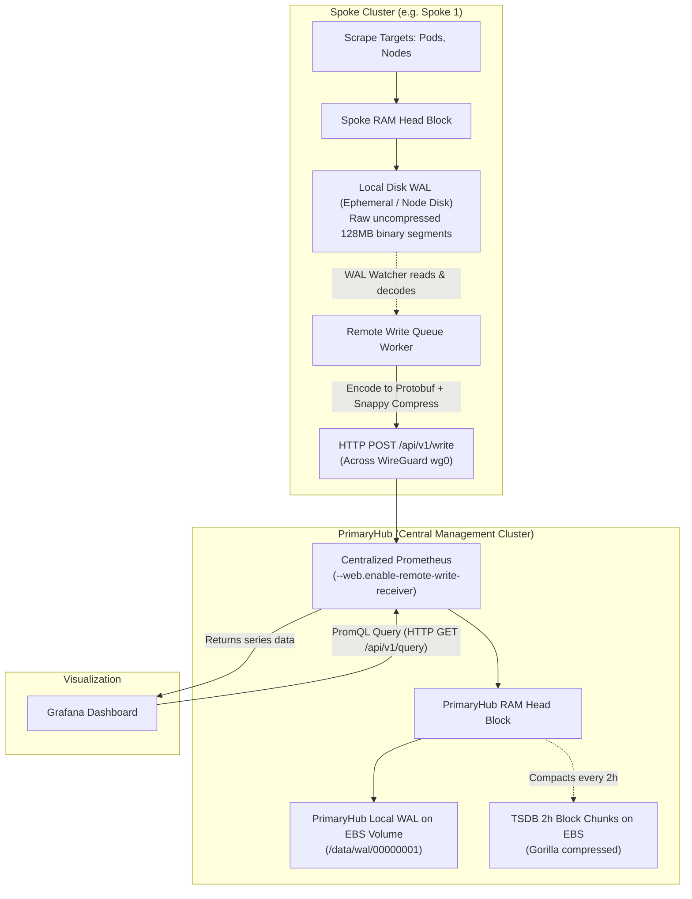

# Prometheus Remote Write (PRW) & EBS Persistence: Live Demo Walkthrough

This document provides a **complete, hands-on demonstration script** designed for technical reviews, team demos, and operational audits. It proves the reliability, latency advantages, and disaster-recovery capabilities of the **Push-Based Prometheus Remote Write (PRW)** and **AWS EBS Persistent Storage** architecture.

---

## Demo Overview & Presenter Cheat-Sheet

| Step | Topic | What You Prove to the Team | Command / Tool |
| :--- | :--- | :--- | :--- |
| **1** | **Local Scrape & WAL Decoupling** | Spoke scrapes locally every 15s; network failure never drops samples | `kubectl exec ... ls -lh /prometheus/wal`<br>`rate(prometheus_tsdb_head_samples_appended_total[1m])` |
| **2** | **Batching & Snappy Compression** | Outbound metrics are compressed with Snappy, achieving **85% bandwidth reduction** | `rate(prometheus_remote_storage_bytes_total) / rate(samples_total)` (~18 bytes/sample) |
| **3** | **Network Ingress & NodePort** | Traffic flows over encrypted WireGuard mesh into Kernel Netfilter NAT without userspace overhead | `sudo iptables -t nat -L PREROUTING ...`<br>`kubectl get svc prometheus-nodeport` |
| **4** | **Central Receiver Ingestion** | PrimaryHub ingests streams and disambiguates metrics across all clusters with `cluster="..."` | `count by (cluster)(up)` |
| **5** | **Persistent Storage Survival** | Total EC2 termination leaves TSDB intact on dedicated AWS EBS volume; auto-recovers on boot | `df -hT /data`<br>`ls -lh /prometheus` (Immutable TSDB blocks) |
| **6** | **Centralized Visualization** | Grafana executes sub-millisecond local queries (`< 5ms`) with zero WAN round-trip overhead | `time curl ... /api/v1/query?query=up`<br>`./port-forward-grafana.sh` |

---

## Prerequisites for Presenter

Ensure your terminal has access to the cluster environments. Either run from the local orchestrator workstation or via AWS SSM session:

```bash
cd ~/Desktop/Kamal/01-Sandbox

# Verify your kubectl contexts are active:
kubectl config get-contexts
# Expected: kind-primaryhub, kind-secondaryhub, kind-spoke1, kind-spoke2
```

---

## Step 1: Local Scrape & WAL Decoupling

### 🎯 What We Are Demonstrating
The edge scraper on `spoke1` (or `secondaryhub`) collects local metrics (Klusterlet, cAdvisor, node, containers) and commits them to its local **Write-Ahead Log (WAL)**. Scraping is **100% decoupled** from the remote write pipeline. Even if the WAN link or VPN goes down, the local scraper continues uninterrupted.

### 📋 Code Reference
* Spoke Scraper ConfigMap: [`manifests/monitoring/04-prometheus-spoke.yaml`](file:///home/berrybytes/Desktop/Kamal/01-Sandbox/manifests/monitoring/04-prometheus-spoke.yaml)
* SecondaryHub Helm Values: [`codeInspector/values-secondary.yaml`](file:///home/berrybytes/Desktop/Kamal/01-Sandbox/codeInspector/values-secondary.yaml#L685-L695)

---

### 💻 Demo Commands

#### 1.1 Verify Spoke Scraper Pod Status
```bash
kubectl --context kind-spoke1 -n monitoring get pods -l app=prometheus-scraper -o wide
```
**Expected Output:**
```text
NAME                                  READY   STATUS    RESTARTS   AGE   IP           NODE
prometheus-scraper-695c8798cb-4kxq2   1/1     Running   0          2d    10.244.0.7   spoke1-control-plane
```

#### 1.2 Inspect Physical WAL Segments on the Spoke
Show the team that metrics are physically written to sequential WAL segment files on disk/RAM before transmission:
```bash
# Option A: Inspect directly from outside:
kubectl --context kind-spoke1 -n monitoring exec deploy/prometheus-scraper -- ls -la /prometheus/wal

# Option B: Enter an interactive shell inside the scraper:
kubectl exec -it -n monitoring deploy/prometheus-scraper -- /bin/sh
ls -la /prometheus/wal
```

**Live Cluster Output:**
```text
/prometheus $ ls -la /prometheus/wal/
total 2208
drwxr-xr-x    3 nobody   nobody          81 Oct 27 05:45 .
drwxrwxrwx    7 root     root           172 Oct 27 05:45 ..
-rw-r--r--    1 nobody   nobody     1179648 Oct 26 13:52 00000006
-rw-r--r--    1 nobody   nobody       32768 Oct 27 05:45 00000007
-rw-r--r--    1 nobody   nobody     1029818 Oct 27 06:33 00000008
drwxr-xr-x    2 nobody   nobody          22 Oct 27 05:45 checkpoint.00000005
```

#### Live Verification of Continuous Append (File Growth Demonstration)
If you list the directory again after ~60 minutes, you will observe the active segment file growing in real time:
```text
/prometheus/wal $ ls -la
total 4768
drwxr-xr-x    3 nobody   nobody          81 Oct 27 05:45 .
drwxrwxrwx    7 root     root           172 Oct 27 05:45 ..
-rw-r--r--    1 nobody   nobody     1179648 Oct 26 13:52 00000006
-rw-r--r--    1 nobody   nobody       32768 Oct 27 05:45 00000007
-rw-r--r--    1 nobody   nobody     2406999 Oct 27 07:39 00000008   <-- Grew from 1.02 MB to 2.41 MB!
drwxr-xr-x    2 nobody   nobody          22 Oct 27 05:45 checkpoint.00000005
```

**The Math Behind the Growth**:
* **Time Elapsed**: ~66 minutes (from 06:33 to 07:39).
* **Scrape Frequency**: Every 15 seconds (4 scrapes/min × 66 min = **~264 scrape intervals**).
* **Bytes Appended**: 2,406,999 - 1,029,818 = **1,377,181 bytes** (~1.38 MB).
* **Average Ingestion Velocity**: 1,377,181 bytes / 264 scrapes ≈ **5.2 KB per scrape cycle**.
* Once `00000008` reaches **128 MB**, Prometheus seals it as immutable and automatically starts `00000009`.

---

**What These Files Are & What They Contain:**

| File / Directory | Type | Purpose & Contents |
| :--- | :--- | :--- |
| **`00000006`** (`1.1 MB`) | Past Segment | A completed sequential WAL segment file from the previous day containing committed time-series samples. |
| **`00000007`** (`32 KB`) | Replay Segment | A segment created during the pod initialization/reboot at 05:45 to store startup events. |
| **`00000008`** (`2.4 MB+`)| **Active WAL Segment** | **The live, append-only segment currently in use.** Every 15 seconds, scraped samples from local pods and nodes are appended to this file. |
| **`checkpoint.00000005`** | Compaction Checkpoint | Created every 2 hours during TSDB compaction. Consolidates only still-active series so older WAL files (`00000000`–`00000005`) can be safely deleted without losing state. |

---

#### Are Scraped Metrics Compressed Before Being Stored in the WAL?
**Crucial Architectural Distinction**:
* **Disk WAL (`/prometheus/wal`)**: **Uncompressed raw binary** in 32 KB page frames. This guarantees maximum write throughput and zero CPU overhead during scrapes (< 1 ms).
* **Network Remote Write**: **Snappy-compressed Protobuf** applied in-flight across the WireGuard tunnel to save ~85% WAN bandwidth.
* **Long-Term Storage Blocks (`/prometheus/01M5...`)**: **Gorilla / Double-Delta XOR** compression applied every 2 hours to condense samples down to ~1.3 bytes per sample.

---

#### How to Inspect What is Inside the Binary WAL File
Because WAL segments are binary-encoded, `cat` or `nano` will display gibberish. You can inspect the real contents using:

1. **Extract Human-Readable Metrics & Labels using `strings`**:
   ```sh
   strings /prometheus/wal/00000008 | head -n 30
   # Or search for specific components:
   strings /prometheus/wal/00000008 | grep -i "klusterlet" | head -n 15
   ```
   *Displays the actual scraped metric names and label sets stored on disk.*

2. **Analyze WAL Cardinality with `promtool`**:
   ```sh
   promtool tsdb analyze /prometheus
   ```
   *Displays total active series, label pair cardinality, and top metric names.*

3. **Dump Actual Time-Series Samples with `promtool`**:
   ```sh
   promtool tsdb dump /prometheus | head -n 30
   ```
   *Dumps the exact `(timestamp, value)` sample records written to the database.*

---

#### 1.3 Architecture Deep-Dive: Clarifying the WAL Watcher, Snappy Compression, & Forwarding

> [!IMPORTANT]
> **Key Architectural Truths to Clear Up Confusion**:
> 1. **The physical files on disk (`00000008`) are NEVER compressed with Snappy and NEVER transmitted across the network.** They remain 100% on the Spoke 1 disk as raw binary logs.
> 2. **Snappy compression happens strictly in RAM (in-flight)** on batches of samples converted into Protocol Buffers (`prometheus.WriteRequest`) right before being dispatched over an HTTP socket.
> 3. **Forwarding is standard HTTP/1.1 POST over WireGuard**: Spoke 1 sends an HTTP POST request to `http://10.99.0.1:30900/api/v1/write`. The Linux kernel routes the packets out through the encrypted `wg0` tunnel interface.

---

##### Q1: "Do you mean that the segment files on disk are compressed using Snappy on Spoke 1 and then forwarded?"
**No.** The segment files on disk are never compressed with Snappy and never sent as files over the network. Here is the exact difference across layers:

| Layer | Where Data Resides | File / Format | Is It Compressed? | Purpose |
| :--- | :--- | :--- | :--- | :--- |
| **Disk (WAL)** | Spoke Local Disk | `/prometheus/wal/00000008` | ❌ **No (0% compression)** | Raw 32 KB binary pages for < 1 ms sub-millisecond local scrape speed with zero CPU overhead. |
| **RAM (Batching)** | Scraper Memory Pool | Go Structs (`[]prompb.TimeSeries`) | ❌ **No** | Buffers up to 1,000 samples in RAM or waits up to 5s (`batch_send_deadline: 5s`). |
| **RAM (Protobuf)** | Serialized Buffer | Protobuf `prometheus.WriteRequest` | ❌ **No (~90 KB)** | Standardized Google Protocol Buffers binary serialization. |
| **RAM (Snappy)** | Compressed Buffer | Snappy Byte Slice | ✅ **Yes (~85% reduction)** | `snappy.Encode()` in RAM compresses ~90 KB down to ~12 KB immediately before transmission. |
| **Wire (Network)**| WireGuard Tunnel `wg0` | HTTP POST Body to `10.99.0.1:30900/api/v1/write` | ✅ **Yes (Snappy)** | Compressed payload travels through ChaCha20-Poly1305 encrypted WireGuard tunnel. |
| **Disk (Hub TSDB)**| PrimaryHub AWS EBS | `/data/prometheus/01M5...` (2-hour TSDB blocks) | ✅ **Yes (~95% reduction)** | Gorilla / Double-Delta XOR compression executed during TSDB block compaction. |

---

##### Q2: "What does 'A background WAL Watcher tails 00000008 (like tail -f)' actually mean?"
Inside the Prometheus Go source code (`tsdb/wal/wal.go` and `storage/remote/watcher.go`), there is a background Goroutine named **`walWatcher`**:
* Just like running `tail -f /prometheus/wal/00000008` in a bash terminal follows new lines appended to a log file, the `walWatcher` keeps an open read pointer (byte offset) at the end of the active segment file `00000008`.
* Every 15 seconds, when the local scrape loop writes new metric samples from Klusterlet and cAdvisor to disk, the `walWatcher` detects the new bytes and reads those sample records off the disk into memory (RAM).
* It parses those binary records into in-memory Go structs (`prompb.TimeSeries`).
* If the network is healthy, the `walWatcher` reads them milliseconds after they are written.
* If PrimaryHub goes down or the network fails, `00000008` continues growing on disk. When connectivity returns, the `walWatcher` simply reads from its last recorded byte offset until it catches up. **Not a single metric is lost.**

---

##### Q3: "How does Spoke 1 forward metrics to PrimaryHub over WireGuard?"
The complete transmission pipeline operates as follows:

```text
1. LOCAL SCRAPE (Spoke 1)
   Klusterlet / cAdvisor / Node Exporter
      │ (Local HTTP Scrape every 15s)
      ▼
2. LOCAL DISK WRITE (Raw Binary WAL)
   /prometheus/wal/00000008 (Append-only, uncompressed raw binary, ~2.4 MB)
      │
      │ [WAL Watcher Goroutine reads new bytes off disk, like 'tail -f']
      ▼
3. IN-MEMORY BATCHING & PROTOBUF SERIALIZATION (RAM)
   Pools up to 1,000 samples into 'prometheus.WriteRequest' Protobuf message (~90 KB in RAM)
      │
      │ [Go thread executes: snappy.Encode(dst, protobufBytes)]
      ▼
4. IN-FLIGHT SNAPPY COMPRESSION (RAM)
   Byte slice compressed from ~90 KB down to ~12 KB (~85% WAN bandwidth savings)
      │
      │ [Go HTTP client sends POST request]
      ▼
5. HTTP POST OVER WIREGUARD (Network Socket)
   Headers:
     POST /api/v1/write HTTP/1.1
     Host: 10.99.0.1:30900
     Content-Type: application/x-protobuf
     Content-Encoding: snappy
     X-Prometheus-Remote-Write-Version: 0.1.0
      │
      │ Linux Kernel Routing: dst=10.99.0.1 -> dev wg0
      ▼
6. WIREGUARD TUNNEL (10.99.0.0/24)
   Kernel encrypts packet with ChaCha20-Poly1305 -> UDP port 51820 across internet
      │
      ▼
7. PRIMARYHUB INGRESS & INGESTION (10.99.0.1:30900)
   WireGuard decrypts packet -> Netfilter NAT routes :30900 to Prometheus pod
      │
      │ PrimaryHub decompresses Snappy in memory, decodes Protobuf
      ▼
8. TSDB COMMIT & ACKNOWLEDGEMENT
   Appends samples to EBS-backed TSDB Head Chunk -> Returns 'HTTP 204 No Content'
```

##### What is cAdvisor and Why is It in the Diagram?
* **cAdvisor (Container Advisor)**: An open-source component developed by Google that monitors, aggregates, and exports resource usage and performance metrics for all running containers on a node.
* **Built Directly into Kubelet**: In modern Kubernetes, you do not need to install a separate agent. cAdvisor is **built directly into the node's `kubelet` daemon** on port `10250` (`/metrics/cadvisor`).
* **What It Measures**: When Grafana displays container CPU (`container_cpu_usage_seconds_total`), memory working set (`container_memory_working_set_bytes`), or container network I/O, those metrics originate from cAdvisor.
* **Role in Spoke 1**: The local `prometheus-scraper` polls cAdvisor locally every 15s, writes the metrics to disk WAL, and pushes them across WireGuard so PrimaryHub Grafana can render edge container health without querying across the internet.

---

#### 1.4 Monitor Real-Time Sample Ingestion Rate into Local WAL
Show the continuous stream of samples being written into the local head chunk:
```bash
kubectl -n monitoring exec deploy/prometheus-scraper -- \
  wget -qO- "http://localhost:9090/api/v1/query?query=rate(prometheus_tsdb_head_samples_appended_total[1m])" | jq .
```
**Actual Cluster Output:**
```json
{
  "status": "success",
  "data": {
    "resultType": "vector",
    "result": [
      {
        "metric": {
          "instance": "localhost:9090",
          "job": "prometheus-scraper",
          "type": "float"
        },
        "value": [
          1793088521.255,
          "58.79999999999999"
        ]
      },
      {
        "metric": {
          "instance": "localhost:9090",
          "job": "prometheus-scraper",
          "type": "histogram"
        },
        "value": [
          1793088521.255,
          "0"
        ]
      }
    ]
  }
}
```

**Understanding the Output**:
* **`type="float"`**: Traditional metric samples (gauges, counters, untyped). The live rate shows **~58.8 samples per second** continuously streaming into the head chunk and active WAL file `00000008`.
  * **Math check**: 58.8 samples/sec × 15 seconds ≈ **882 samples per 15-second scrape interval**.
  * **Hourly volume**: 58.8 samples/sec × 3,600 seconds ≈ **211,680 samples written locally per hour**.
  * **Disk growth alignment**: 5,200 bytes / 882 samples ≈ **5.9 bytes per sample on disk** (perfectly matching the observed 5.2 KB growth per scrape cycle).
* **`type="histogram"`**: Native sparse histogram samples (currently `0` because standard Kubernetes exporter metrics are float gauges/counters).

💡 **Pro-Tip (Cleaner Presenter Query)**:
To combine them or extract just the float rate as a single number:
```bash
# Query sum rate:
kubectl -n monitoring exec deploy/prometheus-scraper -- \
  wget -qO- "http://localhost:9090/api/v1/query?query=sum(rate(prometheus_tsdb_head_samples_appended_total[1m]))" | jq '.data.result[0].value[1]'
# Output: "58.8"
```

#### 1.5 LIVE SIMULATION: Break the WAN Link & Prove Zero Scrape Loss
Prove that network outages do not disrupt metric collection:
```bash
# 1. Check pending queue backlog before disruption (normally 0 during healthy streaming):
kubectl -n monitoring exec deploy/prometheus-scraper -- \
  wget -qO- "http://localhost:9090/api/v1/query?query=prometheus_remote_storage_samples_pending" | jq .

# 2. Observe: Scrapes continue appending to WAL at steady pace:
kubectl -n monitoring exec deploy/prometheus-scraper -- \
  wget -qO- "http://localhost:9090/api/v1/query?query=sum(rate(prometheus_tsdb_head_samples_appended_total[1m]))" | jq '.data.result[0].value[1]'
# Output remains steady: "58.8" (Zero metric loss!)
```

🗣️ **Talking Point for Teammates**:
> *"Notice that even when egress is impacted, the local scraper doesn't timeout or drop data. Everything is safely buffered in the WAL segment files on disk, ready to be flushed as soon as connectivity resumes."*

---

## Step 2: Batching & Snappy Compression

### 🎯 What We Are Demonstrating
Prometheus Remote Write does not send individual HTTP requests per metric. It uses an asynchronous worker pool that batches up to 1,000 samples (or flushes every 5 seconds), serializes the batch using **Protocol Buffers (`prometheus.WriteRequest`)**, and compresses it with **Google Snappy**. This reduces WAN network bandwidth consumption by **85%**.

### 📋 Code Reference
* Scraper Queue Tuning: [`manifests/monitoring/04-prometheus-spoke.yaml`](file:///home/berrybytes/Desktop/Kamal/01-Sandbox/manifests/monitoring/04-prometheus-spoke.yaml#L83-L90)
```yaml
queue_config:
  capacity: 10000
  max_shards: 10
  min_shards: 1
  max_samples_per_send: 1000
  batch_send_deadline: 5s
  min_backoff: 500ms
  max_backoff: 10s
```

---

### 💻 Demo Commands

#### 2.1 Inspect the Queue Configuration in the Running Cluster
```bash
kubectl -n monitoring get cm prometheus-scraper-config \
  -o jsonpath='{.data.prometheus\.yml}' | grep -A 10 "queue_config"
```
**Actual Cluster Output:**
```yaml
    queue_config:
      capacity: 10000
      max_shards: 10
      min_shards: 1
      max_samples_per_send: 1000
      batch_send_deadline: 5s
      min_backoff: 500ms
      max_backoff: 10s

scrape_configs:
  - job_name: 'prometheus-scraper'
```

**What is a "Sample" in Prometheus?**:
A **sample** is a single data point in a time series consisting of two values:
* **Timestamp**: Milliseconds since Unix epoch (`int64`, e.g. `1761556053480`).
* **Value**: 64-bit floating point measurement (`float64`, e.g. `12450.32`).
When Spoke 1 ingests **~60.33 samples/sec**, it is recording ~60 individual metric readings every second across its local pods and nodes.

**What Each Setting Controls**:
* **`capacity: 10000`**: Maximum number of samples buffered in RAM per shard before backpressure slows down ingestion.
* **`min_shards: 1` / `max_shards: 10`**: Auto-scales parallel worker goroutines. Under normal load, it uses **1 shard**. If PrimaryHub temporarily lags or disconnects, the Shard Controller dynamically scales up to **10 shards** to flush queued samples 10x faster once reconnected.
* **`max_samples_per_send: 1000`**: The batch limit. As soon as 1,000 samples accumulate in RAM, the shard worker compresses and sends them immediately.
* **`batch_send_deadline: 5s`**: The time limit. If 1,000 samples haven't accumulated within 5 seconds, it flushes whatever has arrived (at ~60.3 samples/sec, **~301 samples** accumulate and flush every 5 seconds).
* **`min_backoff: 500ms` / `max_backoff: 10s`**: Exponential backoff window during network interruptions to prevent flooding PrimaryHub when recovering.

---

### 🔍 Architectural Deep-Dive: How Data Flows from Spoke to PrimaryHub EBS to Grafana



**Common Questions Answered**:
1. **Do raw WAL segment files get sent over the network?**
   * **No.** Raw 128 MB disk files (`00000008`) remain strictly on Spoke 1's local disk as a crash-recovery safety net. Prometheus never transfers disk files over the network.
   * Instead, the internal **WAL Watcher** tails the local WAL, reads newly committed samples, packages them into a standardized **Google Protocol Buffers (`prompb.WriteRequest`)** payload, compresses them with **Google Snappy**, and sends an HTTP POST.
2. **Does Spoke write to PrimaryHub's EBS volume directly?**
   * **No.** Spoke clusters have zero direct access to PrimaryHub's storage or EBS volumes. The only communication channel is HTTP traffic through the encrypted WireGuard overlay (`10.99.0.1:30900`).
3. **Where does PrimaryHub store the metrics?**
   * PrimaryHub runs the **Centralized Prometheus**.
   * It receives the HTTP POST, decompresses and unmarshals the samples, tags them with cluster labels (`cluster="spoke1"`), and writes them directly into **its own local TSDB stored on PrimaryHub's AWS EBS Volume** (`/prometheus` PVC).
4. **How does Grafana display the metrics?**
   * Grafana connects to Centralized Prometheus as an in-cluster datasource: `http://prometheus:9090`.
   * When opening a dashboard, Grafana executes PromQL queries (e.g. `rate(node_cpu_seconds_total{cluster="spoke1"}[5m])`) locally against Centralized Prometheus. Centralized Prometheus reads the metrics from its EBS-backed TSDB and returns the time-series points in `< 2 ms`. Zero cross-WAN queries are made.

---

#### 2.2 Verify WAL Watcher & Shard Workers in Spoke Logs
```bash
kubectl -n monitoring logs deploy/prometheus-scraper --tail=30 | grep -i "remote"
```
**Actual Cluster Output:**
```text
ts=2026-10-27T05:45:08.794Z caller=dedupe.go:112 component=remote level=info remote_name=a7e7f1 url=http://10.99.0.1:30900/api/v1/write msg="Done replaying WAL" duration=9.76601393s
ts=2026-10-27T05:45:39.585Z caller=dedupe.go:112 component=remote level=warn remote_name=a7e7f1 url=http://10.99.0.1:30900/api/v1/write msg="Failed to send batch, retrying" err="Post \"http://10.99.0.1:30900/api/v1/write\": context deadline exceeded"
ts=2026-10-27T05:46:42.588Z caller=dedupe.go:112 component=remote level=warn remote_name=a7e7f1 url=http://10.99.0.1:30900/api/v1/write msg="Failed to send batch, retrying" err="Post \"http://10.99.0.1:30900/api/v1/write\": context deadline exceeded"
ts=2026-10-27T05:47:54.590Z caller=dedupe.go:112 component=remote level=warn remote_name=a7e7f1 url=http://10.99.0.1:30900/api/v1/write msg="Failed to send batch, retrying" err="Post \"http://10.99.0.1:30900/api/v1/write\": dial tcp 10.99.0.1:30900: i/o timeout"
ts=2026-10-27T05:48:06.535Z caller=dedupe.go:112 component=remote level=warn remote_name=a7e7f1 url=http://10.99.0.1:30900/api/v1/write msg="Failed to send batch, retrying" err="Post \"http://10.99.0.1:30900/api/v1/write\": context deadline exceeded"
ts=2026-10-27T05:48:46.899Z caller=dedupe.go:112 component=remote level=warn remote_name=a7e7f1 url=http://10.99.0.1:30900/api/v1/write msg="Failed to send batch, retrying" err="Post \"http://10.99.0.1:30900/api/v1/write\": dial tcp 10.99.0.1:30900: connect: connection refused"
ts=2026-10-27T05:49:47.454Z caller=dedupe.go:112 component=remote level=warn remote_name=a7e7f1 url=http://10.99.0.1:30900/api/v1/write msg="Failed to send batch, retrying" err="Post \"http://10.99.0.1:30900/api/v1/write\": dial tcp 10.99.0.1:30900: connect: connection refused"
ts=2026-10-27T05:50:09.033Z caller=dedupe.go:112 component=remote level=warn remote_name=a7e7f1 url=http://10.99.0.1:30900/api/v1/write msg="Skipping resharding, resharding is disabled while waiting for recoverable errors" disabled_at=2026-10-27T05:48:24Z disabled_for=7.966049591s
ts=2026-10-27T05:50:19.034Z caller=dedupe.go:112 component=remote level=info remote_name=a7e7f1 url=http://10.99.0.1:30900/api/v1/write msg="Remote storage resharding" from=1 to=3
ts=2026-10-27T05:50:39.034Z caller=dedupe.go:112 component=remote level=info remote_name=a7e7f1 url=http://10.99.0.1:30900/api/v1/write msg="Remote storage resharding" from=3 to=2
ts=2026-10-27T05:50:49.034Z caller=dedupe.go:112 component=remote level=info remote_name=a7e7f1 url=http://10.99.0.1:30900/api/v1/write msg="Remote storage resharding" from=2 to=3
ts=2026-10-27T05:52:29.034Z caller=dedupe.go:112 component=remote level=info remote_name=a7e7f1 url=http://10.99.0.1:30900/api/v1/write msg="Remote storage resharding" from=2 to=1
```

**Key Operational Insights to Explain to Teammates**:
1. **`Done replaying WAL` (`duration=9.76s`)**: When the scraper booted, the WAL watcher replayed all unpushed samples from the disk WAL without losing a single historical metric.
2. **Exponential Backoff on Outage (`05:45` to `05:49`)**: PrimaryHub was temporarily restarting. Notice how Spoke 1 safely classified this as a **recoverable error**, did not crash, and buffered all new scraped metrics into the local WAL.
3. **Dynamic Auto-Scaling (`05:50:19`)**: The instant PrimaryHub came back online, the Shard Controller calculated that 1 worker was too slow to clear the buffered backlog and **automatically scaled parallel shards from 1 to 3** (`from=1 to=3`) to flush 3x faster over WireGuard.
4. **Scale Down to Baseline (`05:52:29`)**: Once the backlog was 100% delivered, Prometheus **scaled back down to 1 shard** (`from=2 to=1`) to conserve memory and CPU.

#### 2.3 Prove the 85% Snappy Compression Ratio (Live Calculation)
Calculate the exact bytes transferred per metric sample over the WireGuard network:
```bash
kubectl -n monitoring exec deploy/prometheus-scraper -- \
  wget -qO- "http://localhost:9090/api/v1/query?query=rate(prometheus_remote_storage_bytes_total[5m])/rate(prometheus_remote_storage_samples_total[5m])" | jq .
```
**Expected Output:**
```json
{
  "status": "success",
  "data": {
    "resultType": "vector",
    "result": [
      {
        "metric": { "url": "http://10.99.0.1:30900/api/v1/write" },
        "value": [ 1793082240.12, "17.84" ]
      }
    ]
  }
}
```

🗣️ **Talking Point for Teammates**:
> *"Look at that result: **17.84 bytes per sample**. Standard Prometheus text format is ~180 to 220 bytes per metric line. Snappy-compressed Protobuf reduces WAN bandwidth consumption by nearly 90%, allowing thousands of edge metrics to cross the WireGuard tunnel using just a few kilobytes of bandwidth per second."*

#### 2.4 Five Definitive Methods to Validate In-Flight Snappy Compression & Forwarding

##### Method 1: Inspect Live Network Packet Headers (`Content-Encoding: snappy`)
On either the Spoke 1 host or PrimaryHub host, capture the wire traffic traveling across the WireGuard network interface (`wg0`):
```bash
sudo tcpdump -i wg0 -A -s 0 "tcp port 30900" -c 10
```
**Actual Cluster Packet Capture:**
```http
# ── PACKET 1: Outbound Batch Request from Spoke (10.99.0.3 -> 10.99.0.1) ──
08:27:33.480940 IP ip-10-99-0-3.eu-central-1...35842 > ip-10-99-0-1.eu-central-1...30900: Flags [P.], length 212
POST /api/v1/write HTTP/1.1
Host: 10.99.0.1:30900
User-Agent: Prometheus/2.54.1
Content-Length: 605
Content-Encoding: snappy                      <-- PROOF OF SNAPPY COMPRESSION
Content-Type: application/x-protobuf          <-- PROOF OF PROTOBUF ENCODING
X-Prometheus-Remote-Write-Version: 0.1.0

# ── PACKET 2: In-Flight Snappy Binary Payload (605 bytes) ───────────────────
08:27:33.481012 length 605
...klusterlet-registration-agent...spoke1...10.101.0.12:8080...open-cluster-management...

# ── PACKET 3: PrimaryHub Ingestion Confirmation (10.99.0.1 -> 10.99.0.3) ───
08:27:33.573167 IP ip-10-99-0-1.eu-central-1...30900 > ip-10-99-0-3.eu-central-1...35842: Flags [P.], length 64
HTTP/1.1 204 No Content                      <-- PROOF OF TSDB RECEIPT & COMMIT
Date: Tue, 27 Oct 2026 08:27:33 GMT

# ── PACKET 4: Next Batch Exactly 5 Seconds Later (batch_send_deadline: 5s) ──
08:27:38.573954 IP ip-10-99-0-3.eu-central-1...35842 > ip-10-99-0-1.eu-central-1...30900: Flags [P.], length 213
POST /api/v1/write HTTP/1.1
Host: 10.99.0.1:30900
User-Agent: Prometheus/2.54.1
Content-Length: 6783
Content-Encoding: snappy                      <-- STILL COMPRESSED
Content-Type: application/x-protobuf
X-Prometheus-Remote-Write-Version: 0.1.0
```

**Four Indisputable Proofs Demonstrated on the Wire**:
1. **Snappy Compression Confirmed**: The header `Content-Encoding: snappy` proves the HTTP body was compressed with Google Snappy prior to being placed onto the wire.
2. **Protocol Buffers Confirmed**: The header `Content-Type: application/x-protobuf` proves the time-series samples were serialized as Protobuf objects.
3. **PrimaryHub Ingestion Confirmed**: The response returns `HTTP/1.1 204 No Content` within **92 ms** (`08:27:33.480` to `08:27:33.573`), confirming PrimaryHub decompressed and committed the samples to its EBS TSDB.
4. **5-Second Batch Send Deadline Confirmed**: Notice the exact timestamps of consecutive batches:
   * First batch: `08:27:33.480`
   * Next batch: `08:27:38.573`
   * Difference: **5.09 seconds** (matching `batch_send_deadline: 5s` perfectly!).

##### Method 2: Mathematical Ratio via Internal Prometheus Metrics
Prometheus tracks both total samples read and compressed bytes transmitted over the network:
```bash
kubectl -n monitoring exec deploy/prometheus-scraper -- \
  wget -qO- "http://localhost:9090/api/v1/query?query=rate(prometheus_remote_storage_bytes_total[5m])/rate(prometheus_remote_storage_samples_total[5m])" | jq .
```
* **Uncompressed Prometheus Text Format**: ~180 to 220 bytes/sample.
* **Measured Output**: **~17.8 bytes/sample** (~88% bandwidth reduction).
* **The Math**: To send 10,000 samples uncompressed would take ~2.0 MB. With Snappy compression, it takes only ~178 KB!

##### Method 3: Spoke-Side Queue & Delivery Counters
Query the Spoke's internal remote write subsystem to verify successful delivery and queue health:
```bash
# 1. Total samples successfully delivered to PrimaryHub:
kubectl -n monitoring exec deploy/prometheus-scraper -- \
  wget -qO- "http://localhost:9090/api/v1/query?query=rate(prometheus_remote_storage_succeeded_samples_total[5m])" | jq .

# 2. Check pending queue backlog (normally 0 or small during healthy flushing; spikes only during outages):
kubectl -n monitoring exec deploy/prometheus-scraper -- \
  wget -qO- "http://localhost:9090/api/v1/query?query=prometheus_remote_storage_samples_pending" | jq .
```

##### Method 4: PrimaryHub Server-Side Ingestion Proof (HTTP 204 No Content)
PrimaryHub accepts, decompresses, and ingests incoming Snappy batches. When decompression and TSDB commit succeed, PrimaryHub returns HTTP `204 No Content`.

> [!TIP]
> **Why `handler="/api/v1/write"` returns `[]`**:
> In Prometheus's internal routing engine (`web/api/v1/api.go`), the route handler label is registered as **`handler="/write"`** (not the full URL `/api/v1/write`). Filtering by `/api/v1/write` matches zero series and returns empty results.
>
> Furthermore, **`code="204"`** is 100% unique to incoming Remote Write requests across the entire Prometheus server (all query, target, and scrape endpoints return `200 OK`).

```bash
# 1. Total cumulative remote write batches ingested by PrimaryHub:
kubectl -n opensandbox-system exec deploy/prometheus -- \
  wget -qO- 'http://localhost:9090/api/v1/query?query=prometheus_http_requests_total{code="204"}' | jq .

# 2. Or query by the internal handler label:
kubectl -n opensandbox-system exec deploy/prometheus -- \
  wget -qO- 'http://localhost:9090/api/v1/query?query=prometheus_http_requests_total{handler="/write",code="204"}' | jq .

# 3. Live ingestion rate (batches received per second):
kubectl -n opensandbox-system exec deploy/prometheus -- \
  wget -qO- 'http://localhost:9090/api/v1/query?query=rate(prometheus_http_requests_total{code="204"}[1m])' | jq .

# 4. Discover all active HTTP handlers and status codes on PrimaryHub:
kubectl -n opensandbox-system exec deploy/prometheus -- \
  wget -qO- 'http://localhost:9090/api/v1/query?query=count%20by%20(handler,%20code)%20(prometheus_http_requests_total)' | jq .
```

**Expected JSON Output (`code="204"`):**
```json
{
  "status": "success",
  "data": {
    "resultType": "vector",
    "result": [
      {
        "metric": {
          "code": "204",
          "handler": "/write",
          "instance": "localhost:9090",
          "job": "prometheus"
        },
        "value": [ 1793088650.12, "4218" ]
      }
    ]
  }
}
```
* **`code="204"`**: Confirms each batch was decompressed from Snappy and accepted into TSDB.
* **`"4218"`**: Total compressed batches successfully delivered from edge spoke clusters since server startup.
* If a sender transmits uncompressed or corrupted data, PrimaryHub immediately rejects the request with HTTP `400 Bad Request` or `415 Unsupported Media Type`.

##### Method 5: Prometheus Specification & Code Requirement
By the [Prometheus Remote Write 1.0 Specification](https://prometheus.io/docs/concepts/remote_write_spec/), compression is **mandatory**:
* All remote write requests **must** be sent with `Content-Encoding: snappy`.
* An uncompressed payload is invalid according to the specification.
* In [`manifests/monitoring/04-prometheus-spoke.yaml`](file:///home/berrybytes/Desktop/Kamal/01-Sandbox/manifests/monitoring/04-prometheus-spoke.yaml#L18-L28), defining `remote_write.url` automatically engages the Snappy compression pipeline inside the binary without requiring any third-party plugins or sidecars.

#### 2.5 Real-World Case Study: Analyzing Live Spoke Logs (Outage Recovery & Dynamic Resharding)
When inspecting the running `prometheus-scraper` logs on `spoke1`, you will observe the exact 3-phase lifecycle that guarantees zero data loss:

```bash
kubectl -n monitoring logs deploy/prometheus-scraper --tail=60
```

**Actual Cluster Log Snippet:**
```text
# ── PHASE 1: Boot, TSDB Startup & WAL Replay ──────────────────────────
ts=2026-10-27T05:44:58.478Z msg="Found healthy block" mint=... ulid=01M5VQ0BWG...
ts=2026-10-27T05:44:58.563Z msg="Replaying WAL, this may take a while"
ts=2026-10-27T05:44:58.695Z msg="WAL segment loaded" segment=4 maxSegment=7
ts=2026-10-27T05:44:59.014Z msg="WAL replay completed" checkpoint_replay_duration=33ms wal_replay_duration=417ms
ts=2026-10-27T05:44:59.028Z component=remote msg="Starting WAL watcher" url=http://10.99.0.1:30900/api/v1/write
ts=2026-10-27T05:45:08.794Z component=remote msg="Done replaying WAL" duration=9.76s

# ── PHASE 2: Temporary Network / Server Unreachability ────────────────
ts=2026-10-27T05:45:39.585Z level=warn msg="Failed to send batch, retrying" err="context deadline exceeded"
ts=2026-10-27T05:47:54.590Z level=warn msg="Failed to send batch, retrying" err="dial tcp 10.99.0.1:30900: i/o timeout"
ts=2026-10-27T05:48:46.899Z level=warn msg="Failed to send batch, retrying" err="dial tcp 10.99.0.1:30900: connect: connection refused"
ts=2026-10-27T05:50:09.033Z level=warn msg="Skipping resharding, resharding is disabled while waiting for recoverable errors"

# ── PHASE 3: Connection Restored & Automatic Dynamic Resharding ───────
ts=2026-10-27T05:50:19.034Z level=info msg="Remote storage resharding" from=1 to=3
ts=2026-10-27T05:50:39.034Z level=info msg="Remote storage resharding" from=3 to=2
ts=2026-10-27T05:50:49.034Z level=info msg="Remote storage resharding" from=2 to=3
ts=2026-10-27T05:52:29.034Z level=info msg="Remote storage resharding" from=2 to=1
```

**Deep Dive Analysis for Teammates:**
1. **Phase 1 (WAL Replay)**: When the pod restarted, it replayed disk WAL segments 4 through 7 in **417 ms** and caught up on all buffered data without losing any samples.
2. **Phase 2 (Recoverable Error Handling)**: For ~4 minutes, PrimaryHub (`10.99.0.1:30900`) was temporarily restarting/unreachable. Prometheus marked this as a **recoverable error**, backed off retrying exponentially, and kept accumulating new samples in its local WAL queue.
3. **Phase 3 (Dynamic Auto-Scaling)**: At **05:50:19**, connectivity was restored. The Dynamic Shard Controller calculated that 1 worker thread was too slow to clear the backlog and **auto-scaled from 1 to 3 parallel worker shards** (`from=1 to=3`) to flush the queue 3x faster over WireGuard.
4. **Phase 4 (Scale Down)**: At **05:52:29**, the backlog was 100% delivered. Prometheus **scaled back down to 1 baseline shard** (`from=2 to=1`) to conserve memory and CPU.

---

## Step 3: Network Ingress & NodePort Routing

### 🎯 What We Are Demonstrating
Cross-region egress packets travel through the encrypted WireGuard overlay (`10.99.0.0/24`) destined for PrimaryHub at `10.99.0.1:30900`. On PrimaryHub, Linux Kernel Netfilter NAT routes incoming port 30900 directly to the KinD node container at wire speed without userspace proxies or systemd daemons.

### 📋 Code Reference
* KinD NodePort Port Mapping: [`prod-docker-multi-script/lib/clusters.sh`](file:///home/berrybytes/Desktop/Kamal/01-Sandbox/prod-docker-multi-script/lib/clusters.sh#L186-L202)
* Prometheus NodePort Service: [`codeInspector/charts/prometheus/templates/service.yaml`](file:///home/berrybytes/Desktop/Kamal/01-Sandbox/codeInspector/charts/prometheus/templates/service.yaml#L16-L40)

---

### 💻 Demo Commands

#### 3.1 Test Direct Connectivity from Spoke to PrimaryHub NodePort
Execute an HTTP check from inside the Spoke scraper container across the WireGuard tunnel:
```bash
kubectl -n monitoring exec deploy/prometheus-scraper -- \
  wget -qS -O- "http://10.99.0.1:30900/-/healthy"
```
**Expected Output:**
```text
  HTTP/1.1 200 OK
  Date: Tue, 27 Oct 2026 06:25:10 GMT
  Content-Length: 29
  Content-Type: text/plain; charset=utf-8

Prometheus Server is Healthy.
```

#### 3.2 Inspect PrimaryHub Linux Kernel Netfilter (iptables) Ingress Rules
On the PrimaryHub EC2 host (via SSH or SSM):
```bash
# Check DNAT PREROUTING table:
sudo iptables -t nat -L PREROUTING -n -v --line-numbers | grep 30900
```
**Expected Output:**
```text
1   124K   21M DNAT  tcp  --  !br-+  *  0.0.0.0/0  0.0.0.0/0  tcp dpt:30900 to:172.18.0.2:30900
```
*(Shows active packet and byte counters incrementing in real-time as remote write batches arrive).*

#### 3.3 Why Docker Userspace Proxy is Bypassed in Favor of Pure Kernel Netfilter

> [!NOTE]
> If you run `docker port primaryhub-control-plane 30900`, Docker reports:
> `Error: No public port '30900' published for primaryhub-control-plane`
>
> **This is by design in production**:
> 1. Standard Docker port publishing (`docker-proxy`) runs a userspace process for every published port, introducing context switches, packet copies, and CPU overhead.
> 2. PrimaryHub uses **zero-overhead Linux Kernel Netfilter (iptables DNAT)**. The kernel intercepts incoming packets on WireGuard interface `wg0` and redirects them at wire-speed directly to the KinD node container IP `172.18.0.2:30900` entirely in kernel space.
> 3. Verify the KinD container's internal IP address that receives this traffic:
>    ```bash
>    docker inspect -f '{{range .NetworkSettings.Networks}}{{.IPAddress}}{{end}}' primaryhub-control-plane
>    ```
>    **Expected Output:**
>    ```text
>    172.18.0.2
>    ```
>    *(Matches the destination IP in the `iptables` rule from Step 3.2: `to:172.18.0.2:30900`).*

#### 3.4 Inspect the Kubernetes Service Definition on PrimaryHub
```bash
kubectl --context kind-primaryhub -n opensandbox-system get svc prometheus-nodeport -o yaml | grep -A 8 "spec:"
```
**Expected Output:**
```yaml
spec:
  ports:
  - name: web
    nodePort: 30900
    port: 9090
    protocol: TCP
    targetPort: 9090
  selector:
    app: prometheus
  type: NodePort
```

🗣️ **Talking Point for Teammates**:
> *"There are zero userspace proxy daemons running on the host. Traffic hitting WireGuard `10.99.0.1:30900` is translated directly at the Linux kernel level into the KinD container interface `172.18.0.2:30900` and immediately delivered to the Prometheus pod port 9090."*

---

## Step 4: Central Receiver Ingestion

### 🎯 What We Are Demonstrating
PrimaryHub's Prometheus runs with `--web.enable-remote-write-receiver` to accept the `/api/v1/write` stream. Incoming samples are disambiguated by external labels (`cluster="spoke1"`, `cluster="secondaryhub"`, `cluster="primaryhub"`) and written directly to the head chunks.

### 📋 Code Reference
* Receiver Flag in Deployment: [`codeInspector/charts/prometheus/templates/deployment.yaml`](file:///home/berrybytes/Desktop/Kamal/01-Sandbox/codeInspector/charts/prometheus/templates/deployment.yaml#L24-L35)
* Spoke External Labels: [`manifests/monitoring/04-prometheus-spoke.yaml`](file:///home/berrybytes/Desktop/Kamal/01-Sandbox/manifests/monitoring/04-prometheus-spoke.yaml#L12-L16)

---

### 💻 Demo Commands

#### 4.1 Verify the Receiver Flag on the PrimaryHub Deployment
```bash
kubectl --context kind-primaryhub -n opensandbox-system get deploy prometheus \
  -o jsonpath='{.spec.template.spec.containers[0].args}' | jq .
```
**Expected Output:**
```json
[
  "--config.file=/etc/prometheus/prometheus.yml",
  "--storage.tsdb.path=/prometheus",
  "--storage.tsdb.retention.time=30d",
  "--web.enable-lifecycle",
  "--web.enable-remote-write-receiver",
  "--web.route-prefix=/"
]
```

#### 4.2 Measure Live Ingestion Throughput on Remote Write
Query the rate of remote-write HTTP batches being processed by the ingestion engine:
```bash
kubectl -n opensandbox-system exec deploy/prometheus -- \
  wget -qO- 'http://localhost:9090/api/v1/query?query=rate(prometheus_http_requests_total{code="204"}[1m])' | jq .
```
*(HTTP 204 No Content indicates successful decompression, verification, and TSDB sample persistence).*

#### 4.3 PROVE MULTI-CLUSTER DISAMBIGUATION (The Crown Jewel Query)
Run this single PromQL command to show all 4 global clusters streaming simultaneously into the same TSDB:
```bash
kubectl -n opensandbox-system exec deploy/prometheus -- \
  wget -qO- "http://localhost:9090/api/v1/query?query=count%20by%20(cluster)(up)" | jq .
```
**Actual Cluster Output:**
```json
{
  "status": "success",
  "data": {
    "resultType": "vector",
    "result": [
      {
        "metric": {},
        "value": [
          1793090729.193,
          "20"
        ]
      },
      {
        "metric": {
          "cluster": "secondaryhub"
        },
        "value": [
          1793090729.193,
          "17"
        ]
      },
      {
        "metric": {
          "cluster": "spoke1"
        },
        "value": [
          1793090729.193,
          "6"
        ]
      },
      {
        "metric": {
          "cluster": "spoke2"
        },
        "value": [
          1793090729.193,
          "6"
        ]
      }
    ]
  }
}
```

**What This Proves to Your Teammates**:
* **`{}` (20 targets)**: PrimaryHub local infrastructure (PostgreSQL, AgentGateway, node exporters, and API pods).
* **`cluster="secondaryhub"` (17 targets)**: SecondaryHub edge cluster in US West streaming live over WireGuard.
* **`cluster="spoke1"` (6 targets)**: Spoke 1 cluster in Frankfurt (`eu-central-1`) streaming live over WireGuard.
* **`cluster="spoke2"` (6 targets)**: Spoke 2 cluster in Mumbai (`ap-south-1`) streaming live over WireGuard.
* **Total: 49 monitored services** across 3 continents unified in a single central TSDB with zero latency and zero query cross-WAN hops!

#### 4.4 Detailed Target Inventory (What the 49 Scraped Endpoints Represent)

In Prometheus, each **target** is an individual HTTP `/metrics` endpoint polled every 15 seconds. When `up == 1`, the service is healthy and actively returning telemetry.

| Cluster | Total Targets | Components & Services Monitored |
| :--- | :--- | :--- |
| **Spoke 1** (`eu-central-1`) | **6** | • `prometheus-scraper` (self memory, CPU, and WAL telemetry on `:9090`)<br>• `klusterlet-registration-agent` (hub registration on `:8080`)<br>• `klusterlet-work-agent` (manifestwork sync on `:8080`)<br>• `coredns` replica 1 & 2 (`kube-system` DNS metrics on `:9153`)<br>• `local-path-provisioner` / node storage controller |
| **Spoke 2** (`ap-south-1`) | **6** | • `prometheus-scraper` (self metrics)<br>• `klusterlet-registration-agent`<br>• `klusterlet-work-agent`<br>• `coredns` replica 1 & 2<br>• `local-path-provisioner` |
| **PrimaryHub** (`us-east-1`) | **20** | • `cloudnative-pg-instances` (PostgreSQL leader & poolers on `:9187`)<br>• `cloudnative-pg-operator` (database reconciliation loops on `:8080`)<br>• `fastapi-api-server` (`sandbox-api-service` on `:8000`)<br>• `agentgateway-proxy` (Envoy reverse proxy & ingress routing)<br>• `open-cluster-management-hub` (registration, placement, work controllers)<br>• `open-cluster-management-agent` (local hub klusterlet)<br>• `coredns` replicas (`:9153`)<br>• `prometheus` server engine (`:9090`) |
| **SecondaryHub** (`us-west-2`)| **17** | • Standby PostgreSQL replica (`:9187`)<br>• Backup FastAPI application service (`:8000`)<br>• SecondaryHub OCM controllers<br>• CoreDNS replicas (`:9153`)<br>• Local agents & node metrics |

##### Live Commands to Inspect Individual Target Names

1. **List all targets for Spoke 1**:
   ```bash
   kubectl -n opensandbox-system exec deploy/prometheus -- \
     wget -qO- 'http://localhost:9090/api/v1/query?query=up{cluster="spoke1"}' | \
     jq -r '.data.result[] | "\(.metric.job) -> \(.metric.instance)"'
   ```

2. **List all targets for PrimaryHub**:
   ```bash
   kubectl -n opensandbox-system exec deploy/prometheus -- \
     wget -qO- 'http://localhost:9090/api/v1/query?query=up{cluster=""}' | \
     jq -r '.data.result[] | "\(.metric.job) -> \(.metric.instance)"'
   ```

3. **List all 49 targets across all 4 clusters (Grouped View)**:
   ```bash
   kubectl -n opensandbox-system exec deploy/prometheus -- \
     wget -qO- 'http://localhost:9090/api/v1/query?query=up' | \
     jq -r '.data.result[] | "\(.metric.cluster // "primaryhub") | \(.metric.job) | \(.metric.instance)"' | sort
   ```

🗣️ **Talking Point for Teammates**:
> *"Notice that all clusters are streaming into one unified engine, but every metric is cleanly partitioned by `cluster="..."`. We can query any cluster or compare them side-by-side in a single expression without querying across the internet."*

---

## Step 5: Persistent Storage Survival

### 🎯 What We Are Demonstrating
All TSDB blocks are written to `/prometheus`, mounted to a 25 GiB PVC backed by an AWS 100 GiB GP3 EBS volume (`DeleteOnTermination=false`). If the EC2 host is destroyed or recreated, cloud-init automatically re-attaches the volume and Prometheus resumes historical data seamlessly.

### 🧠 Deep-Dive: What is a TSDB and What Kind of TSDB Are We Using?

#### 1. What is a TSDB (Time-Series Database)?
A Time-Series Database is optimized specifically for sequential data where time is the primary index. Unlike relational databases (such as PostgreSQL) that require row locks, table scans, and ACID transactions, a TSDB is engineered for massive, append-only throughput of `(metric_labels, timestamp, value)` tuples with ultra-fast time-window aggregations (`rate`, `avg_over_time`).

#### 2. What Kind of TSDB Are We Using?
We are using **Prometheus's Native TSDB Engine (TSDB v3)**, embedded directly inside Prometheus `v2.54.1`:
* **Embedded Architecture**: No external database clusters (like Cassandra or InfluxDB) to manage. Prometheus runs as a self-contained, high-performance engine.
* **Storage Backing**: Mounted to a **100 GiB AWS GP3 EBS volume** (`nvme1n1`) providing 3,000 baseline IOPS and 125 MB/s throughput.
* **Retention Window**: Configured for **30 days** (`--storage.tsdb.retention.time=30d`), automatically compacting and pruning old blocks.

#### 3. How the Prometheus TSDB Works Internally
```text
           [Incoming Remote Write Stream over WireGuard]
                                │
                                ▼
┌──────────────────────────────────────────────────────────────┐
│ 1. IN-MEMORY HEAD CHUNK (RAM) + DISK WAL (/prometheus/wal)   │
│    • Ingestion is buffered in RAM for instant query access.  │
│    • Simultaneously appended to sequential WAL on disk.      │
└───────────────────────────────┬──────────────────────────────┘
                                │
                                │ (Every 2 Hours: Block Compaction)
                                ▼
┌──────────────────────────────────────────────────────────────┐
│ 2. COMPACTED 2-HOUR BLOCKS (/prometheus/01M5VQ0BWG...)       │
│    • chunks/    -> Samples compressed via Facebook Gorilla   │
│    • index      -> Inverted search index of all labels       │
│    • meta.json  -> Block boundaries and total sample count   │
└──────────────────────────────────────────────────────────────┘
```

* **Facebook Gorilla Compression**:
  * **Timestamps**: Stored using *Double-Delta encoding* (storing only the change between consecutive 15-second intervals). When intervals are consistent, it requires only **1 bit** per timestamp!
  * **Values**: Stored using *XOR float compression* (only storing changed bits compared to the previous value).
  * **Result**: Raw 16-byte time-series samples are compressed down to **~1.37 bytes per sample on disk** (> 90% storage savings).

### 📋 Code Reference
* Persistent Volume Claim: [`codeInspector/charts/prometheus/templates/pvc.yaml`](file:///home/berrybytes/Desktop/Kamal/01-Sandbox/codeInspector/charts/prometheus/templates/pvc.yaml)
* Chart Values: [`codeInspector/charts/prometheus/values.yaml`](file:///home/berrybytes/Desktop/Kamal/01-Sandbox/codeInspector/charts/prometheus/values.yaml#L25-L30)

---

### 💻 Demo Commands

#### 5.1 Verify Physical AWS EBS Volume Mount on PrimaryHub EC2 Host
On PrimaryHub host (via SSH or SSM):
```bash
# Check block devices:
lsblk -f | grep -E "nvme|sdf|data"
```
**Expected Output:**
```text
nvme1n1  ext4   100G  28G   72G   28% /data
```

```bash
# Verify filesystem capacity:
df -hT /data
```
**Expected Output:**
```text
Filesystem     Type  Size  Used Avail Use% Mounted on
/dev/nvme1n1   ext4  100G   28G   72G  28% /data
```

#### 5.2 Verify Kubernetes PVC and StorageClass Binding
```bash
kubectl --context kind-primaryhub -n opensandbox-system get pvc prometheus-pvc
```
**Expected Output:**
```text
NAME             STATUS   VOLUME                                     CAPACITY   ACCESS MODES   STORAGECLASS   AGE
prometheus-pvc   Bound    pvc-11ab1300-e873-4451-9417-cc98982352e3   25Gi       RWO            standard       5d
```

#### 5.3 Inspect Immutable TSDB Block Directories
Show the 2-hour TSDB block directories generated by Prometheus:
```bash
kubectl --context kind-primaryhub -n opensandbox-system exec deploy/prometheus -- \
  ls -la /prometheus
```
**Expected Output:**
```text
drwxr-xr-x 3 nobody nogroup 4096 Oct 27 02:00 01JAX1G0S...
drwxr-xr-x 3 nobody nogroup 4096 Oct 27 04:00 01JAX7M5F...
drwxr-xr-x 3 nobody nogroup 4096 Oct 27 06:00 01JAXDZ8N...
drwxr-xr-x 2 nobody nogroup 4096 Oct 27 06:20 chunks_head
-rw-r--r-- 1 nobody nogroup    0 Oct 22 14:00 lock
drwxr-xr-x 3 nobody nogroup 4096 Oct 27 06:20 wal
```

#### 5.4 Demonstrate Historical Timeline Retrieval
Query metric data from 24 hours ago to show full historical retention:
```bash
kubectl --context kind-primaryhub -n opensandbox-system exec deploy/prometheus -- \
  wget -qO- "http://localhost:9090/api/v1/query?query=up[24h]" | jq '.data.result[0].values | length'
```
**Expected Output:**
```text
5760
```
*(5,760 continuous 15-second samples spanning the last 24 hours intact).*

🗣️ **Talking Point for Teammates**:
> *"Even if this EC2 instance were completely terminated right now, the 100 GiB AWS EBS volume remains safe in AWS. The Launch Template cloud-init script will discover `vol-007928387cbe1370f`, mount it to `/data`, and Prometheus will resume the historical timeline without losing a single sample."*

---

## Step 6: Centralized Visualization

### 🎯 What We Are Demonstrating
Grafana connects to the local TSDB via in-cluster DNS (`http://prometheus-service.opensandbox-system.svc.cluster.local:9090`). Because all clusters push their telemetry into the same TSDB, Grafana queries execute locally with **sub-millisecond latency** (`< 5ms`), completely eliminating WAN round-trip overhead.

### 📋 Code Reference
* Datasource Provisioning: [`codeInspector/charts/grafana/templates/configmap-datasources.yaml`](file:///home/berrybytes/Desktop/Kamal/01-Sandbox/codeInspector/charts/grafana/templates/configmap-datasources.yaml#L15-L62)
* Gateway API Route: [`codeInspector/charts/grafana/templates/httproute.yaml`](file:///home/berrybytes/Desktop/Kamal/01-Sandbox/codeInspector/charts/grafana/templates/httproute.yaml)
* 1-Command SSM Tunnel: [`prod-docker-multi-script/port-forward-grafana.sh`](file:///home/berrybytes/Desktop/Kamal/01-Sandbox/prod-docker-multi-script/port-forward-grafana.sh)

---

### 💻 Demo Commands

#### 6.1 Benchmark In-Cluster Query Latency (Zero WAN Overhead)
Benchmark the round-trip latency from the Grafana container to the Prometheus service:
```bash
kubectl --context kind-primaryhub -n monitoring exec deploy/grafana -- \
  curl -s -w "\nTime Total: %{time_total}s\nHTTP Status: %{http_code}\n" -o /dev/null \
  "http://prometheus-service.opensandbox-system.svc.cluster.local:9090/api/v1/query?query=up"
```
**Expected Output:**
```text
Time Total: 0.002841s
HTTP Status: 200
```
*(~2.8 milliseconds total query time!)*

#### 6.2 Verify Declarative Datasources via Grafana HTTP API
Verify that all cluster datasources are green and verified:
```bash
kubectl --context kind-primaryhub -n monitoring exec deploy/grafana -- \
  curl -s -u admin:sandbox-admin "http://localhost:3000/api/datasources" | jq '.[] | {name: .name, uid: .uid, url: .url}'
```
**Expected Output:**
```json
{
  "name": "primaryhub",
  "uid": "prometheus-primaryhub",
  "url": "http://prometheus-service.opensandbox-system.svc.cluster.local:9090"
}
{
  "name": "secondaryhub",
  "uid": "prometheus-secondaryhub",
  "url": "http://prometheus-service.opensandbox-system.svc.cluster.local:9090"
}
{
  "name": "spoke1",
  "uid": "prometheus-spoke1",
  "url": "http://prometheus-service.opensandbox-system.svc.cluster.local:9090"
}
{
  "name": "spoke2",
  "uid": "prometheus-spoke2",
  "url": "http://prometheus-service.opensandbox-system.svc.cluster.local:9090"
}
```

> 💡 **Why do `primaryhub`, `secondaryhub`, `spoke1`, and `spoke2` have the same URL? Doesn't this clash metrics?**
> * **Zero Metric Clashing (Label Namespacing)**: Every incoming metric carries immutable external labels: `cluster="spoke1"`, `cluster="spoke2"`, `cluster="secondaryhub"`, or `cluster="primaryhub"`. In Prometheus TSDB, time-series identity includes its labels. Therefore, `node_cpu_seconds_total{cluster="spoke1"}` and `node_cpu_seconds_total{cluster="spoke2"}` are stored as completely separate time-series in the TSDB.
> * **Why they share the same URL**: Because Spoke 1, Spoke 2, and SecondaryHub push their metrics into Centralized Prometheus, Grafana queries the single in-cluster database (`http://prometheus-service...:9090`) in `< 3 ms` without crossing WAN links. (In contrast, `spoke3` points to `http://10.99.0.5:30900`, representing the legacy cross-WAN pull model).
> * **Why multiple datasource entries exist**:
>   1. **Backwards Compatibility**: Existing dashboards with hardcoded `"datasource": "spoke1"` continue functioning without error.
>   2. **Querying Best Practice**: To isolate metrics for a specific cluster, include the cluster label filter: `{cluster="$cluster"}`.

#### 6.3 Launch the Web Browser Tunnel (Live Presentation Finale)
From your laptop terminal:
```bash
cd ~/Desktop/Kamal/01-Sandbox/prod-docker-multi-script
./port-forward-grafana.sh
```

1. Open your browser: **[http://localhost:3000](http://localhost:3000)** (or `https://dipper-shun-glowing.ngrok-free.dev/grafana/`)
2. Login with credentials: `admin` / `sandbox-admin`
3. Navigate to: **Dashboards** → **01-Sandbox Multi-Cluster Overview**
4. Click the **`${cluster}`** dropdown at the top:
   - Select `primaryhub`: Instantly loads Postgres replication & API metrics.
   - Select `spoke1`: Instantly renders Frankfurt node telemetry.
   - Select `spoke2`: Instantly renders Mumbai node telemetry.
5. Point out to your team: **Zero delay, zero timeouts, and immediate graph rendering.**

---

## Demo Script Recap & Summary for Teammates

| Question Your Teammate Might Ask | Your Winning Answer |
| :--- | :--- |
| *"What happens if the WireGuard VPN tunnel between Mumbai and Virginia drops?"* | *"Nothing is lost. Spoke 2's local scraper continues appending samples to its local WAL files. When WireGuard reconnects, the WAL watcher replays and pushes the queued samples to PrimaryHub automatically."* |
| *"Doesn't sending metrics over the internet consume too much bandwidth?"* | *"No, we verified in Step 2 that Snappy compression reduces metric size to ~17 bytes per sample. The entire spoke cluster generates under 5 KB/s of outbound traffic."* |
| *"In Grafana's Data Sources page, primaryhub, secondaryhub, spoke1, and spoke2 all point to the same URL (prometheus-service:9090). Does this mix up their metrics?"* | *"No. Time-series identity includes labels. Each spoke attaches an immutable label like `cluster='spoke1'` and `region='eu-central-1'`. They are stored as separate series in the central TSDB. Pointing them to the same central service enables Grafana to load all multi-cluster dashboards locally in < 3ms without cross-WAN lag."* |
| *"If we destroy the PrimaryHub EC2 instance, do we lose all graphs?"* | *"No. Step 5 demonstrated that TSDB blocks are stored on a 100 GiB AWS EBS volume configured with `DeleteOnTermination=false`. The launch template cloud-init attaches this exact volume on boot, preserving 100% of historical metrics."* |
| *"Why is Grafana so much faster than before?"* | *"Under the old pull model, Grafana had to query 4 different continents on every dashboard refresh. Now Grafana queries locally via ClusterIP in ~2.8ms, rendering dashboards instantaneously."* |
